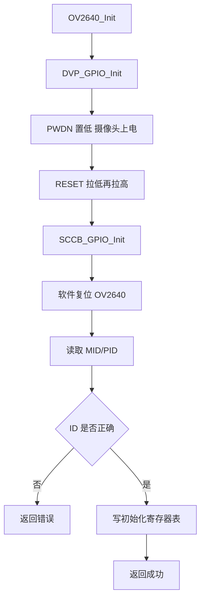
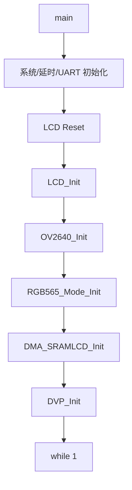
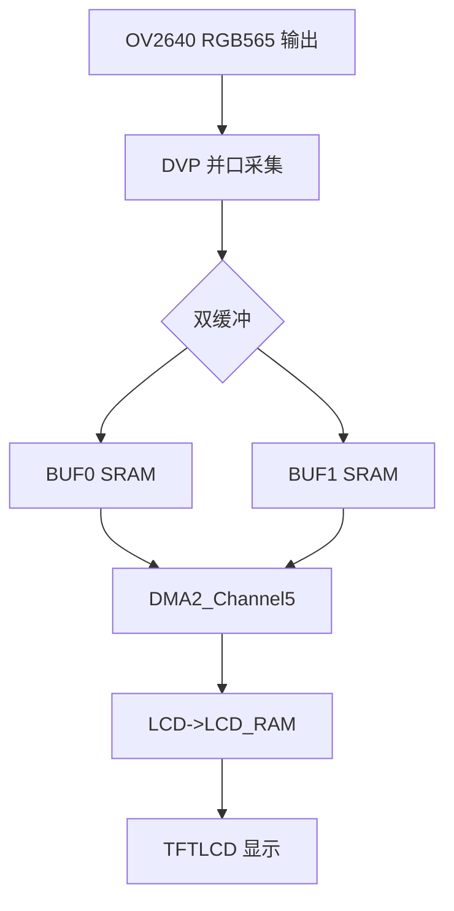
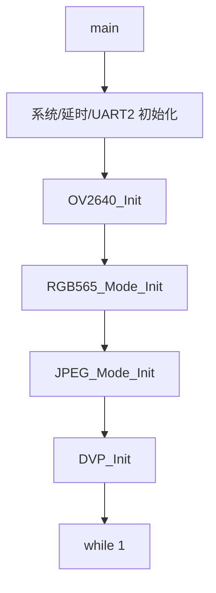
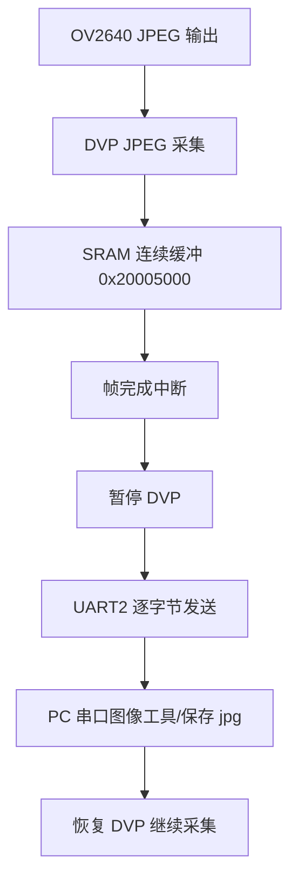

# CH32V307 DVP 示例学习文档

本文档基于 `CH32V307EVT/EXAM/DVP/` 下两个官方示例整理：

- `DVP_TFTLCD`：使用 DVP 采集 OV2640 的 RGB565 视频流，并通过 FSMC + DMA 显示到 TFTLCD。
- `DVP_UART`：使用 DVP 采集 OV2640 的 JPEG 图像，并通过 UART2 输出 JPEG 数据。

适合用来理解 CH32V307 的 DVP 外设、OV2640 摄像头初始化、SCCB 通信、DMA 双缓冲以及图像数据输出流程。

---

## 1. DVP 是什么

DVP，即 Digital Video Port，是一种并行摄像头接口。典型信号包括：

| 信号 | 作用 |
|---|---|
| `D0~D11` | 并行图像数据线，本示例使用 8/12 位相关模式配置 |
| `PCLK` / `DPCLK` | 像素时钟，摄像头输出，MCU 按该时钟采样数据 |
| `VSYNC` / `SYNC` | 帧同步信号，用于标识一帧图像开始/结束 |
| `HREF` / `HERF` | 行有效信号，用于标识一行数据有效区间 |
| `SDA` / `SCL` | SCCB/I2C 类控制接口，用于配置摄像头寄存器 |
| `RESET` | 摄像头复位 |
| `PWDN` | 摄像头掉电控制 |

在本目录中，摄像头模块为 OV2640。OV2640 可以输出 RGB565、YUV422、JPEG 等格式。

---

## 2. 示例目录结构

```text
DVP/
├── DVP_TFTLCD/
│   └── User/
│       ├── main.c        # RGB565 采集并显示到 LCD
│       ├── ov.c/.h       # OV2640 + SCCB + DVP GPIO 配置
│       ├── lcd.c/.h      # TFTLCD + FSMC 驱动
│       └── ...
└── DVP_UART/
    └── User/
        ├── main.c        # JPEG 采集并通过 UART2 输出
        ├── ov.c/.h       # OV2640 + SCCB + DVP GPIO 配置
        └── ...
```

两个示例共用同类 `ov.c/.h` 摄像头配置逻辑，区别主要在 `main.c` 的 DVP 工作模式、DMA 数据去向和输出方式。

---

## 3. 硬件连接

两个示例中 DVP 摄像头引脚说明基本一致。

### 3.1 OV2640 / DVP 引脚

| 摄像头信号 | CH32V307 引脚 |
|---|---|
| `D10` | `PD6` |
| `D11` | `PD2` |
| `D8` | `PC10` |
| `D9` | `PC12` |
| `DPWDN` | `PC3` |
| `DPCLK` | `PA6` |
| `D7` | `PB9` |
| `D6` | `PB8` |
| `D5` | `PB6` |
| `D4` | `PC11` |
| `D3` | `PC9` |
| `D2` | `PC8` |
| `D1` | `PA10` |
| `D0` | `PA9` |
| `RESET` | `PC13` |
| `SDA` | `PB11` |
| `SCL` / `SDCLK` | `PB10` |
| `HREF` | `PA4` |
| `VSYNC` / `SYNC` | `PA5` |

> 注意：`PA9` 被 DVP `D0` 占用，所以示例使用 `UART2(PA2)` 输出调试或图像数据，而不是 `UART1`。

### 3.2 TFTLCD 引脚

`DVP_TFTLCD` 使用 FSMC 驱动 16 位并口 LCD，关键连接如下：

| LCD/FSMC 信号 | CH32V307 引脚 |
|---|---|
| `FSMC_D0~D3` | `PD14`, `PD15`, `PD0`, `PD1` |
| `FSMC_D4~D12` | `PE7~PE15` |
| `FSMC_D13~D15` | `PD8~PD10` |
| `FSMC_NOE` | `PD4` |
| `FSMC_NWE` | `PD5` |
| `FSMC_A16` | `PD11` |
| `FSMC_A17` / `RS` | `PD12` |
| `LCD_RST#` | `PA15` |
| `BLCTR` | `PB14` |

LCD 驱动中将 LCD 映射为 FSMC 外部存储器：

```c
#define LCD_BASE ((u32)(0x60000000 | 0x0003FFFE))
#define LCD      ((LCD_TypeDef *) LCD_BASE)
```

通过访问 `LCD->LCD_REG` 和 `LCD->LCD_RAM` 完成写命令、写显存。

---

## 4. OV2640 摄像头初始化

两个示例中的摄像头初始化核心在 `User/ov.c`。

### 4.1 初始化总流程

`OV2640_Init()` 的流程：

1. 调用 `DVP_GPIO_Init()` 配置摄像头相关 GPIO。
2. 拉低 `PWDN`，摄像头上电。
3. 控制 `RESET` 复位 OV2640。
4. 初始化 SCCB GPIO。
5. 选择 OV2640 寄存器 Bank。
6. 写 `0x12 = 0x80` 软件复位全部寄存器。
7. 读取 MID：`0x1C` + `0x1D`，期望值 `0x7FA2`。
8. 读取 PID：`0x0A` + `0x0B`，期望值 `0x2642`。
9. 批量写入 `OV2640_InitRegTbl` 初始化寄存器表。

简化流程：



### 4.2 SCCB 通信

OV2640 使用 SCCB 接口，时序类似 I2C。本示例没有使用硬件 I2C，而是通过 GPIO 模拟。

相关宏位于 `ov.h`：

```c
#define IIC_SDA_SET { GPIOB->BSHR = GPIO_Pin_11; }
#define IIC_SDA_CLR { GPIOB->BCR  = GPIO_Pin_11; }
#define IIC_SCL_SET { GPIOB->BSHR = GPIO_Pin_10; }
#define IIC_SCL_CLR { GPIOB->BCR  = GPIO_Pin_10; }
```

核心函数：

| 函数 | 作用 |
|---|---|
| `SCCB_Start()` | 产生起始信号 |
| `SCCB_Stop()` | 产生停止信号 |
| `SCCB_WR_Byte()` | 写 1 字节并读取 ACK |
| `SCCB_RD_Byte()` | 读 1 字节 |
| `SCCB_WR_Reg()` | 写 OV2640 寄存器 |
| `SCCB_RD_Reg()` | 读 OV2640 寄存器 |

摄像头设备地址：

```c
#define SCCB_ID 0x60
```

---

## 5. 摄像头输出格式配置

### 5.1 RGB565 模式

`RGB565_Mode_Init()`：

```c
void RGB565_Mode_Init(void)
{
    OV2640_RGB565_Mode();
    OV2640_OutSize_Set(OV2640_RGB565_WIDTH, OV2640_RGB565_HEIGHT);
    OV2640_Speed_Set(28, 1);
}
```

相关分辨率定义：

```c
#define RGB565_ROW_NUM          320
#define RGB565_COL_NUM          480   // Col * 2
#define OV2640_RGB565_HEIGHT    320
#define OV2640_RGB565_WIDTH     240
```

这里容易混淆：

- `OV2640_RGB565_WIDTH = 240`、`HEIGHT = 320` 是摄像头输出尺寸。
- `RGB565_COL_NUM = 480` 表示一行字节数，因为 RGB565 每像素 2 字节，`240 * 2 = 480`。
- DVP 行数设置为 `RGB565_ROW_NUM = 320`。

### 5.2 JPEG 模式

`JPEG_Mode_Init()`：

```c
void JPEG_Mode_Init(void)
{
    OV2640_JPEG_Mode();
    OV2640_OutSize_Set(OV2640_JPEG_WIDTH, OV2640_JPEG_HEIGHT);
    OV2640_Speed_Set(30, 1);
}
```

JPEG 分辨率：

```c
#define OV2640_JPEG_HEIGHT 768
#define OV2640_JPEG_WIDTH  1024
```

JPEG 输出是压缩码流，不再是固定每像素 2 字节的 RGB565 数据。

---

## 6. DVP_TFTLCD 示例分析

路径：`DVP_TFTLCD/User/main.c`

该示例目标：

> OV2640 输出 RGB565，CH32V307 DVP 采集后写入 SRAM 缓冲，再通过 DMA2 将每行数据搬运到 LCD GRAM，实现实时显示。

### 6.1 主流程

`main()` 主要步骤：

1. 配置 NVIC 优先级。
2. 更新系统时钟。
3. 初始化延时。
4. 初始化 UART2 调试输出，波特率 `115200`。
5. LCD 复位。
6. 初始化 LCD。
7. 初始化 OV2640，失败则循环重试。
8. 配置 OV2640 为 RGB565 输出。
9. 初始化 SRAM 到 LCD 的 DMA。
10. 初始化 DVP 并开始采集。
11. 主循环空转，实际工作由 DVP 中断完成。



### 6.2 DVP 配置

关键代码：

```c
DVP->CR0 |= RB_DVP_D8_MOD | RB_DVP_V_POLAR;
DVP->ROW_NUM = RGB565_ROW_NUM;
DVP->COL_NUM = RGB565_COL_NUM;
DVP->DMA_BUF0 = RGB565_DVPDMAaddr0;
DVP->DMA_BUF1 = RGB565_DVPDMAaddr1;
```

含义：

| 配置 | 含义 |
|---|---|
| `RB_DVP_D8_MOD` | DVP 使用 8 位数据相关模式 |
| `RB_DVP_V_POLAR` | VSYNC 高电平有效 |
| `ROW_NUM = 320` | 一帧 320 行 |
| `COL_NUM = 480` | 每行 480 字节，即 240 个 RGB565 像素 |
| `DMA_BUF0/1` | DVP 双缓冲地址 |

DMA 缓冲地址：

```c
UINT32 RGB565_DVPDMAaddr0 = 0x2000A000;
UINT32 RGB565_DVPDMAaddr1 = 0x2000A000 + RGB565_COL_NUM;
```

即：

- `BUF0 = 0x2000A000`
- `BUF1 = 0x2000A000 + 480`

两个缓冲区交替接收一行图像数据。

### 6.3 SRAM 到 LCD 的 DMA

`DMA_SRAMLCD_Init()` 配置 `DMA2_Channel5`，将内存数据搬到 LCD 显存地址：

```c
DMA_InitStructure.DMA_PeripheralBaseAddr = ddr;
DMA_InitStructure.DMA_MemoryBaseAddr = (u32)&LCD->LCD_RAM;
DMA_InitStructure.DMA_DIR = DMA_DIR_PeripheralSRC;
DMA_InitStructure.DMA_PeripheralInc = DMA_PeripheralInc_Enable;
DMA_InitStructure.DMA_MemoryInc = DMA_MemoryInc_Disable;
DMA_InitStructure.DMA_PeripheralDataSize = DMA_PeripheralDataSize_HalfWord;
DMA_InitStructure.DMA_MemoryDataSize = DMA_MemoryDataSize_HalfWord;
DMA_InitStructure.DMA_M2M = DMA_M2M_Enable;
```

虽然字段名叫 `PeripheralBaseAddr` 和 `MemoryBaseAddr`，这里实际利用 DMA 的 M2M 方式：

- 源地址：DVP 接收到的一行 RGB565 缓冲。
- 目的地址：`LCD->LCD_RAM`。
- 源地址递增。
- 目的地址不递增，因为一直写 LCD GRAM 数据寄存器。
- 每次传输半字，即 16 位 RGB565 像素。

每次行中断中，传输长度设为：

```c
DMA_SetCurrDataCounter(DMA2_Channel5, lcddev.width);
```

LCD 竖屏时 `lcddev.width = 240`，正好是一行 240 个 RGB565 像素。

### 6.4 DVP 中断处理

中断函数：`DVP_IRQHandler()`

重点是 `ROW_DONE` 和 `FRM_DONE`。

#### ROW_DONE：一行接收完成

```c
if (DVP->IFR & RB_DVP_IF_ROW_DONE)
{
    DVP->IFR &= ~RB_DVP_IF_ROW_DONE;

    if (addr_cnt % 2) {
        addr_cnt++;
        DMA2_Channel5->PADDR = RGB565_DVPDMAaddr0;
    } else {
        addr_cnt++;
        DMA2_Channel5->PADDR = RGB565_DVPDMAaddr1;
    }

    DMA_SetCurrDataCounter(DMA2_Channel5, lcddev.width);
    DMA_Cmd(DMA2_Channel5, ENABLE);
    href_cnt++;
}
```

逻辑说明：

- DVP 使用双缓冲交替接收行数据。
- 当某个缓冲区接收完成后，CPU/DMA 将上一行数据送到 LCD。
- `addr_cnt` 用奇偶判断当前该搬运哪个缓冲。
- `href_cnt` 统计行数。

#### FRM_DONE：一帧接收完成

```c
addr_cnt = 0;
href_cnt = 0;
```

一帧结束后重置行计数和缓冲切换计数。

### 6.5 RGB565 实时显示数据流



---

## 7. DVP_UART 示例分析

路径：`DVP_UART/User/main.c`

该示例目标：

> OV2640 输出 JPEG 码流，CH32V307 DVP 接收到 SRAM，帧完成后通过 UART2 发出整帧 JPEG 数据。

### 7.1 主流程

`main()` 主要步骤：

1. 配置 NVIC 优先级。
2. 更新系统时钟。
3. 初始化延时。
4. 初始化 UART2，波特率 `921600`。
5. 初始化 OV2640，失败则循环重试。
6. 先调用 `RGB565_Mode_Init()`。
7. 再调用 `JPEG_Mode_Init()` 切换到 JPEG 模式。
8. 初始化 DVP。
9. 主循环空转，由中断完成采集和发送。



> 代码中先执行 `RGB565_Mode_Init()` 再执行 `JPEG_Mode_Init()`，最终工作模式由后者决定。可以理解为先给摄像头设置一个基础输出，再切换到 JPEG 配置。

### 7.2 DVP JPEG 配置

关键代码：

```c
DVP->CR0 |= RB_DVP_D8_MOD | RB_DVP_V_POLAR | RB_DVP_JPEG;
DVP->COL_NUM = OV2640_JPEG_WIDTH;
DVP->DMA_BUF0 = JPEG_DVPDMAaddr0;
DVP->DMA_BUF1 = JPEG_DVPDMAaddr1;
```

JPEG 模式与 RGB565 模式主要区别：

| 项目 | RGB565 显示示例 | JPEG 串口示例 |
|---|---|---|
| DVP 模式 | 普通图像采集 | `RB_DVP_JPEG` JPEG 模式 |
| 行数 | 固定 `ROW_NUM` | 未设置固定行数 |
| 列数 | `RGB565_COL_NUM = 480` | `OV2640_JPEG_WIDTH = 1024` |
| 帧率 | `DVP_RATE_100P` | `DVP_RATE_25P` |
| 输出 | DMA 到 LCD | UART2 输出 JPEG 码流 |

采集率设置：

```c
DVP->CR1 |= DVP_RATE_25P;
```

JPEG 数据量较大，UART 输出速度有限，因此降低采集率到 25%。

### 7.3 JPEG 缓冲管理

缓冲起始地址：

```c
UINT32 JPEG_DVPDMAaddr0 = 0x20005000;
UINT32 JPEG_DVPDMAaddr1 = 0x20005000 + OV2640_JPEG_WIDTH;
```

行完成中断中，缓冲地址不断向后移动：

```c
if (addr_cnt % 2) {
    addr_cnt++;
    DVP->DMA_BUF1 += OV2640_JPEG_WIDTH * 2;
} else {
    addr_cnt++;
    DVP->DMA_BUF0 += OV2640_JPEG_WIDTH * 2;
}
```

这表示 DVP 双缓冲不是固定停留在两块行缓冲，而是交替向后滚动，把整帧 JPEG 数据连续存入 SRAM。

### 7.4 帧完成后通过 UART 输出

帧完成中断中：

```c
DVP->CR0 &= ~RB_DVP_ENABLE;

href_cnt = href_cnt * OV2640_JPEG_WIDTH;

for (i = 0; i < href_cnt; i++) {
    val = *(UINT8 *)(0x20005000 + i);
    UART2_Send_Byte(val);
}

DVP->CR0 |= RB_DVP_ENABLE;
DVP->DMA_BUF0 = JPEG_DVPDMAaddr0;
DVP->DMA_BUF1 = JPEG_DVPDMAaddr1;
href_cnt = 0;
addr_cnt = 0;
```

核心逻辑：

1. 关闭 DVP，避免发送期间继续写内存。
2. 根据 `href_cnt` 估算已接收数据长度。
3. 从 `0x20005000` 开始逐字节发送。
4. 重新使能 DVP。
5. 恢复双缓冲初始地址。
6. 清零计数器。

JPEG 文件识别：

- JPEG 起始标记通常为：`FF D8`
- JPEG 结束标记通常为：`FF D9`

示例注释中说明：可以从串口输出数据中截取以 `0xFF 0xD8` 开始、以 `0xFF 0xD9` 结束的一帧，保存为 `.jpg` 查看。

### 7.5 JPEG UART 输出数据流



---

## 8. LCD 驱动简析

LCD 驱动位于 `DVP_TFTLCD/User/lcd.c/.h`。

### 8.1 FSMC 初始化

`LCD_Init()` 中启用 FSMC 和 GPIO：

```c
RCC_AHBPeriphClockCmd(RCC_AHBPeriph_FSMC, ENABLE);
RCC_APB2PeriphClockCmd(RCC_APB2Periph_GPIOB |
                       RCC_APB2Periph_GPIOD |
                       RCC_APB2Periph_GPIOE, ENABLE);
```

随后配置：

- `GPIOD`、`GPIOE` 的 FSMC 数据/控制线为复用推挽输出。
- FSMC Bank1 NOR/SRAM1。
- 16 位数据宽度。
- 异步 SRAM 模式。
- 使能写操作。

### 8.2 LCD 控制器识别

初始化中先读取 LCD ID：

```c
lcddev.id = LCD_ReadReg(0x0000);
```

如果读取异常，再通过 `0xD3` 读取 ILI9341 ID。当前代码主要针对 `0x9341` 控制器写初始化序列。

### 8.3 写显存

```c
void LCD_WriteRAM_Prepare(void)
{
    LCD->LCD_REG = lcddev.wramcmd;
}

void LCD_WriteRAM(u16 RGB_Code)
{
    LCD->LCD_RAM = RGB_Code;
}
```

对于 ILI9341，写 GRAM 命令通常是 `0x2C`。

---

## 9. 两个示例关键差异总结

| 对比项 | `DVP_TFTLCD` | `DVP_UART` |
|---|---|---|
| 摄像头输出 | RGB565 | JPEG |
| 输出目标 | TFTLCD | UART2 |
| UART 波特率 | `115200`，主要调试 | `921600`，输出图像数据 |
| DVP 模式位 | `RB_DVP_D8_MOD`, `RB_DVP_V_POLAR` | 额外启用 `RB_DVP_JPEG` |
| 采集率 | `DVP_RATE_100P` | `DVP_RATE_25P` |
| DMA 缓冲方式 | 两个行缓冲交替 | 双缓冲地址持续向后推进 |
| 帧完成处理 | 清计数 | 停 DVP、串口发送、恢复采集 |
| 数据解释 | 每 2 字节一个 RGB565 像素 | JPEG 压缩码流 |

---

## 10. 关键寄存器/标志位理解

代码中直接操作 `DVP` 寄存器，常见字段含义如下。

| 字段 | 说明 |
|---|---|
| `DVP->CR0` | DVP 控制寄存器 0，配置数据模式、极性、JPEG、使能等 |
| `DVP->CR1` | DVP 控制寄存器 1，配置 DMA、清除接收、帧率等 |
| `DVP->ROW_NUM` | 行数，RGB565 示例中使用 |
| `DVP->COL_NUM` | 每行接收长度 |
| `DVP->DMA_BUF0` | DMA 缓冲 0 地址 |
| `DVP->DMA_BUF1` | DMA 缓冲 1 地址 |
| `DVP->IER` | 中断使能寄存器 |
| `DVP->IFR` | 中断标志寄存器 |

常见中断：

| 中断标志 | 说明 |
|---|---|
| `RB_DVP_IF_ROW_DONE` | 一行接收完成 |
| `RB_DVP_IF_FRM_DONE` | 一帧接收完成 |
| `RB_DVP_IF_STR_FRM` | 一帧开始 |
| `RB_DVP_IF_STP_FRM` | 一帧停止 |
| `RB_DVP_IF_FIFO_OV` | FIFO 溢出 |

示例中清中断的方法为：

```c
DVP->IFR &= ~RB_DVP_IF_ROW_DONE;
```

注释写着 `Write 0 clear 0`，即通过写 0 清除对应标志位。

---

## 11. 学习重点与调试建议

### 11.1 首先确认摄像头 ID

`OV2640_Init()` 会读取：

```c
#define OV2640_MID 0x7FA2
#define OV2640_PID 0x2642
```

如果串口持续打印 `Camera Err` 或 `Camera Model Err`，优先检查：

1. `PWDN` 和 `RESET` 连接是否正确。
2. SCCB 的 `SDA/PB11`、`SCL/PB10` 是否接反。
3. 摄像头供电电压是否正确。
4. 是否使用了 OV2640 而不是其他型号。
5. GPIO 是否被其他外设复用冲突。

### 11.2 RGB565 显示异常

如果 LCD 无图像或颜色异常：

1. 先确认 LCD ID 是否识别为 `0x9341`。
2. 确认 `LCD_Init()` 能够清屏。
3. 检查 FSMC 数据线顺序。
4. 检查 RGB565 字节序是否与 LCD 期望一致。
5. 检查 `lcddev.width` 是否为 240。
6. 检查 DVP 行宽 `RGB565_COL_NUM = 480` 是否和摄像头输出一致。

### 11.3 JPEG 串口图像异常

如果无法保存为正常 JPEG：

1. 确认串口波特率为 `921600`。
2. 从串口数据中查找 `FF D8` 到 `FF D9`。
3. 确认 PC 端工具没有把二进制数据当文本处理。
4. 检查 SRAM 是否足够容纳一帧 JPEG 数据。
5. 降低图像分辨率或提高压缩率可减少数据量。
6. 避免 UART 发送期间 DVP 继续覆盖缓冲，因此示例在发送前关闭 DVP。

### 11.4 FIFO 溢出

代码中对 FIFO 溢出仅清标志，打印被 `#if 0` 屏蔽：

```c
if (DVP->IFR & RB_DVP_IF_FIFO_OV)
{
    DVP->IFR &= ~RB_DVP_IF_FIFO_OV;
}
```

如果需要调试，可以临时打开打印，但注意中断里频繁 `printf` 会严重影响实时性，可能反而加重溢出。更推荐设置计数器，在主循环中低频打印。

---

## 12. 常见改造方向

### 12.1 修改 RGB565 分辨率

需要同时考虑：

1. `OV2640_RGB565_WIDTH/HEIGHT`
2. `RGB565_ROW_NUM`
3. `RGB565_COL_NUM = width * 2`
4. LCD 显示窗口宽高
5. DMA 每行搬运像素数

当前 LCD 显示路径默认按 `lcddev.width` 搬运一整行。如果改成非全屏显示，建议设置 LCD 显示窗口后再写 GRAM。

### 12.2 将 JPEG 保存到 SD 卡

可在 `FRM_DONE` 中不要通过 UART 输出，而是：

1. 暂停 DVP。
2. 找到 JPEG 数据起止位置。
3. 写入 FATFS 文件。
4. 恢复 DVP。

但不要在中断中直接执行耗时文件系统操作。更合理做法是：

- 中断里只设置“帧完成”标志和数据长度。
- 主循环检测标志后写 SD 卡。

### 12.3 使用主循环处理帧

当前示例很多工作在中断中完成，便于演示，但中断函数较重。工程化时可以改为：

```c
volatile uint8_t frame_ready = 0;
volatile uint32_t frame_len = 0;

void DVP_IRQHandler(void)
{
    // 只维护缓冲与标志
    if (frame done) {
        frame_ready = 1;
        frame_len = xxx;
        disable DVP;
    }
}

int main(void)
{
    while (1) {
        if (frame_ready) {
            frame_ready = 0;
            process_frame(frame_len);
            enable DVP;
        }
    }
}
```

这样可以减少中断占用时间，提高系统可维护性。

---

## 13. 一句话总结

- `DVP_TFTLCD` 展示的是“摄像头 RGB565 → DVP 双缓冲 → DMA → FSMC LCD”的实时视频显示链路。
- `DVP_UART` 展示的是“摄像头 JPEG → DVP 连续 SRAM 缓冲 → UART2 输出”的拍照/传图链路。
- 两者的共同核心是 OV2640 SCCB 初始化和 CH32V307 DVP 双缓冲采集机制。
