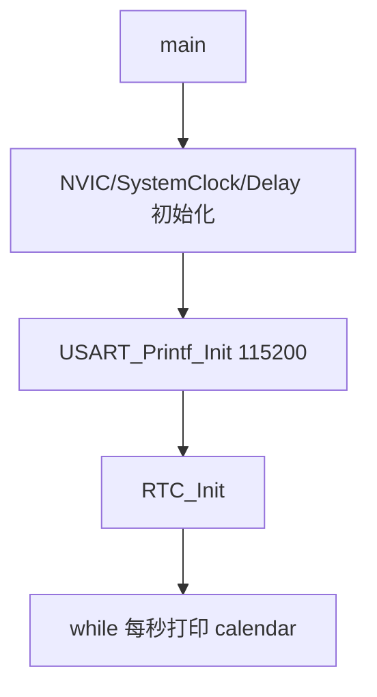
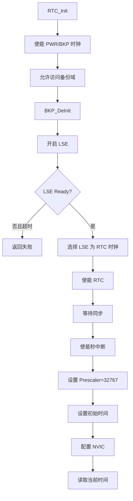
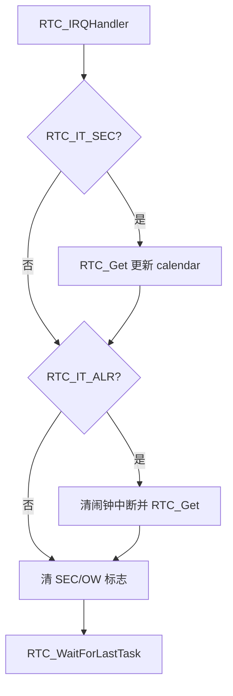
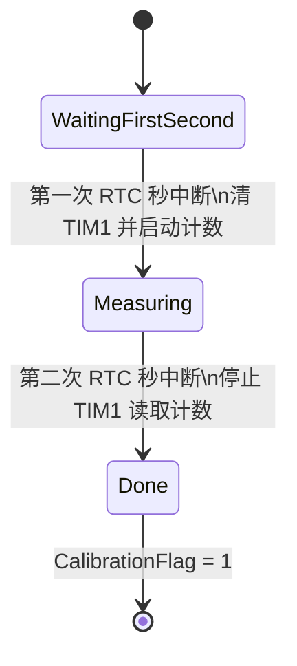
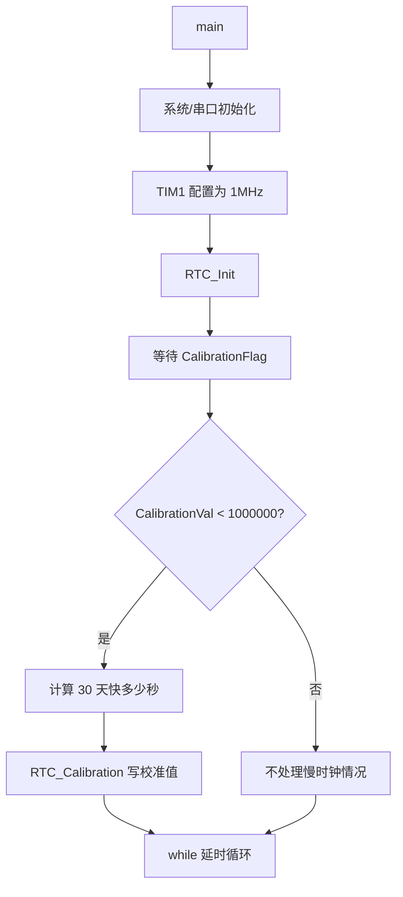

# CH32V307 RTC 示例学习笔记

本文基于 `CH32V307EVT/EXAM/RTC/` 下两个官方示例整理：

- `RTC_Calendar`：RTC 日历计时示例，每秒更新并通过串口打印日期时间。
- `RTC_Calibrations`：RTC 校准示例，使用 TIM1 测量 RTC 秒脉冲偏差，并写入备份域 RTC 校准寄存器。

---

## 1. RTC 示例目录

```text
RTC/
├── RTC_Calendar/
│   └── User/
│       ├── main.c          # RTC 日历主逻辑
│       ├── ch32v30x_it.c   # RTC 秒中断处理
│       └── ch32v30x_conf.h # 外设库头文件配置
└── RTC_Calibrations/
    └── User/
        ├── main.c          # RTC + TIM1 校准逻辑
        ├── ch32v30x_it.c   # NMI/HardFault 基础中断
        └── ch32v30x_conf.h
```

两个示例都依赖这些外设库：

- `ch32v30x_rtc.h`
- `ch32v30x_bkp.h`
- `ch32v30x_pwr.h`
- `ch32v30x_rcc.h`
- `ch32v30x_tim.h`，仅校准示例重点使用
- `ch32v30x_usart.h`，用于串口打印

---

## 2. CH32V307 RTC 基本概念

本示例中的 RTC 不是直接保存“年/月/日/时/分/秒”结构，而是保存一个从 Unix 纪元 `1970-01-01 00:00:00` 开始累计的秒计数。

核心思路：

```text
RTC Counter 秒计数
    ↓ RTC_Get()
换算成年/月/日/时/分/秒/星期
    ↓
通过串口打印 calendar 结构体
```

RTC 使用 LSE 低速外部晶振作为时钟源：

```c
RCC_LSEConfig(RCC_LSE_ON);
RCC_RTCCLKConfig(RCC_RTCCLKSource_LSE);
RCC_RTCCLKCmd(ENABLE);
```

典型 LSE 频率为 `32768 Hz`。若预分频器设置为 `32767`，则：

```text
32768 / (32767 + 1) = 1 Hz
```

所以 RTC 每秒计数加 1。

---

## 3. RTC_Calendar 示例

路径：`RTC_Calendar/User/main.c`

### 3.1 示例功能

官方注释说明：

> 初始时间为 `2019-10-08 13:58:55`，RTC 实时计时，每 1 秒通过串口打印当前时间。

### 3.2 主流程

`main()`：

```c
int main(void)
{
    NVIC_PriorityGroupConfig(NVIC_PriorityGroup_2);
    SystemCoreClockUpdate();
    Delay_Init();
    USART_Printf_Init(115200);

    printf("SystemClk:%d\r\n", SystemCoreClock);
    printf("ChipID:%08x\r\n", DBGMCU_GetCHIPID());
    printf("RTC Test\r\n");

    RTC_Init();

    while(1)
    {
        Delay_Ms(1000);
        printf("year/month/day/week/hour/min/sec:\r\n");
        printf("%d-%d-%d  %d  %d:%d:%d\r\n", ...);
    }
}
```

流程图：



---

## 4. RTC_Init 初始化流程

`RTC_Calendar` 中 `RTC_Init()` 的关键步骤：

```c
RCC_APB1PeriphClockCmd(RCC_APB1Periph_PWR | RCC_APB1Periph_BKP, ENABLE);
PWR_BackupAccessCmd(ENABLE);

RTC_ClearITPendingBit(RTC_IT_ALR);
RTC_ClearITPendingBit(RTC_IT_SEC);

BKP_DeInit();
RCC_LSEConfig(RCC_LSE_ON);

while(RCC_GetFlagStatus(RCC_FLAG_LSERDY) == RESET && temp < 250)
{
    temp++;
    Delay_Ms(20);
}

RCC_RTCCLKConfig(RCC_RTCCLKSource_LSE);
RCC_RTCCLKCmd(ENABLE);
RTC_WaitForLastTask();
RTC_WaitForSynchro();

RTC_ITConfig(RTC_IT_SEC, ENABLE);
RTC_WaitForLastTask();

RTC_EnterConfigMode();
RTC_SetPrescaler(32767);
RTC_WaitForLastTask();
RTC_Set(2019, 10, 8, 13, 58, 55);
RTC_ExitConfigMode();

BKP_WriteBackupRegister(BKP_DR1, 0XA1A1);
RTC_NVIC_Config();
RTC_Get();
```

### 4.1 初始化步骤解释

| 步骤 | 作用 |
|---|---|
| 使能 `PWR` / `BKP` 时钟 | RTC 和备份域相关寄存器需要访问备份域 |
| `PWR_BackupAccessCmd(ENABLE)` | 允许访问备份域 |
| 清 RTC 中断标志 | 避免旧中断影响初始化 |
| `BKP_DeInit()` | 复位备份域，注意会清掉备份寄存器和 RTC 配置 |
| 开启 LSE | 使用外部 32.768 kHz 低速晶振 |
| 等待 `LSERDY` | 等待 LSE 稳定 |
| 选择 RTC 时钟源 | `RCC_RTCCLKSource_LSE` |
| 使能 RTC 时钟 | `RCC_RTCCLKCmd(ENABLE)` |
| 等待同步 | `RTC_WaitForSynchro()` |
| 使能秒中断 | `RTC_IT_SEC` |
| 进入配置模式 | 修改 Prescaler / Counter / Alarm 前需要 |
| 设置预分频 | `32767` 对应 1Hz |
| 设置初始时间 | 通过 `RTC_Set()` 写秒计数器 |
| 写备份寄存器 | `BKP_DR1 = 0xA1A1` 可作为已初始化标记 |
| 配置 RTC NVIC | 开启 RTC 中断通道 |

初始化流程：



---

## 5. 备份域 BKP 与初始化标记

示例中写入：

```c
BKP_WriteBackupRegister(BKP_DR1, 0XA1A1);
```

这通常用于标记 RTC 已经初始化过。实际项目中可以这样使用：

```c
if (BKP_ReadBackupRegister(BKP_DR1) != 0xA1A1) {
    // 第一次上电或备份域丢失，重新配置 RTC
} else {
    // 备份域有效，只同步 RTC，不重置时间
}
```

但本示例每次都执行：

```c
BKP_DeInit();
```

这会清空备份域，因此每次复位都会重新设置到 `2019-10-08 13:58:55`。

> 学习重点：官方示例为了演示方便强制重置 RTC；实际产品中通常不应每次 `BKP_DeInit()`，否则 RTC 断电保持意义会被破坏。

---

## 6. 时间设置：RTC_Set

函数原型：

```c
u8 RTC_Set(u16 syear, u8 smon, u8 sday, u8 hour, u8 min, u8 sec)
```

功能：把年月日时分秒换算成从 `1970-01-01 00:00:00` 起算的秒数，然后写入 RTC 计数器。

关键逻辑：

```c
for(t = 1970; t < syear; t++)
{
    if(Is_Leap_Year(t))
        seccount += 31622400;
    else
        seccount += 31536000;
}
```

每年秒数：

| 年份类型 | 天数 | 秒数 |
|---|---:|---:|
| 平年 | 365 | `31536000` |
| 闰年 | 366 | `31622400` |

月份和日期换算：

```c
smon -= 1;
for(t = 0; t < smon; t++)
{
    seccount += (u32)mon_table[t] * 86400;
    if(Is_Leap_Year(syear) && t == 1)
        seccount += 86400;
}
seccount += (u32)(sday - 1) * 86400;
```

最后加上当天的时分秒：

```c
seccount += (u32)hour * 3600;
seccount += (u32)min * 60;
seccount += sec;
```

写入 RTC：

```c
RTC_SetCounter(seccount);
RTC_WaitForLastTask();
```

### 6.1 年份范围

示例限定：

```c
if(syear < 1970 || syear > 2099)
    return 1;
```

因此支持年份为 `1970~2099`。

---

## 7. 时间读取：RTC_Get

函数原型：

```c
u8 RTC_Get(void)
```

功能：读取 RTC 秒计数，换算到全局 `calendar` 结构体。

`calendar` 定义：

```c
typedef struct
{
    vu8 hour;
    vu8 min;
    vu8 sec;

    vu16 w_year;
    vu8  w_month;
    vu8  w_date;
    vu8  week;
} _calendar_obj;

_calendar_obj calendar;
```

### 7.1 秒计数拆分

```c
timecount = RTC_GetCounter();
temp = timecount / 86400;
```

- `timecount`：从 1970 年开始的总秒数。
- `temp`：从 1970 年开始经过的总天数。

日期部分只在天数变化时重新计算：

```c
static u16 daycnt = 0;
if(daycnt != temp)
{
    daycnt = temp;
    // 重新计算年/月/日
}
```

这样可以减少每秒重复计算年月日的开销。

### 7.2 时分秒换算

```c
temp = timecount % 86400;
calendar.hour = temp / 3600;
calendar.min = (temp % 3600) / 60;
calendar.sec = (temp % 3600) % 60;
```

### 7.3 星期计算

```c
calendar.week = RTC_Get_Week(calendar.w_year, calendar.w_month, calendar.w_date);
```

`RTC_Get_Week()` 使用查表和年份偏移计算星期：

```c
u8 const table_week[12] = {0, 3, 3, 6, 1, 4, 6, 2, 5, 0, 3, 5};
```

返回值为 `temp2 % 7`。示例没有额外说明 0~6 分别对应哪一天；根据算法通常可按实际打印结果或日期对照表确认。

---

## 8. RTC 秒中断

`RTC_Calendar/User/ch32v30x_it.c` 中定义：

```c
void RTC_IRQHandler(void)
{
    if(RTC_GetITStatus(RTC_IT_SEC) != RESET)
    {
        RTC_Get();
    }
    if(RTC_GetITStatus(RTC_IT_ALR) != RESET)
    {
        RTC_ClearITPendingBit(RTC_IT_ALR);
        RTC_Get();
    }

    RTC_ClearITPendingBit(RTC_IT_SEC | RTC_IT_OW);
    RTC_WaitForLastTask();
}
```

### 8.1 秒中断流程



### 8.2 主循环与中断的关系

- 中断中每秒调用 `RTC_Get()` 更新 `calendar`。
- 主循环每秒打印一次 `calendar`。

也就是说，主循环不直接读取硬件 RTC，而是打印中断维护的全局时间结构体。

---

## 9. RTC 闹钟函数

示例提供了 `RTC_Alarm_Set()`，但默认没有启用闹钟中断：

```c
// RTC_ITConfig(RTC_IT_ALR, ENABLE);
RTC_ITConfig(RTC_IT_SEC, ENABLE);
```

`RTC_Alarm_Set()` 和 `RTC_Set()` 类似，也是先把日期时间换算成秒数，然后调用：

```c
RTC_SetAlarm(seccount);
RTC_WaitForLastTask();
```

如果要启用闹钟，可以参考：

```c
RTC_ITConfig(RTC_IT_ALR, ENABLE);
RTC_Alarm_Set(2019, 10, 8, 14, 0, 0);
```

并在中断里处理：

```c
if(RTC_GetITStatus(RTC_IT_ALR) != RESET)
{
    RTC_ClearITPendingBit(RTC_IT_ALR);
    // alarm event
}
```

---

## 10. RTC_Calibrations 示例

路径：`RTC_Calibrations/User/main.c`

### 10.1 示例功能

该示例在 RTC 日历基础上增加校准逻辑：

1. 使用 LSE 驱动 RTC。
2. 故意设置 RTC 预分频为 `32766`，使 RTC 比标准 1Hz 稍快。
3. 使用 TIM1 以 1MHz 计数，测量两个 RTC 秒中断之间的实际微秒数。
4. 根据测量偏差计算 30 天快了多少秒。
5. 根据 RTC 校准步进换算出校准值。
6. 调用 `BKP_SetRTCCalibrationValue()` 写入校准值。

### 10.2 与 Calendar 示例的核心差异

| 项目 | `RTC_Calendar` | `RTC_Calibrations` |
|---|---|---|
| RTC 预分频 | `32767` | `32766`，故意让 RTC 变快 |
| TIM1 | 不使用 | 用于测量 RTC 秒周期 |
| RTC 中断定义位置 | `ch32v30x_it.c` | `main.c` 内定义 |
| 秒中断作用 | 更新日历 | 先校准测量，再更新日历 |
| 校准寄存器 | 不使用 | `BKP_SetRTCCalibrationValue()` |

---

## 11. TIM1 测量 RTC 秒周期

校准示例中 TIM1 初始化：

```c
TIM1_Base_Init(65535, SystemCoreClock / 1000000 - 1);
```

含义：

- TIM1 计数频率配置为 `1 MHz`。
- 每计数一次表示 `1 us`。
- 自动重装载值为 `65535`，16 位周期。
- 如果超过 65535 us，则通过更新中断累计溢出次数。

TIM1 溢出中断：

```c
void TIM1_UP_IRQHandler()
{
    if (!CalibrationFlag)
        CalibrationTIMCir += 1;
    TIM_ClearITPendingBit(TIM1, TIM_IT_Update);
}
```

`CalibrationTIMCir` 记录 TIM1 溢出次数。

---

## 12. 校准测量状态机

相关全局变量：

```c
volatile uint8_t CalibrationFlag = 0;
volatile uint8_t Calibration_STA = 0;
volatile uint32_t CalibrationTIMCir = 0;
volatile uint32_t CalibrationVal = 0;
```

在 RTC 秒中断中：

```c
if (!CalibrationFlag)
{
    if (RTC_GetITStatus(RTC_IT_SEC) != RESET)
    {
        if (Calibration_STA == 0)
        {
            CalibrationTIMCir = 0;
            TIM1->CNT = 0;
            TIM1->CTLR1 |= TIM_CEN;
            Calibration_STA = 1;
        }
        else if (Calibration_STA == 1)
        {
            TIM1->CTLR1 &= ~TIM_CEN;
            CalibrationVal = TIM1->CNT + CalibrationTIMCir * 65536;
            TIM1->CNT = 0;
            Calibration_STA = 0;
            CalibrationFlag = 1;
        }
    }
}
```

测量逻辑：



因为 TIM1 是 1MHz，所以理想情况下，两个 RTC 秒中断之间应为：

```text
1 秒 = 1,000,000 us
```

如果 `CalibrationVal < 1000000`，说明 RTC 秒中断来得太快，也就是 RTC 走快。

---

## 13. RTC 校准计算

校准示例定义：

```c
#define PPM_PER_STEP 0.9536743 // 10^6 / 2^20
#define PPM_PER_SEC  0.3858025 // 10^6 / (30d*24h*3600s)
```

### 13.1 计算 30 天快多少秒

主函数中：

```c
if (CalibrationVal < 1000000)
{
    uint16_t FastSecPer30days =
        (1000000 - CalibrationVal) * 3600 * 24 * 30 / 1000000;
    RTC_Calibration(FastSecPer30days);
}
```

解释：

- `1000000 - CalibrationVal`：每秒快了多少微秒。
- 乘以 `3600 * 24 * 30`：换算成 30 天累计快多少微秒。
- 除以 `1000000`：转成秒。

### 13.2 计算校准步进

```c
void RTC_Calibration(uint16_t FastSecPer30days)
{
    float Deviation = 0.0;
    u8 CalibStep = 0;

    Deviation = FastSecPer30days * PPM_PER_SEC;
    Deviation /= PPM_PER_STEP;
    CalibStep = (u8)Deviation;

    if (Deviation >= (CalibStep + 0.5))
        CalibStep += 1;

    if (CalibStep > 127)
        CalibStep = 127;

    BKP_SetRTCCalibrationValue(CalibStep);
    printf("Calibration cab: %d\n", CalibStep);
}
```

换算关系：

| 宏 | 含义 |
|---|---|
| `PPM_PER_SEC = 0.3858025` | 30 天快 1 秒约等于 0.3858 ppm |
| `PPM_PER_STEP = 0.9536743` | RTC 校准寄存器每步约调整 0.9537 ppm |
| `CalibStep` | 最终写入的校准步进，最大限制为 127 |

校准值写入：

```c
BKP_SetRTCCalibrationValue(CalibStep);
```

---

## 14. 校准示例主流程

`RTC_Calibrations` 中 `main()`：

```c
int main(void)
{
    NVIC_PriorityGroupConfig(NVIC_PriorityGroup_2);
    SystemCoreClockUpdate();
    Delay_Init();

    USART_Printf_Init(115200);
    printf("RTC Test\r\n");

    TIM1_Base_Init(65535, SystemCoreClock / 1000000 - 1);
    RTC_Init();

    while (CalibrationFlag == 0)
        ;

    if (CalibrationVal < 1000000)
    {
        uint16_t FastSecPer30days = ...;
        RTC_Calibration(FastSecPer30days);
    }

    while (1)
    {
        Delay_Ms(100);
    }
}
```

流程图：



> 注意：该示例只处理 `CalibrationVal < 1000000` 的情况，也就是 RTC 走快时通过校准寄存器减慢。若 RTC 走慢，示例没有做补偿处理。

---

## 15. 重要注意事项

### 15.1 LSE 启动超时

示例等待 LSE Ready：

```c
while(RCC_GetFlagStatus(RCC_FLAG_LSERDY) == RESET && temp < 250)
{
    temp++;
    Delay_Ms(20);
}
if(temp >= 250)
    return 1;
```

最长等待约：

```text
250 * 20ms = 5000ms
```

如果返回失败，优先检查：

1. 板上是否焊接 32.768 kHz 晶振。
2. 晶振负载电容是否匹配。
3. LSE 引脚是否被占用或短路。
4. 备份域电源是否正常。

### 15.2 不要在产品代码中每次 BKP_DeInit

示例为了演示每次重置 RTC：

```c
BKP_DeInit();
```

实际项目中，如果希望 RTC 在复位后继续走时，应该使用备份寄存器判断是否已初始化，而不是每次清空备份域。

### 15.3 修改 RTC 寄存器后的等待

示例多次调用：

```c
RTC_WaitForLastTask();
```

这是 RTC 编程中很重要的步骤。写入 RTC 相关寄存器后，需要等待上一次写操作完成，再进行下一步。

### 15.4 中断中不宜频繁打印

`RTC_Calibrations` 示例中，在校准完成后 `RTC_IRQHandler()` 会打印日期时间。实际工程中不建议在中断里频繁 `printf`，原因：

- 串口打印耗时长。
- 可能阻塞中断。
- 影响其他实时任务。

更推荐中断里只设置标志，在主循环或任务中打印。

---

## 16. 可复用代码模板

### 16.1 更适合项目的 RTC 初始化思路

```c
#define RTC_INIT_FLAG 0xA1A1

u8 RTC_ProjectInit(void)
{
    RCC_APB1PeriphClockCmd(RCC_APB1Periph_PWR | RCC_APB1Periph_BKP, ENABLE);
    PWR_BackupAccessCmd(ENABLE);

    if (BKP_ReadBackupRegister(BKP_DR1) != RTC_INIT_FLAG)
    {
        BKP_DeInit();
        RCC_LSEConfig(RCC_LSE_ON);
        // wait LSE ready
        RCC_RTCCLKConfig(RCC_RTCCLKSource_LSE);
        RCC_RTCCLKCmd(ENABLE);
        RTC_WaitForSynchro();

        RTC_EnterConfigMode();
        RTC_SetPrescaler(32767);
        RTC_Set(2024, 1, 1, 0, 0, 0);
        RTC_ExitConfigMode();

        BKP_WriteBackupRegister(BKP_DR1, RTC_INIT_FLAG);
    }
    else
    {
        RTC_WaitForSynchro();
    }

    RTC_ITConfig(RTC_IT_SEC, ENABLE);
    RTC_NVIC_Config();
    RTC_Get();
    return 0;
}
```

### 16.2 秒中断只置标志

```c
volatile uint8_t rtc_1s_flag = 0;

void RTC_IRQHandler(void)
{
    if (RTC_GetITStatus(RTC_IT_SEC) != RESET)
    {
        RTC_ClearITPendingBit(RTC_IT_SEC);
        rtc_1s_flag = 1;
    }
    RTC_WaitForLastTask();
}

int main(void)
{
    while (1)
    {
        if (rtc_1s_flag)
        {
            rtc_1s_flag = 0;
            RTC_Get();
            // print or update UI
        }
    }
}
```

---

## 17. 学习总结

- CH32V307 RTC 示例使用 LSE 作为 RTC 时钟源。
- `RTC_SetPrescaler(32767)` 可将 32768 Hz LSE 分频成 1Hz。
- 示例把 RTC 当作 Unix 秒计数器，再通过软件换算成年月日时分秒。
- `RTC_Calendar` 演示 RTC 基本日历功能和秒中断。
- `RTC_Calibrations` 演示使用 TIM1 测量 RTC 秒周期，并通过 `BKP_SetRTCCalibrationValue()` 进行走快校准。
- 实际项目中应谨慎使用 `BKP_DeInit()`，否则会清除备份域并重置 RTC 时间。
