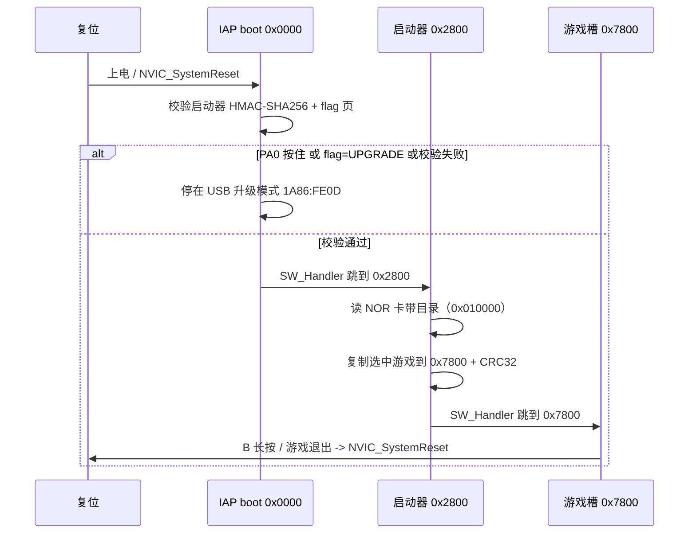
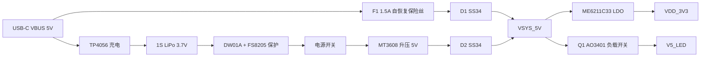

# N1 掌机综合硬件设计（CH32X035 LQFP48 / CH32X033 TSSOP20）

> 本文是两份原始设计文档的“合体版”：
>
> - `CH32X033_OLED_Cartridge_Console_Design.md`：OLED + 外挂 NOR 卡带 + N 合 1 菜单
> - `CH32X033F8P6_Handheld_Platform_Design.md`：6 键 + IMU + 红外 + 蜂鸣器 + 电池
>
> 结合本仓库现有的 `WS2812_Panel_IAP`（LQFP48 默认开发板）与
> `IAP_USB_SIGNED`（10 KB 签名 boot），做出一个**以 16×16 WS2812 面板为主屏、
> 外挂 NOR 为卡带/存档、USB-C 供电与升级、6 键 + 蜂鸣器 + 红外**的统一掌机平台。
>
> 当前阶段以 **CH32X035 LQFP48** 为开发目标；CH32X033 TSSOP20 作为精简版，
> 等实物到板后只需 `sh tools/build.sh --tssop20`。

---

## 1. 产品形态

| 形态            | 主控                 | 显示                                | 输入 | 存储                     | 供电            | 状态             |
| --------------- | -------------------- | ----------------------------------- | ---- | ------------------------ | --------------- | ---------------- |
| **N1 全功能版** | CH32X035 LQFP48      | 16×16 WS2812 面板 + 可选 0.96" OLED | 6 键 | 内部 62 KB + 外挂 W25Q32 | USB-C / 1S 锂电 | 当前开发目标     |
| **N1 精简版**   | CH32X033F8P6 TSSOP20 | 16×16 WS2812 面板                   | 6 键 | 内部 62 KB + 外挂 W25Q32 | USB-C / 3×AAA   | 等板，仅编译验证 |

两款板子共用同一套固件源码，只有引脚表不同（`User/board_config.h`）。

### 1.1 与现有开发板的关系

`WS2812_Panel_IAP` 的 LQFP48 板已经有：

- WS2812 DIN = **PC7**（PIOC IO0 重映射，保留 SDI 调试）
- SPI1 NOR = **PA2/PA5/PA6/PA7**
- USB = **PC16/PC17**
- 1 个用户键 = **PA0**

本设计在它基础上增加：

- 6 键：UP/DOWN/LEFT/RIGHT/A/B
- 蜂鸣器从 `PA2` 改到 **PA3/TIM2_CH4**（`PA2` 必须留给 NOR 片选）
- 红外发射与蜂鸣器共用 `PA3`（频域隔离），红外接收 `PB1`
- 可选 OLED：`PA10/PA11`
- 卡带检测：`PB12`

---

## 2. 系统框图

```mermaid
flowchart TB
    USB[USB-C 5V] --> PMU[电源管理]
    BAT[1S LiPo / 3xAAA] --> PMU
    PMU --> V33[3.3V MCU]
    PMU --> V5[5V LED]
    V33 --> MCU[CH32X035 LQFP48]
    MCU -->|PC7 PIOC| LED[16x16 WS2812]
    MCU -->|SPI1 PA2/5/6/7| NOR[W25Q32 卡带座]
    MCU -->|PA10/PA11 I2C| OLED[0.96 SSD1306 可选]
    MCU -->|PA3 TIM2_CH4| BUZ[蜂鸣器]
    MCU -->|PA3 TIM2_CH4| IRTX[38kHz 红外发射]
    MCU <--|PB1| IRRX[红外接收头]
    MCU <--|PA0..PA9 PB0| KEY[6 键]
    MCU <-->|PC16/PC17| USB
    MCU -->|PB10/PB11| DBG[调试串口]
    MCU <-->|PC18/PC19| SWD[WCH-LinkE]
```

---

## 3. 启动链与存储分区

### 3.1 片内 62 KB Flash

不再把 50 KB 全给应用，而是拆成“启动器 + 游戏槽”：

```text
0x0000_0000 .. 0x0000_27FF   IAP boot        10 KB   签名校验 / USB 升级 / 恢复
0x0000_2800 .. 0x0000_77FF   启动器          20 KB   菜单 + 卡带加载器 + USB
0x0000_7800 .. 0x0000_EFFF   游戏槽          30 KB   从 NOR 复制，CRC32 校验
0x0000_F000 .. 0x0000_F0FF   镜像头页        256 B   packer 写入
0x0000_F100 .. 0x0000_F1FF   flag 页         256 B   UPGRADE / VALID
0x0000_F200 .. 0x0000_F7FF   用户区          1.5 KB  预留
```

IAP boot 的签名/校验范围仍然由 `img_len` 决定，所以**不需要改签名格式**：

- 正常升级只擦除/编程 `0x2800..0x2800+img_len`，启动器最大 20 KB，
  正好停在 `0x7800` 游戏槽之前。
- `IAP_CMD_ERASE` 改成“有有效镜像头时只擦 `hdr.img_len`”，避免误擦游戏槽；
  头页损坏时才回退到整槽擦除。
- 游戏槽不在签名覆盖范围内，由启动器在复制后做 CRC32 校验；游戏代码来自
  用户卡带，不参与启动器签名。

启动链：



> **为什么游戏不直接从 NOR 执行？**
>
> SPI NOR 不是内存映射，CPU 不能原地取指；所以启动器把选中的 30 KB 游戏
> 复制到片内游戏槽，校验 CRC32 后再跳转。这样：
>
> - 选错游戏不会刷坏启动器；游戏槽与启动器物理分离。
> - 换游戏不擦启动器，换启动器也不擦游戏（IAP 只擦 20 KB）。
> - 掉电/卡带拔出不影响启动器，菜单永远能起来。

### 3.2 外挂 W25Q32（4 MB）分区

| 地址          | 大小 | 用途                                        |
| ------------- | ---- | ------------------------------------------- |
| `0x000000`    | 4 KB | 设置槽 A：亮度、声音、上次游戏、最高分、CRC |
| `0x001000`    | 4 KB | 设置槽 B：A/B 交替写，掉电保留上一份        |
| `0x010000`    | 4 KB | 卡带目录（`N1CA`，最多 32 条）              |
| `0x011000` 起 | 余下 | 游戏数据，4 KB 对齐；每款 ≤30 KB            |
| 末 4 KB       | 4 KB | 预留：工厂测试 / 校准数据                   |

卡带目录（`User/cart.h`）：

```c
typedef struct {
    uint32_t magic;       // "N1CA"
    uint16_t version;     // 1
    uint16_t count;       // 1..32
    uint32_t total_size;  // 从 0x010000 起的整个卡带镜像大小
    uint32_t crc32;       // 游戏数据区 CRC32
    uint8_t  reserved[16];
} __attribute__((packed)) cart_hdr_t;

typedef struct {
    char     name[12];    // OLED 列表
    char     code[4];     // WS2812 3 字母代号
    uint8_t  theme;       // 调色板索引
    uint8_t  flags;
    uint16_t reserved;
    uint32_t offset;      // NOR 绝对地址
    uint32_t size;        // 游戏 .bin 大小
    uint32_t crc32;       // 游戏 .bin CRC32
    uint8_t  icon[20];    // 16x10 单色图标，每行 2 字节
} __attribute__((packed)) cart_entry_t;
```

`tools/n1pack.py` 按 `tools/games.json` 生成 `cart.bin`；启动器通过 USB
`CART_*` 命令把整包写入 NOR `0x010000`，设置区不受影响。

设置结构（`User/nor_store.h`）：

```c
typedef struct {
    uint32_t magic;      // "N1ST"
    uint16_t version;
    uint16_t seq;
    uint8_t  bright;     // 8..255
    uint8_t  sound;      // 0/1
    uint8_t  last_game;
    uint8_t  reserved;
    uint16_t hi[8];      // 最高分
    uint16_t crc;        // CRC16-CCITT
} settings_t;
```

---

## 4. 电源设计

### 4.1 方案选择

| 方案                  | 适用               | 优点                               | 注意                                         |
| --------------------- | ------------------ | ---------------------------------- | -------------------------------------------- |
| **A. USB-C 5V 直供**  | 当前 LQFP48 开发板 | 最简单，和 `WS2812_Panel_IAP` 一致 | 灯带峰值电流要限流；固件已限 500 mA          |
| **B. 1S 锂电 + 升压** | 成品掌机           | 便携，可充电                       | 需要 TP4056 + DW01A + MT3608                 |
| **C. 3×AAA 直供**     | TSSOP20 精简版     | 无 LDO 静态功耗                    | 3.0–4.5 V，WS2812 亮度略低；数据高电平需评估 |

下面给出**方案 B（推荐成品）**的完整电源树，方案 A 只是去掉电池/充电/升压部分。

### 4.2 电源树



### 4.3 电源子电路（文本原理图）

```text
USB-C J1
  VBUS ── F1(1.5A) ── D1(SS34) ──+── VSYS_5V ── U2(ME6211C33) ── VDD_3V3
                                 |                               C3 1uF || C4 10uF
                                 ├── Q1(AO3401, EN 可选) ── V5_LED
                                 |                          C5 470uF/10V || C6 100nF
                                 └── U4(TP4056) ── BAT+ ── SW1 ── U3(MT3608) ── D2(SS34) ── VSYS_5V

BAT+ ── DW01A + FS8205 ── BAT- (GND)
CC1/CC2 ── 5.1k ── GND
D+/D- ── 22R ── MCU PC17/PC16
```

关键器件：

| 位号  | 型号          | 参数           | 说明                       |
| ----- | ------------- | -------------- | -------------------------- |
| F1    | 自恢复保险丝  | 1.5 A          | USB 输入保护               |
| D1/D2 | SS34          | 40 V / 3 A     | 防倒灌、电源 OR            |
| U2    | ME6211C33M5G  | 3.3 V / 500 mA | MCU、NOR、OLED             |
| U3    | MT3608        | 5 V / 2 A      | 灯带升压                   |
| U4    | TP4056        | 1 A 线性充电   | 1S 锂电                    |
| Q1    | AO3401        | P-MOS          | 灯带负载开关，便于待机断电 |
| C5    | 470 µF / 10 V | 低 ESR         | WS2812 瞬态电流            |

### 4.4 电流预算

16×16 = 256 颗 WS2812B，单通道满占空比约 20 mA：

```text
全白最坏：256 × 3 × 20 mA = 15.4 A
固件 25% 亮度：约 3.8 A
固件限流 500 mA：由 ws2812_limit_frame() 自动整帧缩放
```

因此：

- 开发板 USB 口按 **500 mA** 限流（`WSP_CURRENT_LIMIT_MA`）。
- 成品电池版可把限流放宽到 **1.5–2 A**，同时保留 470 µF 以上储能。
- 灯带 5 V 走线宽度 ≥ 1.5 mm（25 mil），电源入口再并 100 nF。

### 4.5 MCU 退耦与复位

```text
VDD(48) ──+── C7 100nF ── GND
          └── C8 10uF  ── GND
PA21/RST ── R9 10k ── VDD_3V3
         ├── C9 100nF ── GND
         └── SW_RST ── GND
```

> `PA21` 是 RST 脚，硬件上不要再当普通 GPIO 使用。

---

## 5. LQFP48 全功能版引脚表

> 引脚号来自 `PinMux/CH32X035_pins.csv` 的 LQFP48 列。
> **注意：PC0..PC5 在 LQFP48 上没有引出**，不要照搬 QFN/TSSOP 的引脚表。

| 脚     | 名称     | 网络           | 功能 / 备注                         |
| ------ | -------- | -------------- | ----------------------------------- |
| 1      | PA15     | NC             | 扩展排针                            |
| 2      | PA16     | NC             | 扩展排针                            |
| 3      | PA17     | NC             | 扩展排针                            |
| 4      | PA18     | NC             | 扩展排针                            |
| 5      | PA19     | NC             | 扩展排针                            |
| 6      | PA20     | NC             | 扩展排针                            |
| 7      | PA21/RST | RESET_N        | 10k 上拉 + 100nF + 复位键           |
| 8      | PA22     | NC             | 扩展排针                            |
| 9      | PA23     | NC             | 扩展排针                            |
| **10** | **PA0**  | **BTN_UP**     | 内部上拉，按下接地；也是 IAP 停留键 |
| **11** | **PA1**  | **BTN_DOWN**   | 内部上拉                            |
| **12** | **PA2**  | **NOR_CS**     | SPI1 片选，10k 上拉                 |
| **13** | **PA3**  | **BUZZ_IR**    | TIM2_CH4；蜂鸣器 / 38 kHz 红外共用  |
| **14** | **PA4**  | **BTN_LEFT**   | 内部上拉                            |
| **15** | **PA5**  | **NOR_SCK**    | SPI1                                |
| **16** | **PA6**  | **NOR_MISO**   | SPI1                                |
| **17** | **PA7**  | **NOR_MOSI**   | SPI1                                |
| 18     | PC6      | NC             | 扩展排针                            |
| **19** | **PC7**  | **WS2812_DIN** | PIOC IO0 重映射，SDI 保留           |
| **20** | **PB0**  | **BTN_B**      | 内部上拉；也可做 IR TX 备选         |
| **21** | **PB1**  | **IR_RX**      | 红外接收头 OUT，10k 上拉            |
| 22     | PB2      | NC             | 扩展排针                            |
| 23     | PB3      | NC             | 扩展排针                            |
| 24     | PB4      | NC             | 扩展排针 / IR TX 备选               |
| 25     | PB5      | NC             | 扩展排针                            |
| 26     | PB6      | NC             | 扩展排针                            |
| 27     | PB7      | NC             | 扩展排针                            |
| 28     | PB8      | NC             | 扩展排针                            |
| 29     | PB9      | NC             | 扩展排针                            |
| **30** | **PB10** | **DBG_TX**     | USART1 TX，115200                   |
| **31** | **PB11** | **DBG_RX**     | USART1 RX                           |
| **32** | **PC16** | **USB_DM**     | 全速 USB D-                         |
| **33** | **PC17** | **USB_DP**     | 全速 USB D+                         |
| **34** | **PC18** | **SWDIO**      | WCH-LinkE                           |
| **35** | **PB12** | **CARD_DET**   | 卡座检测开关，内部上拉              |
| 36     | PB13     | NC             | 扩展排针                            |
| **37** | **PC19** | **SWCLK**      | WCH-LinkE                           |
| 38     | PC14     | NC             | TSSOP20 的 LEFT 键，本封装可扩展    |
| 39     | PC15     | NC             | TSSOP20 的 RIGHT 键，本封装可扩展   |
| **40** | **PA8**  | **BTN_RIGHT**  | 内部上拉                            |
| **41** | **PA9**  | **BTN_A**      | 内部上拉                            |
| **42** | **PA10** | **OLED_SCL**   | 可选 SSD1306，4.7k 上拉             |
| **43** | **PA11** | **OLED_SDA**   | 可选 SSD1306，4.7k 上拉             |
| 44     | PA12     | NC             | 扩展排针                            |
| 45     | PA13     | NC             | 扩展排针                            |
| 46     | PA14     | NC             | 扩展排针                            |
| **47** | **GND**  | GND            | 完整地平面                          |
| **48** | **VDD**  | VDD_3V3        | 100nF + 10µF 就近                   |

### 5.1 电池电压（不占引脚）

LQFP48 上没有空闲 ADC 脚（PA0..PA7、PB0、PB1 全部被按键/SPI/蜂鸣器占用），
所以电池检测使用**内部 VREFINT**，与原始 TSSOP20 文档一致：

```c
VDD(mV) = 1200 * 4095 / ADC_Vrefint_Val
```

若后续一定要外部分压，可把 `PA15/PA16` 这类扩展脚改作 ADC 输入，但当前固件
不依赖电池检测。

---

## 6. TSSOP20 精简版引脚表

| 脚  | 名称 | 网络       | 功能 / 备注                        |
| --- | ---- | ---------- | ---------------------------------- |
| 1   | PB12 | CARD_DET   | 卡座检测                           |
| 2   | PC14 | BTN_LEFT   | 内部上拉                           |
| 3   | PC15 | BTN_RIGHT  | 内部上拉                           |
| 4   | —    | —          | 按官方封装图保留                   |
| 5   | PC1  | BTN_A      | 内部上拉                           |
| 6   | PA0  | BTN_UP     | 内部上拉；IAP 停留键               |
| 7   | PA1  | BTN_DOWN   | 内部上拉                           |
| 8   | PA2  | NOR_CS     | SPI1 片选                          |
| 9   | PA3  | BUZZ_IR    | TIM2_CH4，蜂鸣器                   |
| 10  | PA4  | NC         | 可扩展第 7 键 / IR RX              |
| 11  | PA5  | NOR_SCK    | SPI1                               |
| 12  | PA6  | NOR_MISO   | SPI1                               |
| 13  | PA7  | NOR_MOSI   | SPI1                               |
| 14  | PB1  | BTN_B      | 内部上拉                           |
| 15  | GND  | GND        |                                    |
| 16  | VDD  | VDD_3V3    | 100nF + 10µF                       |
| 17  | PC16 | USB_DM     |                                    |
| 18  | PC17 | USB_DP     |                                    |
| 19  | PC18 | WS2812_DIN | PIOC IO0，**占用 SDI，调试口失效** |
| 20  | PC19 | NC         | 保留 SWCLK                         |

TSSOP20 上没有 OLED、IR 接收、调试串口、外部电池检测；WS2812 只能用 PC18，
因此 `ws2812_init()` 会执行 `GPIO_Remap_SWJ_Disable`。现场升级只能走 USB，
生产烧录用 `factory.bin` 一次写完整片。

---

## 7. 共用外设模块设计

### 7.1 WS2812 面板接口

```text
MCU PC7 (3.3V) ── U5 74AHCT125 (VCC=5V)
                    A  ── PC7
                    /OE ── GND
                    Y  ── R10 330R ── J2 DIN
J2: 1 = V5_LED, 2 = DIN, 3 = GND
V5_LED ── C5 470uF/10V ── GND
V5_LED ── C6 100nF ── GND
```

要点：

- **必须做 3.3V → 5V 电平转换**（74AHCT125 或 74HCT245）。直接用 3.3V 驱动
  5V WS2812 在低温/长线时会出现颜色错乱。
- DIN 串 330 Ω，抑制反射；面板端再并 100 nF。
- 16×16 面板的电源入口并 470 µF 低 ESR 电解，防止全白瞬间拉低 5V 导致 MCU 复位。
- 如果省掉电平转换，可把灯带供电串一只 1N4007 降到约 4.3 V，3.3V 数据勉强
  满足 VIH，但只建议手工验证，不建议量产。

### 7.2 SPI NOR 卡带座

```text
VDD_3V3 ── R11 10k ── U6 /CS (1)
MCU PA2 ───────────── U6 /CS (1)
MCU PA5 ───────────── U6 CLK (6)
MCU PA6 ───────────── U6 DO  (2)
MCU PA7 ───────────── U6 DI  (5)
VDD_3V3 ───────────── U6 /WP (3)
VDD_3V3 ───────────── U6 /HOLD (7)
VDD_3V3 ── C10 100nF ── GND
U6 VCC (8) ── VDD_3V3
U6 GND (4) ── GND
卡座检测开关 ── PB12 ── GND（内部上拉）
```

要点：

- `/CS` 必须 10k 上拉，防止上电/热插拔瞬间误进入编程。
- `/WP`、`/HOLD` 直接上拉到 3.3V；不要悬空。
- 卡座旁 100 nF；插拔频繁时可在 SPI 线上加 33 Ω 串阻和 ESD 阵列。
- 支持 W25Q16/32/64/128、GD25Q 系列；JEDEC ID 自动识别。
- 当前固件只用 NOR 存设置/最高分；`0x010000` 之后预留给关卡包和后续卡带游戏。

### 7.3 USB-C

```text
J1 CC1 ── R12 5.1k ── GND
J1 CC2 ── R13 5.1k ── GND
J1 D-  ── R14 22R ── MCU PC16
J1 D+  ── R15 22R ── MCU PC17
J1 VBUS ── F1 ── D1 ── VSYS_5V
J1 GND ── GND
D+/D- 对地：USBLC6-2SC6 ESD
```

要点：

- CH32X035 内部已有 D+ 1.5k 上拉，**外部不要再加**。
- `PC10/PC11` 与 USB 引脚内部合封，初始化时不要配置这两个引脚。
- D+/D- 差分对等长、紧耦合，下方完整 GND。
- USB 仅用于 CDC 升级/调试，不取大电流；灯带大电流请用独立 5V 输入或电池升压。

### 7.4 六键输入

```text
UP    PA0 ── SW1 ── GND
DOWN  PA1 ── SW2 ── GND
LEFT  PA4 ── SW3 ── GND
RIGHT PA8 ── SW4 ── GND
A     PA9 ── SW5 ── GND
B     PB0 ── SW6 ── GND
每个按键两端并 100nF（可选，软件已有 2 帧消抖）
```

全部使用内部上拉，按下为低。`PA0` 同时是 IAP boot 的“上电按住停留”键，
所以 **UP 键不要外部拉低**，否则每次上电都会停在升级模式。

### 7.5 蜂鸣器 + 红外发射共用 PA3

这是原始 TSSOP20 文档的核心技巧：一个引脚、两路 MOS、频域隔离。

```text
PA3 / TIM2_CH4
  ├── R16 1k ── Q2 AO3400 栅极
  │              Q2 源极 ── GND
  │              Q2 漏极 ── IR_LED 阴极
  │              IR_LED 阳极 ── R17 12R ── V5_LED
  │              V5_LED ── C11 100uF ── GND
  │
  └── R18 0R ── R19 1k ── Q3 AO3400 栅极
                 Q3 源极 ── GND
                 Q3 漏极 ── BZ1 负极
                 BZ1 正极 ── V5_LED
                 BZ1 两端反并 D4 1N4148（阴极接 5V）
```

- **38 kHz**：红外载波，蜂鸣器谐振带宽之外，基本不响。
- **1–4 kHz**：蜂鸣器音效，红外接收头内部 38 kHz 带通滤波器会滤掉，不会误触发家电。
- 红外发射回路（C11 → R17 → IR_LED → Q2 → GND）面积最小化，线宽 ≥ 25 mil。
- 后续做红外遥控时，PA3 仍然发 38 kHz 载波，`PB1` 做接收/学习，不需要改板。

### 7.6 红外接收（可选）

```text
V5_LED ── R20 47R ── U7 VCC
U7 VCC ── C12 47uF ── GND
U7 VCC ── C13 100nF ── GND
U7 OUT ── PB1（10k 上拉）
U7 GND ── GND
```

推荐 IRM-H638T / HS0038 系列，宽压 2.4–5.5 V。接收头尽量远离蜂鸣器和 WS2812
电源走线，避免 38 kHz 干扰。

### 7.7 OLED（可选）

```text
VDD_3V3 ── J3 pin1
GND     ── J3 pin2
PA10 ── 4.7k 上拉 ── VDD_3V3 ── J3 SCL
PA11 ── 4.7k 上拉 ── VDD_3V3 ── J3 SDA
J3 VCC ── C14 100nF ── GND
```

0.96" SSD1306，7 位地址 `0x3C`。N1 启动器已用软件 I2C 驱动 OLED：菜单显示
卡带游戏列表/最高分，游戏内显示 `HI`/`SCORE`/`HOLD B: MENU`。没有 OLED 时
`oled_init()` 返回 0，菜单自动只用 WS2812 面板。

### 7.8 调试与扩展

```text
J4 2x6 排针：
  1  3V3        2  GND
  3  PB10 TX    4  PB11 RX
  5  PC18 SWDIO 6  PC19 SWCLK
  7  PB1 IR_RX  8  PA10 SCL
  9  PA11 SDA  10  PB12 CD
 11  PA12      12  PA13
```

- 调试串口 115200 8N1，仅 LQFP48 有。
- SWD 保留给 WCH-LinkE；用 TSSOP20 时 PC18 被 WS2812 占用，SWD 失效。
- 扩展排针可接 IMU、红外模块、OLED、逻辑分析仪。

---

## 8. 网表汇总（关键网络）

| 网络          | 源                 | 目标                           | 备注           |
| ------------- | ------------------ | ------------------------------ | -------------- |
| `VDD_3V3`     | U2 OUT             | MCU VDD(48), NOR VCC, OLED VCC | 100nF + 10µF   |
| `V5_LED`      | Q1 OUT             | WS2812 VCC, IR LED, 蜂鸣器     | 470µF + 100nF  |
| `GND`         | 电池负极 / USB GND | 全板                           | 完整地平面     |
| `WS2812_DIN`  | PC7                | U5 A                           | 74AHCT125 输入 |
| `WS2812_DOUT` | U5 Y               | R10 → J2 DIN                   | 330Ω           |
| `NOR_CS`      | PA2                | U6 /CS                         | 10k 上拉       |
| `NOR_SCK`     | PA5                | U6 CLK                         |                |
| `NOR_MISO`    | PA6                | U6 DO                          |                |
| `NOR_MOSI`    | PA7                | U6 DI                          |                |
| `CARD_DET`    | PB12               | 卡座开关 → GND                 | 内部上拉       |
| `USB_DM`      | PC16               | J1 D-                          | 22Ω            |
| `USB_DP`      | PC17               | J1 D+                          | 22Ω            |
| `OLED_SCL`    | PA10               | J3 SCL                         | 4.7k 上拉      |
| `OLED_SDA`    | PA11               | J3 SDA                         | 4.7k 上拉      |
| `BUZZ_IR`     | PA3                | Q2/Q3 栅极                     | TIM2_CH4       |
| `IR_RX`       | PB1                | U7 OUT                         | 10k 上拉       |
| `BTN_UP`      | PA0                | SW1 → GND                      | 内部上拉       |
| `BTN_DOWN`    | PA1                | SW2 → GND                      | 内部上拉       |
| `BTN_LEFT`    | PA4                | SW3 → GND                      | 内部上拉       |
| `BTN_RIGHT`   | PA8                | SW4 → GND                      | 内部上拉       |
| `BTN_A`       | PA9                | SW5 → GND                      | 内部上拉       |
| `BTN_B`       | PB0                | SW6 → GND                      | 内部上拉       |
| `RESET_N`     | PA21               | 10k 上拉 + 100nF + 复位键      |                |

---

## 9. BOM（全功能版）

| 位号                 | 名称       | 规格                | 封装      | 数量 | 备注                   |
| -------------------- | ---------- | ------------------- | --------- | ---- | ---------------------- |
| U1                   | MCU        | CH32X035C-R0-1V2    | LQFP48    | 1    | 也可用 CH32X033 同 die |
| U2                   | LDO        | ME6211C33M5G        | SOT-23-5  | 1    | 3.3V/500mA             |
| U3                   | 升压       | MT3608              | SOT-23-6  | 1    | 5V/2A，电池版          |
| U4                   | 充电       | TP4056              | SOP-8     | 1    | 1A，电池版             |
| U5                   | 电平转换   | 74AHCT125           | SOIC-14   | 1    | WS2812 数据            |
| U6                   | NOR 卡座   | SOIC-8 宽体座 / ZIF | —         | 1    | W25Q32                 |
| U7                   | 红外接收   | IRM-H638T           | 3-pin     | 1    | 可选                   |
| Q1                   | P-MOS      | AO3401              | SOT-23    | 1    | 灯带负载开关           |
| Q2/Q3                | N-MOS      | AO3400              | SOT-23    | 2    | IR / 蜂鸣器            |
| D1/D2/D3             | 肖特基     | SS34                | SMA       | 3    | 电源 OR / 升压         |
| D4                   | 开关二极管 | 1N4148              | SOD-323   | 1    | 蜂鸣器续流             |
| L1                   | 电感       | 22µH                | 功率电感  | 1    | MT3608                 |
| F1                   | 保险丝     | 1.5A 自恢复         | 1206      | 1    |                        |
| SW1–SW6              | 轻触开关   | 6×6                 | —         | 6    | 方向/A/B               |
| SW_RST               | 轻触开关   | 6×6                 | —         | 1    | 复位                   |
| J1                   | USB-C      | 16P 母座            | —         | 1    |                        |
| J2                   | WS2812     | 3P JST-XH           | —         | 1    | 5V/DIN/GND             |
| J3                   | OLED       | 4P 排母             | —         | 1    | 可选                   |
| J4                   | 扩展       | 2×6 排针            | 2.54mm    | 1    |                        |
| C1/C4/C5             | 电容       | 10µF/470µF          | —         | 3    | 电源储能               |
| C2/C6/C7/C10/C13/C14 | 电容       | 100nF               | 0402/0603 | 6    | 退耦                   |
| C3                   | 电容       | 1µF                 | 0603      | 1    | LDO 输出               |
| C8                   | 电容       | 10µF                | 0805      | 1    | MCU 储能               |
| C9                   | 电容       | 100nF               | 0603      | 1    | 复位                   |
| C11                  | 电容       | 100µF               | 0805      | 1    | IR 瞬态                |
| C12                  | 电容       | 47µF                | 0805      | 1    | IR 接收滤波            |
| R9/R11               | 电阻       | 10k                 | 0402      | 2    | 复位 / NOR CS          |
| R10                  | 电阻       | 330R                | 0402      | 1    | WS2812 串阻            |
| R12/R13              | 电阻       | 5.1k                | 0402      | 2    | USB-C CC               |
| R14/R15              | 电阻       | 22R                 | 0402      | 2    | USB 串阻               |
| R16/R19              | 电阻       | 1k                  | 0402      | 2    | MOS 栅极               |
| R17                  | 电阻       | 12R                 | 0805      | 1    | IR LED 限流            |
| R18                  | 电阻       | 0R                  | 0402      | 1    | 蜂鸣器支路选择         |
| R20                  | 电阻       | 47R                 | 0402      | 1    | IR 接收供电            |
| R21/R22              | 电阻       | 4.7k                | 0402      | 2    | OLED 上拉              |
| BZ1                  | 无源蜂鸣器 | MLT-7525            | SMD       | 1    |                        |
| IR_LED               | 红外发射   | 940nm               | 3mm/5mm   | 1    |                        |

---

## 10. PCB Layout 规范

1. **面板接口**：WS2812 5V/GND 走线 ≥ 1.5 mm；470 µF 尽量靠近 J2；DIN 与
   SCK/MOSI 分开走，避免串扰。
2. **USB 差分**：D+/D- 90 Ω 差分、等长，下方完整 GND，不跨分割。
3. **NOR**：SPI 线短而直，`/CS` 上拉靠近座子；卡座下方铺 GND，插拔区域加 ESD。
4. **IR / 蜂鸣器**：IR LED 回路面积最小，C11 紧贴 LED；蜂鸣器与 IR 接收头
   拉开距离，避免 38 kHz 串扰。
5. **按键**：6 键按人体工学布置，左十字、右 A/B；走线远离 WS2812 电源。
6. **复位**：复位电容靠近 PA21，复位键放板边或背面。
7. **禁止**：不要把 `PC10/PC11`（USB 内部合封）、`PB0` 以外的保留脚接到
   任何网络；LQFP48 上 `PC0..PC5` 本来就没有引出，不要画。
8. **TSSOP20**：WS2812 在 PC18，SWD 失效，生产只走 `factory.bin`；板上留
   USB-C 作为唯一现场升级口。

---

## 11. 上板调试清单

### 11.0 在现有 `WS2812_Panel_IAP` 板上先玩起来

现有 LQFP48 开发板只引出了一个用户键 **PA0**、WS2812、NOR 和 USB。N1 固件需要
6 个键，所以第一版可以直接在板上飞 5 根线到轻触开关（另一端接 GND），不需要
外加电阻（全部使用内部上拉）：

| 功能           | MCU 脚 | 现有板     | 试玩接法                                        |
| -------------- | ------ | ---------- | ----------------------------------------------- |
| UP             | PA0    | 已有用户键 | 直接当 UP                                       |
| DOWN           | PA1    | 排针/焊盘  | 轻触开关 → GND                                  |
| LEFT           | PA4    | 排针/焊盘  | 轻触开关 → GND                                  |
| RIGHT          | PA8    | 排针/焊盘  | 轻触开关 → GND                                  |
| A              | PA9    | 排针/焊盘  | 轻触开关 → GND                                  |
| B              | PB0    | 排针/焊盘  | 轻触开关 → GND                                  |
| 蜂鸣器（可选） | PA3    | 排针/焊盘  | PA3 → 100R → 无源蜂鸣器 → GND，或经 AO3400 驱动 |

> 如果你的板子把 PA4/PA8/PA9/PB0 引到了排针，直接用杜邦线接按键即可。
> 没有蜂鸣器也能玩，只是没有音效。

### 11.1 LQFP48（当前开发板）

1. 不装 WS2812，先量 `VDD_3V3 = 3.3V`、`V5_LED = 5V`。
2. 用 WCH-LinkE 烧 `build/factory.bin`（boot + 启动器 + 头页 + flag）。
3. 上电看 USB：应枚举为 `1A86:FE0F`（启动器）或 `1A86:FE0D`（boot）。
4. 不插卡带时，OLED/面板应显示 `NO CARTRIDGE`；按 A 可重新扫描。
5. 面板先接 1 颗灯，确认 PC7 有 800 kHz 波形、颜色顺序为 GRB。
6. 接满 16×16 + OLED（可选），执行：

   ```sh
   sh tools/build_games.sh
   python tools/n1pack.py --upload --port COMx
   ```

7. 菜单应出现 5 款游戏；按 A 选一款，观察 `LOADING` → 游戏画面。
8. 游戏内按住 B 0.75 s，确认复位回菜单；最高分应保存到 NOR。
9. 按 UP+DOWN 2 秒，确认进入 `FE0D`；用 `iap_flash.py` 升级启动器一次，
   再确认卡带游戏还在（IAP 不应擦 `0x7800` 之后）。

### 11.2 TSSOP20（等板）

1. `sh tools/build.sh --tssop20` 生成 `factory.bin`。
2. `sh tools/build_games.sh --tssop20` 生成 TSSOP20 游戏镜像，重新 `n1pack.py`。
3. 烧录后确认 `FE0F` 出现，面板正常；OLED/调试串口不存在属正常。
4. 量 PC18（第 19 脚）波形：800 kHz、高电平经电平转换后接近 5V。
5. 确认 6 键映射：UP/DOWN/LEFT/RIGHT/A/B。
6. 由于 SDI 被 WS2812 占用，后续只能 USB 升级；调试用 LQFP48 + `--standalone`。

---

## 12. 与原始设计文档的取舍

| 原始设计                                    | 本设计                                           | 原因                                     |
| ------------------------------------------- | ------------------------------------------------ | ---------------------------------------- |
| CH32X033 TSSOP20 为主                       | **LQFP48 为主，TSSOP20 精简**                    | 当前只有 LQFP48 实物；TSSOP20 等板       |
| SSD1306 OLED 为主屏                         | **16×16 WS2812 为主屏，OLED 可选**               | 复用 `WS2812_Panel_IAP` 现有硬件         |
| boot 16 KB + app 46 KB，游戏从 NOR 搬到片内 | **IAP boot 10 KB + 启动器 20 KB + 游戏槽 30 KB** | 不改签名格式；IAP 只擦启动器，游戏槽独立 |
| 蜂鸣器 PA3 / 红外 PA0                       | **蜂鸣器+红外共用 PA3，红外接收 PB1**            | PA2 必须给 NOR CS；频域隔离成熟          |
| 电池检测外部 ADC 脚                         | **VREFINT，不占脚**                              | LQFP48 没有空闲 ADC 脚                   |
| 6 轴 IMU                                    | **预留 I2C / 扩展排针**                          | 当前 N1 优先游戏，IMU 后续加             |
| 红外遥控固件                                | **后续工程，复用 IAP boot**                      | 先把 N 合 1 游戏跑通                     |

---

## 13. 后续：红外遥控（不重新做 boot）

红外部分直接复用现有 `IAP_USB_SIGNED` 的 boot 与升级链路：

1. 新建 `N1_Remote` 应用，链接在 `0x2800`，与 N1 掌机**同一个 boot**。
2. 复用本文的 `PA3 + Q2` 38 kHz 发射、`PB1` 接收/学习。
3. 码库放 NOR `0x010000` 之后；设置/学习记录放 `0x000000/0x001000`。
4. USB 升级仍然用 `iap_pack.py` + `iap_flash.py`；PID 可改为 `0xFE10` 区分产品。
5. 因为 boot 只认签名镜像，红外应用和掌机应用可以互刷，不会变砖。

---

## 14. 已知限制

1. **卡带游戏上限 30 KB / 最多 32 款**：启动器把游戏复制到片内 30 KB 游戏槽，
   目录条目上限 32。需要更大游戏时得重新划分启动器/游戏槽比例。
2. **TSSOP20 未上板**：仅编译验证；WS2812 使用 PC18 会关闭 SDI。
3. **OLED 未上板实测**：软件 I2C + SSD1306 驱动已接入，硬件预留 PA10/PA11；
   没有 OLED 时自动降级为 WS2812 菜单。
4. **电池版电源树**：TP4056 + MT3608 为参考设计，打板前请按实际电池和灯带
   电流复核热设计/电感饱和电流。
5. **WS2812 限流**：默认 500 mA，全白场景会被整帧压暗；电池版可改
   `WSP_CURRENT_LIMIT_MA`。
