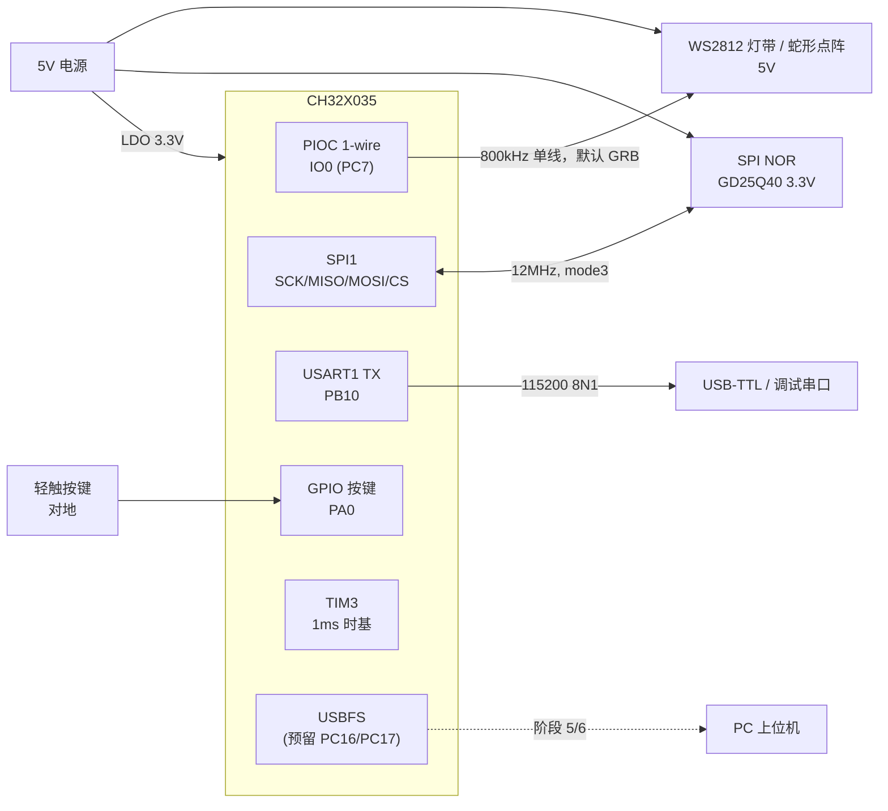

# WS2812_Panel 原理图 / PinMux（demo 级）

> **MCU 型号**：CH32X035
> **汇总表**：[`PinMux/CH32X035_PinMux.xlsx`](../../../../PinMux/CH32X035_PinMux.xlsx)
> （工作表 `PinList` = 全型号引脚复用，`DemoUsage` = 各 demo 分配）
>
> 本文件只描述 **WS2812_Panel 这个 demo** 的引脚分配、接线、电气与自检步骤。
> 引脚复用资源（其它 AF、重映射选项、封装引脚号）请看汇总表。

> 适用工程：`CH32X035EVT/EXAM/APPLICATION/WS2812_Panel`
> 芯片：CH32X035（RISC-V，48MHz HSI，62KB Flash，20KB SRAM，其中高 4KB 归 PIOC）
> 当前实验板：**CH32X035C-R0-1V2**（型号中的 `C` 通常对应 LQFP48，请对照板子丝印/PINMUX 汇总表确认）+ **GD25Q40**（512KB SPI NOR）+ 5V WS2812 灯带。
> 若实物为 TSSOP20/QFN20 等小封装（**PC7、PB10 均不存在**），按第 11 节改引脚。
> 本文档描述**当前固件的引脚占用**、可替代配置、电气连接与上电自检方法。

---

## 1. 系统框图



---

## 2. 引脚分配总表

| 引脚     | 名称/功能               | GPIO 配置                | 方向 | 复用/备注                                                                                      |
| -------- | ----------------------- | ------------------------ | ---- | ---------------------------------------------------------------------------------------------- |
| **PC7**  | WS2812 数据（PIOC IO0） | `GPIO_Mode_AF_PP`，50MHz | 输出 | `GPIO_PinRemapConfig(GPIO_Remap_PIOC, ENABLE)`（仅置 `AFIO_PCFR1.PIOC_REMAP` bit23，不动 SDI） |
| **PA0**  | 用户按键                | `GPIO_Mode_IPU`          | 输入 | 低电平有效；短按切效果/场景，长按 1.2s 切模式                                                  |
| **PA2**  | NOR Flash CS            | `GPIO_Mode_Out_PP`       | 输出 | 上电默认拉高（不选中）                                                                         |
| **PA5**  | NOR Flash SCK           | `GPIO_Mode_AF_PP`        | 输出 | SPI1_SCK，12MHz（48MHz/4），CPOL=1/CPHA=2Edge（模式 3）                                        |
| **PA6**  | NOR Flash MISO          | `GPIO_Mode_IN_FLOATING`  | 输入 | SPI1_MISO                                                                                      |
| **PA7**  | NOR Flash MOSI          | `GPIO_Mode_AF_PP`        | 输出 | SPI1_MOSI                                                                                      |
| **PB10** | 调试串口 TX             | `GPIO_Mode_AF_PP`        | 输出 | USART1_TX，115200 8N1（`USART_Printf_Init`）                                                   |
| PC16     | USB FS D−（CDC）        | `GPIO_Mode_IN_FLOATING`  | 双向 | `usb_cdc.c` 初始化，枚举为虚拟串口                                                             |
| PC17     | USB FS D+（CDC）        | `GPIO_Mode_IPU`          | 双向 | 同上，内置 1.5k 上拉由 `AFIO->CTLR` 配置                                                       |
| —        | 1ms 时基                | 内部                     | —    | TIM3（`wsp_tick.c`），不占引脚                                                                 |
| —        | 延时/微秒               | 内部                     | —    | SysTick（SDK `Delay_*`），不占引脚                                                             |

> 引脚复用为芯片固定映射，除 PC7（PIOC 重映射）外未使用任何 GPIO 重映射。

---

## 3. 外设级说明

### 3.1 PIOC 1-wire（WS2812 输出）

| 项目     | 值                                                       |
| -------- | -------------------------------------------------------- |
| 时钟     | `RCC_AHBPeriph_IO2W` + `RCC_APB2Periph_AFIO/GPIOC`       |
| 代码 RAM | `PIOC_SRAM_BASE = 0x20004000`，4KB（用户 RAM 只剩 16KB） |
| 数据缓冲 | PIOC SRAM `+0x400`，最多 3072 字节（1024 颗 RGB）        |
| 位周期   | 56 × PIOC 时钟 @48MHz ≈ 1.167µs                          |
| 位序     | MSB first，字节按缓冲顺序（固件按 **G,R,B** 存放）       |
| 帧尾     | 引擎自动拉低 286µs（锁存）                               |

引脚选择由 `wsp_config.h` 决定：

```c
#define WS2812_PIOC_PC7   1
#define WS2812_PIOC_PC18  2
#define WS2812_PIOC_PC19  3
#define WS2812_PIOC_PIN   WS2812_PIOC_PC7   /* 默认 */
```

### 3.2 SPI1（NOR Flash）

| 项目     | 值                                                                      |
| -------- | ----------------------------------------------------------------------- |
| 时钟     | `RCC_APB2Periph_SPI1`                                                   |
| 速率     | `SPI_BaudRatePrescaler_4` → 12MHz（探测失败时自动降到 1.5MHz 重试）     |
| 模式     | 主模式，8bit，CPOL=1，CPHA=2Edge，软件 NSS                              |
| 容量探测 | JEDEC ID（0x9F），支持 64KB~32MB；实测板载 GD25Q40 = `C8 40 13` = 512KB |

### 3.3 USART1（调试）

- 仅 TX（PB10），115200 8N1；SDK `debug.c` 默认配置。
- 若与其它外设冲突，可改 `DEBUG_UART2/3`（USART2_TX = PA2，USART3_TX = PB3），
  但注意 PA2 已被 NOR CS 占用，**本工程建议保留 USART1（PB10）**。

### 3.4 按键（PA0）

- 内部上拉 + 按键对地（与厂商 `EXAM/EXTI/EXTI0` 一致）。
- 去抖 20ms，长按阈值 1200ms（`WSP_BTN_DEBOUNCE_MS` / `WSP_BTN_LONG_MS`）。
- 若底板按键带上拉且低有效，可把 `GPIO_Mode_IPU` 改为 `GPIO_Mode_IN_FLOATING` 或保留（并联上拉无碍）。

---

## 4. 接线图（网表）

```
                         +5V (LED 电源, 建议 ≥5A)
                          │
              ┌───────────┴───────────┐
              │      1000µF ∥ 0.1µF   │
              │           │           │
              │        WS2812 灯带 5V  │
              │           │           │
              │        GND┴────────────┼──────┐
              └───────────────────────┘      │
                                             │ 共地
   CH32X035                                  │
   ┌─────────┐                               │
   │  PC7 ───┼──[330~470Ω]──► DIN ───────────┤
   │  GND ───┼───────────────────────────────┘
   │  PA0 ───┼──┬── 轻触按键 ── GND
   │         │  └── (内部上拉)
   │  PA2 ───┼──► /CS   ┐
   │  PA5 ───┼──► CLK   │
   │  PA6 ───┼◄── DO    ├─ GD25Q40 / W25Qxx (3.3V, WP/HOLD→3.3V)
   │  PA7 ───┼──► DI    │
   │  3V3 ───┼──► VCC   ┘
   │  PB10 ──┼──► USB-TTL RX (调试)
   │  PC16 ──┼── USB D−   (预留)
   │  PC17 ──┼── USB D+   (预留)
   └─────────┘
```

### 网表

| 网络       | 起点        | 终点               | 备注                                |
| ---------- | ----------- | ------------------ | ----------------------------------- |
| `WS_DIN`   | PC7         | 灯带 DIN           | 串 330~470Ω；3.3V→5V 建议加电平转换 |
| `LED_5V`   | 5V 电源     | 灯带 VDD           | 1000µF + 0.1µF 去耦                 |
| `GND`      | 5V 电源 GND | MCU GND / 灯带 GND | **必须共地**                        |
| `NOR_CS`   | PA2         | /CS                | 10kΩ 上拉到 3.3V（可选）            |
| `NOR_SCK`  | PA5         | CLK                |                                     |
| `NOR_MISO` | PA6         | DO                 |                                     |
| `NOR_MOSI` | PA7         | DI                 |                                     |
| `NOR_VCC`  | 3.3V        | VCC / WP / HOLD    | WP、HOLD 直接接 3.3V                |
| `BTN`      | PA0         | 按键 → GND         | 内部上拉，无需外部电阻              |
| `DBG_TX`   | PB10        | USB-TTL RX         |                                     |
| `USB_DM`   | PC16        | D−                 | 串 22Ω（可选）                      |
| `USB_DP`   | PC17        | D+                 | 串 22Ω（可选）                      |

---

## 5. 可替代配置 / 重映射

### 5.1 PIOC 输出引脚

| 宏                        | 引脚 | 说明                        | SDI 调试                             |
| ------------------------- | ---- | --------------------------- | ------------------------------------ |
| `WS2812_PIOC_PC7`（默认） | PC7  | `GPIO_Remap_PIOC`，PIOC IO0 | ✅ 保留                              |
| `WS2812_PIOC_PC18`        | PC18 | PIOC IO0 默认位置           | ❌ 初始化会 `GPIO_Remap_SWJ_Disable` |
| `WS2812_PIOC_PC19`        | PC19 | PIOC IO1（`mod=1`）         | ❌ 同上                              |

> PC18/PC19 与 SDI 调试引脚复用（厂商 `EXAM/PIOC/1_Wire` 使用前会关闭 SDI）。
> 量产可用 PC18/PC19，调试阶段建议 PC7。

### 5.2 SPI1

- 本工程固定使用默认位置：PA5/PA6/PA7 + PA2(CS)。
- CH32X035 支持 `AFIO_PCFR1.SPI1_REMAP[1:0]` 重映射，但重映射后的具体引脚以芯片数据手册为准；
  若需要改动，`norflash.c` 中按新引脚配置即可（接口不变）。

### 5.3 按键

```c
#define WSP_BTN_PORT   GPIOA
#define WSP_BTN_PIN    GPIO_Pin_0
```

改到其它引脚时，同时确认该引脚在底板上空闲；`button_init()` 会按宏配置上拉输入。

---

## 6. 电气设计要点

| 项目        | 建议                                                                              |
| ----------- | --------------------------------------------------------------------------------- |
| 灯带供电    | 单颗全白 ≈60mA；16×16=256 颗满亮 ≈15A，建议独立 5V/10A 以上电源                   |
| 共地        | MCU、灯带、NOR、USB-TTL 必须共地                                                  |
| 数据电平    | WS2812B VIH≈0.7×VDD=3.5V（5V 供电）；建议 74HCT245/74AHCT1G125，或将灯带降到 4.5V |
| 数据线      | 串 330~470Ω，尽量短；长线可加 74HCT 缓冲                                          |
| 去耦        | 灯带电源端 1000µF 电解 + 0.1µF 陶瓷；MCU 每个电源脚 0.1µF                         |
| NOR         | WP/HOLD 接 3.3V；CS 可加 10kΩ 上拉，避免上电误选中                                |
| USB（预留） | D+/D− 串 22Ω，D+ 上拉由芯片内部（`UDP_PUE_*`）提供                                |
| ESD         | 外部接口（DIN、USB、按键）加 TVS 二极管                                           |

---

## 7. 存储与地址映射

| 区域                    | 地址         | 大小             | 说明                                                                   |
| ----------------------- | ------------ | ---------------- | ---------------------------------------------------------------------- |
| 内部 Flash（代码/常量） | `0x00000000` | 62KB             | 链接脚本 `FLASH` 区；`img_demo.c` 内置素材 ≈1.8KB                      |
| 主 SRAM                 | `0x20000000` | 16KB（用户可用） | `Ld/Link.ld` 限制为 16K                                                |
| PIOC 代码 RAM           | `0x20004000` | 4KB              | 引擎程序 + 数据缓冲（`+0x400` 起 3KB）                                 |
| 外部 NOR                | 0 起         | 512KB（GD25Q40） | WSP1 图片/动画；`nor_img_src(&src, 0)`；**设置块在 `size-8K`，勿占用** |
| 栈                      | RAM 顶部 2KB | 2KB              | `__stack_size = 2048`                                                  |

> 注意：`PIOC_SRAM_BASE = SRAM_BASE + 0x4000`，所以 **RAM 必须链接为 16K**，
> 否则变量可能与 PIOC 代码 RAM 重叠。

---

## 8. 引脚冲突检查清单

| 检查项                             | 结论                                                        |
| ---------------------------------- | ----------------------------------------------------------- |
| PA2 同时用于 NOR CS 与 USART2_TX？ | 本工程调试串口用 **USART1(PB10)**，不冲突                   |
| PC7 与 SPI1 冲突？                 | 否，SPI1 在 PA5/PA6/PA7                                     |
| PC7 与 SDI 冲突？                  | 否（`GPIO_Remap_PIOC` 不改 `SWJ_CFG`）                      |
| PC18/PC19 与 SDI 冲突？            | 是，选用它们会关闭 SDI                                      |
| PC16/PC17 与当前功能冲突？         | 否，仅为 USB 预留                                           |
| PA0 与其它外设冲突？               | 否；若底板已占用，改 `WSP_BTN_*`                            |
| TIM3 与用户代码冲突？              | 当前无；若冲突可换 TIM2（向量名 `TIM2_TRG_COM_IRQHandler`） |

---

## 9. 上电自检 / 测量点

| 步骤 | 操作                         | 预期                                                      |
| ---- | ---------------------------- | --------------------------------------------------------- |
| 1    | 上电，串口 115200            | 打印 `WS2812 demo: panel 16x16, strip 144 LEDs`           |
| 2    | PANEL 模式启动               | 左上角一颗**微亮红点**（约 0.5s）                         |
| 3    | 继续启动                     | 8 段色条 + 亮度渐变（白/黄/青/绿/品红/红/蓝/黑）          |
| 4    | 长按 PA0                     | 串口打印 `mode: STRIP` / `mode: PANEL`                    |
| 5    | STRIP 短按                   | 12 种效果依次切换，串口打印 `STRIP effect N: xxx`         |
| 6    | 示波器测 PC7                 | 空闲低电平；发送时约 1.167µs/bit，帧尾低 ≥286µs           |
| 7    | 串口出现 `PIOC 1-wire error` | 检查 PC7 接线、灯带供电与共地                             |
| 8    | 插 NOR                       | 打印 `NOR flash: GigaDevice JEDEC 0xC84013, 524288 bytes` |
| 9    | `WSP_NOR_SELFTEST=1` 重烧    | 打印 `NOR selftest: OK`（擦写最后一个 4KB 扇区）          |

> 若 PA0 未接按键：上电默认处于内部上拉状态，不会误触发；
> 短接 PA0 到 GND 可手工模拟按键。

### 9.1 NOR 首次接线调试（GD25Q40）

| 现象                                    | 含义                                 | 处理                                                     |
| --------------------------------------- | ------------------------------------ | -------------------------------------------------------- |
| `NOR flash: not found (JEDEC 0xFFFFFF)` | MISO 无响应（浮空被拉高）            | 查 MISO 接 DO、CS 接 PA2、WP/HOLD 是否接 3.3V、是否共地  |
| `JEDEC 0x000000`                        | MISO 被拉低 / 无供电                 | 查 VCC 3.3V、地线、CS 是否误接为常低                     |
| `JEDEC 0xC84013` 但 selftest FAIL       | 能读 ID 但写不进（WP 被拉低/线太长） | WP 上拉到 3.3V；把 `WSP_NOR_SPI_PRESCALER` 改为 8/16     |
| ID 乱码（如 `0x3F8F0F`）                | 速率过高或长飞线                     | 驱动已自动降到 1.5MHz 重试；仍乱则缩短线长、加 100Ω 串阻 |

### 9.2 上板实测记录

环境：**CH32X035C-R0-1V2（LQFP48）+ GD25Q40 + 5V 16×16 蛇形灯带**，
WCH-LinkE（RV/SDI 模式）、MounRiver Studio 3 自带 `riscv-none-embed-gcc` 与 OpenOCD。

固件占用（含 USB CDC + gamma + 限流 + 字库）：Flash **26036 B / 62K（41%）**，RAM **8280 B + 2K 栈 / 16K（63%）**。

| 项目           | 验证方法                                                  | 实测值                                                         | 结论                              |
| -------------- | --------------------------------------------------------- | -------------------------------------------------------------- | --------------------------------- |
| 烧录/校验      | OpenOCD `program … verify`                                | `device id 0x8c80abcd`，flash 62KB，Verified OK                | ✅                                |
| NOR 识别       | 读回 `nor_id` / `nor_bytes`                               | `0x00C84013` / `0x00080000`                                    | ✅ GD25Q40 512KB                  |
| NOR 擦写回读   | `nor_selftest()` 返回值                                   | `1`                                                            | ✅                                |
| NOR 编程镜像   | `nor_write()` 后 memcmp                                   | 一致（`0`）                                                    | ✅ 偏移 0 写入 8 帧动画           |
| 从 NOR 播放    | `nor_img_src()` + `img_open()`                            | `IMG_OK`，`frames=8`                                           | ✅                                |
| 解码 + 画布    | `img_show()` 后读 `panel_fb`                              | `rc=0`，`px0=0xFFFFFF`                                         | ✅                                |
| PIOC 波形      | `ws2812_last_error()`                                     | `0`（连续上百帧）                                              | ✅ 无 `1-wire error`              |
| TIM3 1ms       | 读 `tick_counter_ms` 1000ms 前后                          | `0xD7F3 → 0xDBE4`（+1009）                                     | ✅ 误差 0.9%                      |
| 主循环节拍     | 1000ms 内循环计数增量                                     | `+17`                                                          | ✅ 与 `Delay_Ms(50)`+7ms 发送吻合 |
| 字节顺序       | 写入 `(0x11,0x22,0x33)` 后读回 `ws_buf`                   | `22 11 33`                                                     | ✅ GRB                            |
| Gamma 表       | 写入 `(128,128,128)` 后读回 `ws_buf`                      | `25 25 25`（`gamma[128]=37`）                                  | ✅ γ=2.8 生效                     |
| 顺序运行时切换 | USB `SET_ORDER 4` 后读回 `ws_order` + `INFO`              | `ws_order=0x04`，`INFO` 报 `RBG (4)`；`9` 被拒                 | ✅ RBG/RGB 等 6 种随时可切        |
| 1-wire 速率    | USB `SET_CYC` / `CFG_SET`，读回 `RGB1W_Cyc` + `INFO`      | 56→1166ns，`rate 62`→1291ns；范围外被拒                        | ✅ 48~72 cyc 可调                 |
| 设置持久化     | `config --rate 60` 后重启，`INFO`                         | NOR `0x7E000` = `57 43 46 47 3C 01 01 FF 00 54`，重启后仍报 60 | ✅ 掉电保持                       |
| 颜色顺序       | 判色固件：满屏 R/G/B + 8 段色条                           | 与设计一致                                                     | ✅ 默认 GRB 正确                  |
| 蛇形几何       | 判色固件：白边框 + 左上红/右上蓝角标                      | 完整矩形、角标位置正确                                         | ✅ 16×16 映射正确                 |
| USART1         | 读 `STATR/BRR/CTLR1`                                      | `TXE\|TC=1`，`BRR=0x1A1`，`UE\|TE=1`                           | ⚠ 已发送，板上未接接收端          |
| USB 枚举       | 主机侧 `VID:PID=1A86:FE0C`                                | 自动绑定 `usbser.sys`，生成 COM 口                             | ✅                                |
| USB INFO       | `wsp_cdc.py info`                                         | `proto 1, 16x16, GRB, NOR 524288 B`                            | ✅                                |
| USB 帧流       | 连续推 64 帧 RGB888 + 11 帧 RGB565 @16fps                 | `frames=75`，`crc_errors=0`，`len_errors=0`                    | ✅                                |
| USB 写 NOR     | `nor-upload` 2048 B → 偏移 0x1000，再 `nor-dump`          | 回读与源文件 **逐字节一致**                                    | ✅ 阶段 6 上传通路                |
| 限流（常态）   | 读回 `ws_scale` / `ws_was_limited`                        | `255` / `0`（demo 内容不超 8A）                                | ✅ 不干扰正常画面                 |
| 限流（全白）   | 满屏白 + `limit 8000`，读回 `ws_scale`                    | **132** → 等效 ≈**7.95 A**（原本 15.4 A）                      | ✅ 压暗到预算内                   |
| 限流（压测）   | 满屏红 + `limit 500`，读回 `ws_scale`                     | **24** → 等效 ≈500 mA                                          | ✅ 公式与实测一致                 |
| 限流持久化     | `config --limit 500` 后重启                               | NOR `0x7E000` v2 记录生效，`ws_limit_ma=500`                   | ✅ 掉电保持                       |
| 文字渲染       | 读回 `panel_fb` 还原成 PNG                                | 角标 `02`（USB 3fps 推黑帧时）、`58`（STRIP 模式）             | ✅ 字形清晰、位置正确             |
| 新增效果       | 宿主机单测遍历 16 种效果                                  | 无空帧、无越界，`ALL TESTS PASSED`                             | ✅ wave/chaser/bounce/meteor      |
| 尺寸适配       | 8×8 / 8×16 / 8×32 / 16×16 / 16×32 / 32×16 全部编译 + 单测 | 6 种全部 `ALL TESTS PASSED`；16×32 占 RAM 82%                  | ✅ 上限 512 px                    |
| PA0 按键       | —                                                         | 未验证（需人工按压）                                           | ⏳                                |

小结：**颜色顺序与蛇形几何均正确，无需调整 `WS2812_COLOR_ORDER` 和 `PANEL_*` 宏；
USB CDC 枚举、帧流与 NOR 上传均已在板上跑通。**

> 复盘：曾经怀疑“颜色不对”，是因为自检流程里的画面变化快、不好区分；
> 用「满屏单色 + 边框角标」的静态图形一次就能判定。以后遇到类似问题先用静态图形，
> 不要靠动图猜。

---

## 10. 与厂商例程的对应关系

| 本工程              | 参考例程                                    |
| ------------------- | ------------------------------------------- |
| PIOC 1-wire 驱动    | `EXAM/PIOC/1_Wire`（`RGB1W.c/.h` 原样拷贝） |
| SPI NOR             | `EXAM/SPI/SPI_FLASH`                        |
| USART1 调试         | `EXAM/SRC/Debug/debug.c`                    |
| 按键（上拉/低有效） | `EXAM/EXTI/EXTI0`（PA0）                    |
| USBFS 引脚          | `EXAM/USB/USBFS/DEVICE/*`（PC16/PC17）      |

---

## 11. 封装可用性（本 demo 所用引脚）

CH32X035 不同封装的引脚差异很大，**PC7 和 PB10 只存在于 LQFP48 / LQFP64M**。
换小封装时必须重新选引脚（数据来自 `PinMux/CH32X035_pins.csv`）：

| 引脚 | 本工程用途     | LQFP48 | LQFP64M | QSOP28 | QFN28 | TSSOP20 | QFN20 | QFN12 |
| ---- | -------------- | ------ | ------- | ------ | ----- | ------- | ----- | ----- |
| PA0  | 按键           | 10     | 14      | 9      | 5     | 6       | 2     | —     |
| PA2  | NOR CS         | 12     | 16      | 11     | 7     | 8       | 4     | 2     |
| PA5  | NOR SCK        | 15     | 21      | 16     | 10    | 11      | 7     | 4     |
| PA6  | NOR MISO       | 16     | 22      | 13     | 11    | 12      | 8     | 5     |
| PA7  | NOR MOSI       | 17     | 23      | 17     | 12    | 13      | 9     | 6     |
| PC7  | WS2812（PIOC） | 19     | 25      | —      | —     | —       | —     | 6\*   |
| PB10 | 调试串口 TX    | 30     | 42      | 25     | 21    | —       | —     | —     |
| PC16 | USB D−（预留） | 32     | 44      | 2      | 26    | 17      | 17    | 7     |
| PC17 | USB D+（预留） | 33     | 45      | 3      | 27    | 18      | 18    | 8     |
| PC18 | PIOC 备用      | 34     | 46      | 28     | 25    | 19      | 14    | 9     |
| PC19 | PIOC 备用      | 37     | 49      | 1      | 24    | 20      | 16    | 10    |

\* QFN12 的 `PC7` 与 `PA7` 同为 pin 6，属 PDF 解析的 alternate bonding 未收录，实际使用前请查数据手册。

**小封装（TSSOP20 / QFN20）迁移注意事项**：

1. `WS2812_PIOC_PIN` 只能选 `WS2812_PIOC_PC18` 或 `WS2812_PIOC_PC19`（会执行
   `GPIO_Remap_SWJ_Disable`，SDI 调试失效，只能 ISP/上电模式烧录）；
2. 调试串口必须换脚：USART2_TX=PA2（与 NOR CS 冲突）或 USART3_TX=PB3，
   否则只能把日志改为 WS2812 屏上显示；
3. 小封装引脚总数不够同时保留 USB，阶段 5/6 需要取舍（例如放弃按键或 NOR）。
