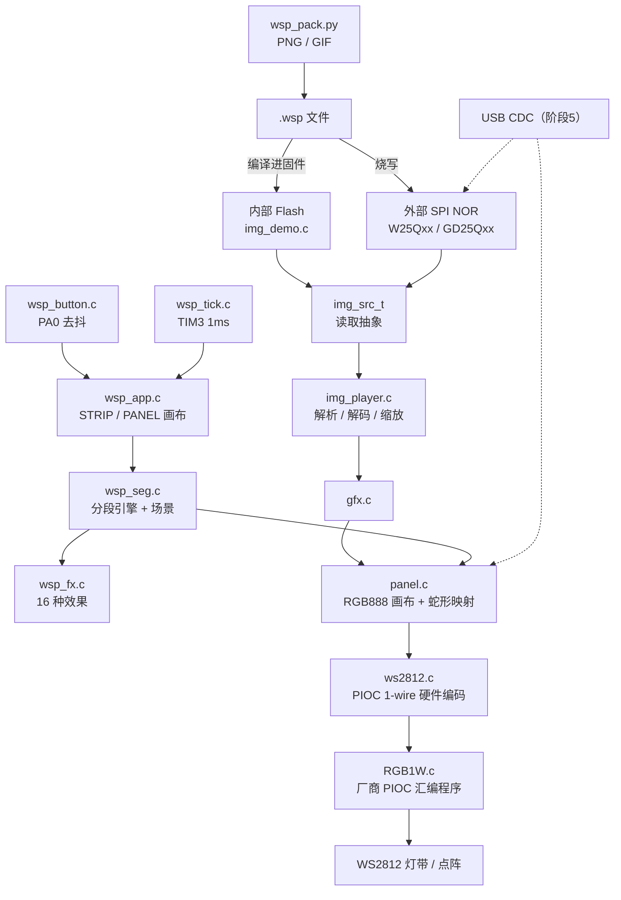

# WS2812_Panel — 蛇形 WS2812 灯带点阵

基于 `CH32X035EVT/EXAM/SPI/SPI_FLASH` 工程拷贝改造（工程骨架、`system_*`、`ch32x035_it.*`
与原例程保持一致），实现：

- 双模式：**STRIP 线性灯带**（按键切换效果）与 **PANEL 蛇形点阵**（按键切换场景），长按切模式；
- 类 WS2812FX 的 **分段（segment）引擎**：矩形“点/线/面”段 + 灯带区间段，支持亮度、速度、反向与叠加混合；
- **16 种效果**：solid/blink/breath/rainbow/wipe/scanner/theater/dot/fire/plasma/sparkle/gradient/wave/chaser/bounce/meteor；
- 一条连续 WS2812 灯带折叠成 **蛇形（zig-zag）点阵**，按普通屏幕坐标绘图；
- 播放 **静态图片**（PNG/BMP 打包）与 **动图**（GIF 打包，多帧动画）；
- 从 **外部 SPI NOR Flash（W25Qxx / GD25Qxx，64KB~32MB）** 读取并播放图片/动画（弥补内部 Flash 容量不足）；
- 预留 **USB 实时送帧** 与 **USB 下发图片到 NOR** 的接口与协议（阶段 5/6）。

---

## 1. 硬件连接

| 功能           | 引脚                  | 说明                                                                                              |
| -------------- | --------------------- | ------------------------------------------------------------------------------------------------- |
| WS2812 数据    | **PC7**（PIOC IO0）   | PIOC 1-wire 硬件编码输出（`GPIO_Remap_PIOC` 重映射，不影响 SDI 调试）；也可选 PC18(IO0)/PC19(IO1) |
| NOR Flash SCK  | **PA5**（SPI1_SCK）   | 12MHz（`SPI_BaudRatePrescaler_4`），探测失败自动降到 1.5MHz 重试                                  |
| NOR Flash MISO | **PA6**（SPI1_MISO）  |                                                                                                   |
| NOR Flash MOSI | **PA7**（SPI1_MOSI）  |                                                                                                   |
| NOR Flash CS   | **PA2**（GPIO 推挽）  | 与厂商 `EXAM/SPI/SPI_FLASH` 相同接线；实测板载 **GD25Q40（512KB）**                               |
| 调试串口       | **PB10**（USART1_TX） | 115200 8N1                                                                                        |
| 用户按键       | **PA0**（低电平有效） | 内部上拉；**短按**切换效果/场景，**长按**切换 STRIP/PANEL                                         |

> 波形由 **PIOC 1-wire 引擎**产生（参考 `EXAM/PIOC/1_Wire`），CPU 只负责填充帧缓冲。
> 默认引脚 **PC7**：通过 `GPIO_PinRemapConfig(GPIO_Remap_PIOC, ENABLE)` 把 PIOC IO0
> 映射到 PC7（只置 `AFIO_PCFR1` bit23，不动 `SWJ_CFG`），**SDI 调试完全保留**。
> 如果板子只能从 PC18/PC19 走线，把 `wsp_config.h` 的 `WS2812_PIOC_PIN` 改为
> `WS2812_PIOC_PC18` 或 `WS2812_PIOC_PC19`；这两根脚与 SDI 复用，初始化会执行
> `GPIO_Remap_SWJ_Disable`，之后 WCH-Link 的 SDI 调试不可用（只能上电/ISP 烧写）。
> 另外：厂商 `EXAM/APPLICATION/WS2812_LED` 用的是 SPI(PA7)/PWM(PB9)，不是 PIOC。

> 完整引脚表、可选重映射、接线网表、上电自检与测量点见 **[PINMUX.md](PINMUX.md)**。
> MCU 型号级的引脚复用汇总表（Excel）见 **[PinMux/CH32X035_PinMux.xlsx](../../../../PinMux/CH32X035_PinMux.xlsx)**。

### 蛇形布局

```
行0 :   0   1   2 ... 15      ──►
行1 :  31  30  29 ... 16      ◄──
行2 :  32  33  34 ... 47      ──►
行3 :  63  62  61 ... 48      ◄──
```

`panel.c` 在 `panel_init()` 中生成 `panel_map[]`（条带位置 → 逻辑像素索引），
绘图代码始终使用 `(x, y)` 屏幕坐标，无需关心走线方向。支持以下编译期选项
（`wsp_config.h`）：

| 宏                              | 作用                             |
| ------------------------------- | -------------------------------- |
| `PANEL_W` / `PANEL_H`           | 点阵宽高（LED 数量）             |
| `PANEL_SERPENTINE`              | `1` 蛇形走线，`0` 每行都从左到右 |
| `PANEL_START_RIGHT`             | 第 0 行首颗灯是否在右侧          |
| `PANEL_FLIP_X` / `PANEL_FLIP_Y` | 镜像，便于实际装配方向           |

修改后上电时的 `startup_check()`（左上角一颗微亮点 + 色条）即可确认方向。

### 支持的点阵尺寸

`PANEL_W` / `PANEL_H` / `STRIP_LEDS` 都可用编译宏覆盖（`STRIP_LEDS` 默认等于
`PANEL_PIXELS`，即“整条灯带折成这个形状”）。实测数据（含 USB + gamma + 限流 + 字库）：

| 尺寸      | 像素 | 单帧时长 | RAM（含 2K 栈） | 占用 | 剩余   |
| --------- | ---- | -------- | --------------- | ---- | ------ |
| 8×8       | 64   | 1.8 ms   | 8024 B          | 49%  | 8.2 KB |
| 8×16      | 128  | 3.6 ms   | 8792 B          | 54%  | 7.4 KB |
| 8×32      | 256  | 7.2 ms   | 10328 B         | 63%  | 5.9 KB |
| **16×16** | 256  | 7.2 ms   | 10328 B         | 63%  | 5.9 KB |
| 16×32     | 512  | 14.3 ms  | 13400 B         | 82%  | 2.9 KB |
| 32×16     | 512  | 14.3 ms  | 13400 B         | 82%  | 2.9 KB |

```bash
# 例：16×32
sh build.sh -DPANEL_W=16 -DPANEL_H=32
# MRS：Project → Properties → C/C++ Build → Settings → Preprocessor Definitions
```

- 上限是 **512 px**（`PANEL_PIXELS > 512` 直接 `#error`）；32×32=1024 px 还要再 4.6 KB RAM，
  且刚好顶到 PIOC 3072 B 单帧上限，所以不支持；
- 角标会自适应：宽度 ≥11 列才显示两位帧率，8 列宽时只显示一位；高度 <7 时自动隐藏；
- 宿主机单测对这 6 种尺寸全部跑通（映射/解码/缩放/段/效果/场景）。

### 颜色顺序（RGB / GRB / BRG）

WS2812 把**收到的第一个字节当红色**的很少，实际有 GRB、RGB、BRG 等多种卷带。
本工程把它做成一个宏（`wsp_config.h`），顺序不对只改这一行：

```c
#define WS2812_COLOR_ORDER      WS2812_ORDER_GRB   /* 默认，绝大多数 WS2812B */
/*  其它可选项：WS2812_ORDER_RGB / _BRG / _BGR / _RBG / _GBR  */
```

两套切换方式：

- **编译期**：改上面的宏，永久生效（掉电不丢）；
- **运行时**：USB 命令 `SET_ORDER`，不用重编，但**只存在 RAM**，重新上电回到宏的值：

  ```bash
  python wsp_cdc.py --port COM5 order       # 查当前值（INFO 也回报）
  python wsp_cdc.py --port COM5 order 4     # 0=RGB 1=GRB 2=BRG 3=BGR 4=RBG 5=GBR
  ```

  适合“手边好几卷不同顺序的灯带”的场合：插上 → `bars` 看一眼 → `order N` 试到颜色对为止。

判断方法：上电自检的 8 段竖向色条就是为此设计的，设计顺序（从左到右）为
**白 / 黄 / 青 / 绿 / 品红 / 红 / 蓝 / 黑**。把你**实际看到的 8 段颜色**对到下表：

| 实际看到（左→右）          | 真实字节顺序 | 改成               |
| -------------------------- | ------------ | ------------------ |
| 白 黄 青 绿 品红 **红** 蓝 | GRB（正确）  | 不用改             |
| 白 黄 品红 红 青 **绿** 蓝 | RGB          | `WS2812_ORDER_RGB` |
| 白 品红 青 蓝 黄 **红** 绿 | BRG          | `WS2812_ORDER_BRG` |
| 白 青 品红 蓝 黄 **绿** 红 | BGR          | `WS2812_ORDER_BGR` |
| 白 品红 黄 红 青 **蓝** 绿 | RBG          | `WS2812_ORDER_RBG` |
| 白 青 黄 绿 品红 **蓝** 红 | GBR          | `WS2812_ORDER_GBR` |

> 缩短判断：只看**第 2 段（应为黄）**和**第 6 段（应为红）**即可唯一定位：
> 黄/红 = GRB，黄/绿 = RGB，品红/红 = BRG，青/绿 = BGR，品红/蓝 = RBG，青/蓝 = GBR。
> （上表是程序枚举全部 6 种排列得到的，不是拍的。）

### 电气注意事项

1. **电平**：WS2812B 的 VIH ≈ 0.7×VDD = 3.5V（5V 供电时），3.3V 直驱可能不稳。
   建议加 `74HCT245` / `74AHCT1G125` 电平转换；或将灯带电源降到 4.5V。
2. **串联电阻与电容**：数据线串 330~470Ω，灯带电源端并 1000µF 电解 + 0.1µF 陶瓷。
3. **供电**：WS2812B 每颗灯珠内含 IC，**全黑也耗电**。按每个颜色通道 20mA 计算：

   | 状态            | 单颗   | 256 颗（16×16） |
   | --------------- | ------ | --------------- |
   | 全黑（IC 静态） | ~1 mA  | 0.26 A          |
   | 单通道满亮      | ~21 mA | 5.4 A           |
   | 双通道满亮      | ~41 mA | 10.5 A          |
   | 全白满亮        | ~61 mA | **15.6 A**      |

   所以“满屏全白 ≈ 15A”是按 **20mA/通道 × 3 通道 × 256 颗** 算出的**最坏值**。
   实际取决于灯珠批次：新版 WS2812B（12mA/通道）约 **9.5 A**，老版（20mA）才是 15A
   左右，用万用表串在 5V 总线上一测就知道。

   工程上需要：独立 5V 电源（≥20A 或接受降低亮度）、灯带首尾**两端并馈电**、
   1000µF 电解靠近灯带、连线尽量粗短；否则压降会让远端灯珠偏色/闪烁。
   软件侧的限流/降亮方案见第 5 节阶段 7。

4. NOR Flash 的 WP/HOLD 引脚接 3.3V。

### 当前验证板

| 项目     | 值                                                                           |
| -------- | ---------------------------------------------------------------------------- |
| MCU 板   | **CH32X035C-R0-1V2**（WCH-Link 已连接；封装按 `C` = LQFP48，请对照丝印确认） |
| NOR      | **GD25Q40**，JEDEC `0xC8 0x40 0x13`，512KB                                   |
| 灯带     | 5V WS2812B，DIN ← PC7（串 330~470Ω），与 MCU 共地                            |
| 调试串口 | PB10 → USB-TTL RX，115200 8N1                                                |

> 首次接线先用 `WSP_NOR_SELFTEST=1` 编译一次（见 `wsp_config.h`），
> 串口打印 `NOR selftest: OK` 即证明 CS/SCK/MISO/MOSI/供电全部正确；
> 之后改回 `0`，避免每次开机擦写该扇区。
>
> ⚠️ **PC7 与 PB10 只存在于 LQFP48 / LQFP64M**。若实板为 TSSOP20 / QFN20，
> 这两根脚不存在，必须按 [PINMUX.md 第 11 节](PINMUX.md) 改引脚
> （WS2812 只能走 PC18/PC19，会关闭 SDI 调试）。

### 为什么用 PIOC（与 SPI / PWM 方案对比）

先澄清一个容易误会的地方：`EXAM/APPLICATION/WS2812_LED` **不是** PIOC 实现，
它提供了两种后端 —— SPI 模式（PA7，SPI1 半双工 + DMA，每颗灯 12 字节编码缓冲）
和 PWM 模式（PB9，TIM1_CH1 + DMA，每颗灯 24 个 `uint16`）。真正用 PIOC 的是
`EXAM/PIOC/1_Wire`（PC18/PC19/PC7）。

| 维度     | **PIOC 1-wire（本工程）**                    | TIM1 PWM + DMA          | SPI + DMA              |
| -------- | -------------------------------------------- | ----------------------- | ---------------------- |
| 波形产生 | PIOC 硬件编码                                | 定时器比较值            | SPI 位模式编码         |
| 每帧缓冲 | 3 B/像素（768 B @16×16）                     | ~48 B/像素（需分块）    | 9~12 B/像素（约 3 KB） |
| CPU 开销 | 填缓冲 + 一次 `memcpy`                       | 编码 + 分块等待         | 编码 + 分块等待        |
| 单次上限 | 3072 B = 1024 px                             | 无（分块）              | 无（分块）             |
| 复位脉冲 | 引擎自带 286µs                               | 软件延时                | 软件发送 0x00          |
| 引脚     | PC7（重映射，不占 SDI）/ PC18/PC19（占 SDI） | 任意 TIM 通道（如 PB9） | SPI1 MOSI（如 PA7）    |
| RAM 代价 | **4 KB PIOC SRAM（用户 RAM 剩 16 KB）**      | 分块缓冲 ~1.5 KB        | 编码缓冲大（>3 KB）    |
| 可维护性 | 厂商汇编二进制，时序不可改                   | 全 C，参数可调          | 全 C，参数可调         |

结论：点阵规模 16×16 / 32×32 时，PIOC 的 RAM 开销完全可接受，换来的是
**CPU 不参与逐位翻转、无需大编码缓冲、时序由已验证的汇编引擎保证**，
所以采用 PIOC；超过 1024 颗灯（或 PC7 不可用、又不想因此关闭 SDI）时，
可退回 TIM1+DMA 方案（`ws2812.c` 对外 API 不变，只换实现）。

---

## 2. 软件架构



| 文件              | 职责                                                                                                                                                      |
| ----------------- | --------------------------------------------------------------------------------------------------------------------------------------------------------- |
| `wsp_tick.c/.h`   | TIM3 1ms 时基（与 `Delay_Ms` 的 SysTick 互不干扰）                                                                                                        |
| `wsp_button.c/.h` | PA0 按键去抖，短按/长按事件                                                                                                                               |
| `wsp_app.c/.h`    | 当前显示模式、画布尺寸、`app_put()` / `app_show()`                                                                                                        |
| `wsp_seg.c/.h`    | 分段引擎（矩形段/灯带段）、混合、时间相位、点线面场景                                                                                                     |
| `wsp_fx.c/.h`     | 16 种效果与颜色工具（HSV/RGB565/混色/正弦表）                                                                                                             |
| `wsp_config.h`    | 点阵尺寸、灯带长度、默认模式、引脚、按键参数                                                                                                              |
| `ws2812.c/.h`     | 帧缓冲（按 `WS2812_COLOR_ORDER` 排字节，默认 GRB，带亮度缩放）→ `RGB1W_SendRAM_Wait()`，阻塞等待 286µs 锁存                                               |     |
| `RGB1W.c/.h`      | 厂商 PIOC 1-wire 程序与 API（`EXAM/PIOC/1_Wire` 拷贝，含 PIOC 汇编码数组；`RGB1W_Init()` **未被调用**，引脚初始化由 `ws2812.c` 的 `ws_pioc_init()` 负责） |
| `panel.c/.h`      | 画布、蛇形映射表、整屏刷新                                                                                                                                |
| `gfx.c/.h`        | 点/线/矩形/位图/RGB565/RGB332/最近邻缩放                                                                                                                  |
| `wsp_img.h`       | 图像容器与数据源抽象（内部 Flash / NOR）                                                                                                                  |
| `img_player.c`    | 头部解析、RLE565/RAW565/RAW332 解码、缩放、循环播放                                                                                                       |
| `norflash.c/.h`   | W25Qxx / GD25Qxx：JEDEC ID、厂商识别、容量、读、扇区擦除、页编程、`nor_selftest()`                                                                        |
| `img_demo.c`      | `wsp_pack.py --demo` 生成的内置素材（笑脸 / 动画 / 8×8 缩放测试）                                                                                         |
| `usb_cdc.c/.h`    | USBFS CDC 设备层：枚举、EP0 标准/类请求、EP2 OUT / EP3 IN 数据通道（改自厂商 `SimulateCDC`）                                                              |
| `usb_desc.c/.h`   | CDC 描述符（VID `1A86` / PID `FE0C`）                                                                                                                     |
| `wsp_usb.c/.h`    | 帧/命令协议：中断内解析 + 主循环解码刷屏，含 NOR 上传命令                                                                                                 |
| `wsp_gamma.c/.h`  | 256 项 gamma 表（γ=2.8），由 `tools/gen_gamma.py` 生成                                                                                                    |
| `wsp_cfg.c/.h`    | NOR 持久化设置块：1-wire 位速率 / 颜色顺序 / 亮度 / 默认模式 / 电流上限                                                                                   |
| `wsp_font.c/.h`   | 5×7 点阵字库（45 字形，5 B/字形），由 `tools/gen_font.py` 生成                                                                                            |
| `wsp_text.c/.h`   | 文字绘制：`text_draw()` / `text_char()` / `text_width()`                                                                                                  |
| `wsp_osd.c/.h`    | 角标：帧率两位数字 + 限流红点，`WSP_OSD_ENABLE` 控编译，`WSP_OSD_DEFAULT` 控上电默认值                                                                    |
| `PINMUX.md`       | 原理图 / 引脚复用 / 网表 / 上电自检清单                                                                                                                   |
| `main.c`          | 双模式状态机 + 按键交互 + 启动自检                                                                                                                        |

### WS2812 位时序（PIOC 1-wire，来自 `EXAM/PIOC/1_Wire`）

| 参数       | 值                                                                   |
| ---------- | -------------------------------------------------------------------- |
| 波形发生器 | PIOC 引擎（长数据/RAM 模式，硬件 PWM 编码），CPU 不参与逐位翻转      |
| 位周期     | 56 个 PIOC 时钟 @48MHz ≈ **1.167µs**（WS2812 目标 1.25µs，在容差内） |
| 位序       | 字节 **MSB first**，数据字节按缓冲区顺序发送（因此缓冲存 G,R,B）     |
| 帧结束     | 引擎自带 **286µs 拉低**，满足复位/锁存要求                           |
| 单次上限   | 3072 字节 = **1024 颗 RGB 像素**（16×16=768B，32×32=3072B）          |
| 帧耗时     | 256×24×1.167µs ≈ 6.7ms + 286µs ≈ **7ms/帧**                          |

使用流程与厂商例程一致：

1. `ws_pioc_init()`：开 `AFIO/GPIOC/IO2W` 时钟 → 配置引脚 → `PIOC->D8_SYS_CFG = RB_MST_RESET`
   → 把 `PIOC_1W_CODE[]` 拷到 `PIOC_SRAM_BASE`（0x20004000）；
2. 每帧：CPU 填 `ws_buf[]`（按 `WS2812_COLOR_ORDER`，默认 GRB）→ `RGB1W_SendRAM_Wait(768, buf, mod)` 把数据拷入
   PIOC SRAM +0x400，写命令 `0xB8`（0x80 | 56）；
3. 轮询 `RB_INT_REQ` 等待完成，读 `D8_CTRL_RD` 得到状态（非 0 即异常，见 `ws2812_last_error()`）。

### 亮度与 Gamma

输出级每通道的处理顺序是：

```
画布像素 (0..255) → × WS2812_BRIGHTNESS / 255 → gamma[ ] 查表 → 字节重排 → ws_buf
```

**为什么 gamma 放在最后**：亮度是给人手的旋钮，希望“调一半”看起来就暗一半（感知线性）；
而 PWM 占空比与人眼亮度是非线性的（约 γ=2.2~2.8）。所以先把亮度乘到感知值上，
最后再一次性查表换成占空比，两个目标同时满足。

表就是一张普通的 256 项 `uint8_t` LUT（256 B 常量，不是 1KB）：

```
table[i] = round(255 * (i / 255) ^ 2.8)     i = 0..255
```

**和 Arduino 那张表是同一回事**：Adafruit 的 `gamma8[]`、FastLED 的默认 video gamma
都是同一条曲线的 LUT（γ≈2.8：前 28 项为 0，`t[128]=37`），本工程的表由
`tools/gen_gamma.py` 按公式生成，所以可复现、可改参数：

```bash
cd tools
python gen_gamma.py                     # γ=2.8（默认，对位 Arduino 曲线）
python gen_gamma.py --gamma 2.2         # sRGB 教科书值，低端更亮
python gen_gamma.py --gamma 1.0         # 线性表，用于 A/B 对比
```

不想用 gamma 时把 `wsp_config.h` 的 `WS2812_GAMMA` 置 0 即可。

实机校验（写 `(128,128,128)` 后读回 `ws_buf`）：`25 25 25` = `gamma[128]=37` ✅，
关掉 gamma 则是 `80 80 80`。

### 1-wire 位速率（可调 + 可存 NOR）

WS2812 的位周期不是硬编码的：PIOC 命令的低 7 位就是“每个 bit 用多少个 PIOC 时钟”，
`RGB1W_CYC_48M = 56`。48MHz 下一个时钟 20.83ns：

| cycles | 位周期       | 说明                     |
| ------ | ------------ | ------------------------ |
| 48     | 1.00 µs      | 下限（`WS2812_CYC_MIN`） |
| **56** | **1.167 µs** | 厂商默认值，本工程默认   |
| 60     | 1.250 µs     | WS2812B 数据手册标称值   |
| 72     | 1.500 µs     | 上限（`WS2812_CYC_MAX`） |

WS2812B 实际容差约 1.1~1.4 µs，所以 48~72 都安全。改它会影响整帧时长：
`768 B × 8 bit × cycles × 20.83 ns`（56 → 7.2 ms，60 → 7.7 ms）。

两条路径：

```bash
python wsp_cdc.py --port COM5 rate          # 查当前
python wsp_cdc.py --port COM5 rate 60       # 临时改（只改 RAM，适合一边看一边调）
python wsp_cdc.py --port COM5 config --rate 60   # 写进 NOR，掉电不丢
```

### 持久化设置块（GD25Q40）

上面的位速率、颜色顺序、亮度、开机默认模式都存在外部 NOR 的**倒数第二个 4KB 扇区**
（`nor_size() - 8192`，GD25Q40 上是 `0x7E000`），16 字节记录：

```
偏移 0  magic "WCFG"        uint32 LE
偏移 4  wire_cyc            PIOC clocks/bit
偏移 5  version             2
偏移 6  order               WS2812_ORDER_*
偏移 7  brightness          0..255
偏移 8  mode                WSP_MODE_*
偏移 9  limit100            电流上限，单位 100mA（0 = 不限）
偏移 10 crc8(poly 0x07)     覆盖偏移 0..9
偏移 11 pad[5]
```

- magic / version / crc / 取值范围任何一项不符 → **静默回退到 `wsp_config.h` 的编译期默认值**，
  所以空白 Flash 或坏数据不会把屏幕“锁死”；
- 写入后立即回读比对，不一致就报错；
- **图片/动画请放在 `nor_size() - 8192` 以下**；最后一个 4KB 扇区留给 `nor_selftest()`。

实机验证：`config --rate 60` → 读回 NOR `57 43 46 47 3C 02 01 FF 00 50 6E`
（`WCFG`,60,v2,GRB,255,panel,80=8A,crc）→ **重启后 `info` 仍报 60 cyc/bit**，证明掉电保持生效。

### 限流（保护 5V 电源）

每帧发送前多走一遍画布，把整帧的 PWM 占空比求和，再和预算比：

```
I_frame ≈ 20mA × Σ(duty) / 255            每通道满占空 20mA
预算    = limit_mA × 255 / 20
Σ > 预算 → 整帧按 预算/Σ 等比压暗（不改颜色比例，只看亮度）
```

- `duty` 用的是**亮度 × gamma 之后**的实际占空比（`ws2812_duty_table()`），
  所以开了 gamma 之后估算不会过度保守；
- 代价：每帧多遍历 768 字节（约 0.05 ms），发送前算好，不影响帧率；
- 默认 `WSP_CURRENT_LIMIT_MA = 8000`，可用 USB 改并持久化：

```bash
python wsp_cdc.py --port COM5 config                 # 看当前上限
python wsp_cdc.py --port COM5 config --limit 12000   # 12A
python wsp_cdc.py --port COM5 config --limit 0       # 关闭限流
```

实机验证（`ws_scale` 是驱动内部的压暗系数，255 = 未压暗）：

| 场景                   | limit   | 实测 `ws_scale`   | 等效帧电流                |
| ---------------------- | ------- | ----------------- | ------------------------- |
| demo 常态内容          | 8000 mA | **255**（未触发） | 不计                      |
| 满屏红 `image red.png` | 500 mA  | **24**            | ≈ 500 mA                  |
| **满屏白**             | 8000 mA | **132**           | ≈ 7.95 A（原本会 15.4 A） |

> 注意：限流是「整帧等比压暗」，所以推全白图时屏会明显变暗——宁可暗也不要拉垓电源。

### 文字与角标（OSD）

5×7 点阵字库（`wsp_font.c`，45 个字形，每个 5 字节 = 225 B），由 ASCII 图生成，
可用 `tools/gen_font.py --preview out.png` 先看效果再烧录：

```c
#include "wsp_text.h"
text_draw(2, 3, "HI", RGB565(255, 255, 0));   /* 返回下一个 x 坐标 */
```

角标（右上角帧率 + 右下角限流红点）默认是**编译进去但不开**，三个开关各管一件事：

| 宏                | 作用                           |
| ----------------- | ------------------------------ |
| `WSP_TEXT_ENABLE` | 是否编译字库/文字模块          |
| `WSP_OSD_ENABLE`  | 是否编译角标（依赖文字模块）   |
| `WSP_OSD_DEFAULT` | 上电时角标是否显示（默认 `0`） |

16×16 屏上两位帧率就占掉第 0 行的 11/16 列，所以默认关；调试时用 USB 临时打开：

```bash
python wsp_cdc.py --port COM5 osd on     # 显示
python wsp_cdc.py --port COM5 osd off    # 关掉
```

实测（把 `panel_fb` 读回来还原成图）：USB 以 3fps 推黑帧时角标显示 **`02`**，
STRIP 模式自己跑时显示 **`58`** 上下——和实测帧率一致。

### 抖动（`WSP_DITHER`，默认关）

给旋转的 1/4 像素的占空比 +1，用来打散 gamma 量化在渐变上的色阶。
幅度只有 1/255，单个像素看不出来，但能看到“台阶”消失。
因为**只能靠眼睛验收**，默认关闭，确认后再把 `WSP_DITHER` 改 1。

---

## 3. 双模式与分段引擎（WS2812FX 风格）

### 显示模式

| 模式             | 画布                              | 内容                                     | 按键                             |
| ---------------- | --------------------------------- | ---------------------------------------- | -------------------------------- |
| `WSP_MODE_STRIP` | `STRIP_LEDS`（默认 144）          | 线性灯带效果：跑马、彩虹、火焰、等离子…… | 短按：下一个效果；长按：切 PANEL |
| `WSP_MODE_PANEL` | `PANEL_W × PANEL_H`（默认 16×16） | 图片/动图/NOR 内容 + 点/线/面场景        | 短按：下一个条目；长按：切 STRIP |

默认模式由 `wsp_config.h` 的 `WSP_DEFAULT_MODE` 决定；两种模式共用同一块画布
`panel_fb[CANVAS_PIXELS*3]`，切换时自动清屏：

- PANEL：`panel_fb` 索引 = `y*PANEL_W + x`，`panel_show()` 按蛇形走线输出；
- STRIP：`panel_fb` 索引 = 灯带位置，`ws2812_show()` 1:1 输出。

### 段（segment）

完全对标 WS2812FX 的 `SEGMENT` 结构，增加 2D 矩形支持：

```c
wsp_seg_t *s = seg_config_rect(1, 0, 7, 16, 2, FX_THEATER_CHASE); /* x,y,w,h */
s->speed = 140;          /* 0..255，映射到 2000..60ms 周期 */
s->intensity = 128;      /* 拖尾长度 / 火花密度 / 亮度调制 */
s->brightness = 255;     /* 段级限亮 */
s->blend = SEG_BLEND_ADD;/* REPLACE / ADD / MAX */
seg_colors(1, c0, c1, c2);
```

| 段类型      | 含义                                                               |
| ----------- | ------------------------------------------------------------------ |
| `SEG_RECT`  | 点阵矩形区域（点/线/面），自动裁剪到面板内                         |
| `SEG_STRIP` | 物理灯带连续区间；PANEL 模式下按蛇形走线映射（演示“点沿走线移动”） |

渲染顺序 = 段号顺序，后渲染的段可通过 `SEG_BLEND_ADD` 叠加到前面的段上，
这就是“点/线/面 + 叠加”的实现方式。

### 效果表（`wsp_fx.c`）

| ID  | 名称               | 说明                    |
| --- | ------------------ | ----------------------- |
| 0   | `FX_STATIC`        | 纯色                    |
| 1   | `FX_BLINK`         | 双色闪烁                |
| 2   | `FX_BREATH`        | 呼吸                    |
| 3   | `FX_RAINBOW`       | 彩虹（2D 用 x+y 渐变）  |
| 4   | `FX_WIPE`          | 颜色擦除                |
| 5   | `FX_SCANNER`       | 扫描线/彗星（带拖尾）   |
| 6   | `FX_THEATER_CHASE` | 剧院追逐                |
| 7   | `FX_RUNNING_DOT`   | 单点                    |
| 8   | `FX_FIRE`          | 火焰（热度场 + 调色板） |
| 9   | `FX_PLASMA`        | 等离子                  |
| 10  | `FX_SPARKLE`       | 随机闪烁                |
| 11  | `FX_GRADIENT`      | 渐变/流动               |

### 内置场景（PANEL）

- **点** `seg_scene_point()`：整条灯带一个 `FX_SCANNER` 段，亮点沿 **蛇形走线** 移动；
- **线** `seg_scene_line()`：横向 `FX_THEATER_CHASE` 线 + 纵向 `FX_SCANNER` 线（ADD 叠加）；
- **面** `seg_scene_plane()`：四象限 彩虹/等离子/火焰/呼吸，再加一个沿走线跑的亮点叠加层。

### 为什么面板模式效果有限

效果代码本身很小（`wsp_fx.c` ≈ 6KB），真正的限制是 **62KB 内部 Flash** 里还要放
图片/动图素材（内置演示已占 ≈1.8KB）。因此：

- 常用/通用效果编译进固件；
- 图片、动图、更多内容（甚至新效果参数表）放到 **外部 NOR**，通过
  `tools/wsp_pack.py` 打包后写入，运行时不占 MCU Flash；
- 后续可用 USB 下发并热切换（见第 7 节协议）。

---

## 4. 图像容器 WSP1

`tools/wsp_pack.py` 生成，小端序：

```
+0   uint32 magic      = "WSP1" (0x31505357)
+4   uint8  version    = 1
+5   uint8  format     0=RLE565, 1=RAW565, 2=RGB332
+6   uint16 width
+8   uint16 height
+10  uint16 frames
+12  uint16 frame_ms
+14  uint16 flags      预留，0
+16  uint32 frame_offset[frames]    相对文件起点的绝对偏移（16 字节头部之后）
...  帧数据
```

帧数据：

- `RLE565`：重复的 `(uint8 count, uint16 colour)`，`count` 取 1~255，适合纯色/像素风；
- `RAW565`：`width*height` 个 `uint16`，适合照片；
- `RGB332`：`width*height` 个字节，体积最小，颜色有损。

固件端 `img_player.c` 将任意尺寸（≤ `IMG_SCRATCH_PIXELS`）的一帧解码到暂存区，
再用最近邻缩放到点阵，所以 8×8 / 32×32 素材都可以直接播放。

### 主机工具

| 工具             | 用途                                                                                                                  |
| ---------------- | --------------------------------------------------------------------------------------------------------------------- |
| `wsp_pack.py`    | PNG/GIF → `.wsp`，也能生成内置素材 `User/img_demo.c`                                                                  |
| `wsp_cdc.py`     | USB CDC 上位机：`info / bars / solid / image / anim / order / rate / osd / config / nor-upload / nor-read / nor-dump` |
| `gen_gamma.py`   | 生成 gamma 表（可改 γ）                                                                                               |
| `gen_font.py`    | 生成 5×7 字库，`--preview` 先看效果                                                                                   |
| `build_cli.sh`   | CLI 构建（自带工具链探测），可传 `-D` 宏                                                                              |
| `build_sizes.sh` | 一键编完 8×8 / 8×16 / 8×32 / 16×16 / 16×32 / 32×16 并打印占用                                                         |
| `dump_panel.py`  | 从 WCH-Link 读回 `panel_fb` 存成 PNG                                                                                  |

```bash
cd CH32X035EVT/EXAM/APPLICATION/WS2812_Panel/tools

# 单张图片：16x16，RLE 压缩
python wsp_pack.py --input logo.png --size 16x16 --format rle565 --output logo.wsp

# 动图：GIF 转动画，80ms/帧，同时导出 C 数组（可编译进内部 Flash）
python wsp_pack.py --input anim.gif --size 16x16 --frame-ms 80 \
                   --output anim.wsp --c-array anim

# 查看已有文件的头信息与各帧大小
python wsp_pack.py --info logo.wsp

# 重新生成内置演示素材 User/img_demo.c（不依赖 Pillow）
python wsp_pack.py --demo ../User/img_demo.c

# 重新生成 gamma 表 User/wsp_gamma.c
python gen_gamma.py --gamma 2.8
```

依赖：处理 PNG/GIF 需要 `pip install pillow`；`--demo` 与 `--info` 只用标准库。

---

## 5. 开发计划

| 阶段 | 目标              | 主要产出                                                                                      | 状态                      |
| ---- | ----------------- | --------------------------------------------------------------------------------------------- | ------------------------- |
| 0    | 工程骨架          | 从 `SPI_FLASH` 拷贝的 `WS2812_Panel` 工程、清单登记                                           | ✅ 已完成                 |
| 1    | 点亮与寻址        | `ws2812.c`（PIOC 1-wire）、`panel.c`（蛇形映射）、色彩测试图                                  | ✅ 已上板验证             |
| 2    | 分段引擎 + 双模式 | `wsp_seg` / `wsp_fx` / `wsp_app` / `wsp_tick` / `wsp_button`、12 种效果、点线面场景、PA0 按键 | ✅ 已上板验证（按键除外） |
| 3    | 图片/动图播放     | WSP1 格式、`wsp_pack.py`、`img_player.c`、内置素材                                            | ✅ 已上板验证             |
| 4    | 本地 NOR 播放     | `norflash.c`（W25Qxx/GD25Qxx 64KB~32MB）、NOR 数据源、自动探测与回退                          | ✅ 已上板验证（GD25Q40）  |
| 5    | USB 实时送帧      | `usb_cdc.c`（CDC 设备层）、`wsp_usb.c`（帧协议）、`tools/wsp_cdc.py`                          | ✅ 已上板验证             |
| 6    | USB 下发到 NOR    | `NOR_ERASE/WRITE/READ` 命令、`wsp_cdc.py nor-upload/nor-read`                                 | ✅ 已上板验证             |
| 7    | 效果与优化        | Gamma（✅）、限流（✅）、文字/字符（✅）、**16 种效果（✅）**、抖动（代码就绪）、过渡动画     | ⏳ 部分完成               |

### 各阶段验收标准

- **阶段 1**：左上角只有一颗亮点；色条颜色顺序正确；亮度渐变无闪烁。
- **阶段 2**：STRIP 模式下短按可循环 16 种效果，长按切到 PANEL；PANEL 模式下点/线/面
  三个场景连续可辨，串口打印当前效果名。
- **阶段 3**：内置笑脸/8×8 缩放/动画按顺序循环；串口无 `img_open failed`。
- **阶段 4**：烧写 WSP 到 NOR 偏移 0 后能播放；拔掉 Flash 时自动跳过。
  首板（CH32X035C-R0-1V2 + GD25Q40）额外验证 `nor_selftest()` 返回 OK。
- **阶段 5**：主机 30fps 连续送 16×16 RGB888 帧，点阵无撕裂、无丢帧；USB 断开后自动回到本地演示。
- **阶段 6**：通过 USB 把 1 个动画写入 NOR 并回读校验 CRC 一致，断电重启后可播放。

---

## 6. 执行计划（当前进度与下一步）

### 执行步骤汇总

1. 拷贝 `EXAM/SPI/SPI_FLASH` → `EXAM/APPLICATION/WS2812_Panel`，重命名 `.project`
   /`.template`/`.wvproj`，保持与 `EXAM/SRC` 的相对链接可用。
2. 新增 `ws2812`（PIOC 后端，`RGB1W.c/.h` 由 `EXAM/PIOC/1_Wire` 原样拷贝）、
   `panel`、`gfx`、`wsp_img`/`img_player`、`norflash` 模块与 `wsp_config.h`。
   由于 PIOC 占用高 4KB SRAM，新增项目内 `Ld/Link.ld`（RAM=16K）并移除对
   `EXAM/SRC/Ld` 的链接。
3. 新增分段引擎与双模式：`wsp_tick`（TIM3 1ms）、`wsp_button`（PA0 去抖）、
   `wsp_app`（STRIP/PANEL 画布）、`wsp_seg`（矩形段/灯带段、混合、相位）、
   `wsp_fx`（当时 12 种效果，现为 16 种），以及点/线/面三个内置场景。
4. 重写 `main.c`：双模式状态机；短按切效果/场景，长按切模式；PANEL 模式保留
   原点/色条自检、内置图片、缩放、动画与 NOR 动画。
5. 编写 `tools/wsp_pack.py`，生成 `User/img_demo.c`（内置素材约 1.8KB）。
6. 用 gcc 在宿主机编译 `panel`/`gfx`/`img_player`/`wsp_app`/`wsp_seg`/`wsp_fx` 并跑通单元测试：
   映射表、RLE/RAW565/RGB332 解码一致性、缩放、裁剪、异常文件、段裁剪/反向/叠加混合、
   灯带段映射、全部效果冒烟（现为 16 种）、三个场景；
   另外对 `ws2812.c`/`RGB1W.c`/`norflash.c`/`wsp_tick.c`/`wsp_button.c`/`main.c`
   做了 `-fsyntax-only` 校验（宿主机 gcc 不支持 `interrupt("WCH-Interrupt-fast")`，属预期差异）。
7. 适配实验硬件（CH32X035C-R0-1V2 + **GD25Q40**）：容量识别放宽到 64KB~32MB，
   新增 `nor_vendor()` / `nor_selftest()`，JEDEC 探测失败时自动降速（1.5MHz）重试，
   忙等待加超时（防拆拔 Flash 时死循环）。

### 上板实测记录

首板（CH32X035C-R0-1V2 + GD25Q40 + 5V 16×16 蛇形灯带）已逐项实测，
详细的方法、读回的原始数值和波形说明见 **[PINMUX.md §9.2](PINMUX.md#92-上板实测记录)**。

已验证：NOR 识别/擦写/回读、从 NOR 播放 WSP1、图片解码与缩放、PIOC 波形成帧、
TIM3 1ms 时基、**颜色顺序 GRB**、**16×16 蛇形几何**、**USB CDC 枚举与帧流**、
**USB 上传到 NOR 并回读校验**。
尚未验证：PA0 按键手感（需人工按压）、串口日志（板上未接接收端）。

### 下一步（按顺序执行）

1. ~~上板验证阶段 1/2~~ ✅ 已完成（颜色顺序 GRB、16×16 蛇形几何、PIOC 无错帧，
   见 [PINMUX.md §9.2](PINMUX.md#92-上板实测记录)）；
   剩下只需人工确认 **PA0 按键手感/去抖**，不合适就调 `WSP_BTN_DEBOUNCE_MS` / `WSP_BTN_LONG_MS`。
2. ~~阶段 4 硬件验证~~ ✅ 已完成（GD25Q40 识别、`nor_selftest()`=1、
   镜像写入 NOR 偏移 0 后可通过 `nor_img_src()` 播放 8 帧动画）；
   若日后要换到串口看日志，把 PB10 接到 USB-TTL 的 RXD 即可（驱动侧无需改动）。
3. **阶段 5 USB 送帧**
   - 以 `EXAM/USB/USBFS/DEVICE/SimulateCDC` 为底，裁剪为 CDC 单向大包传输；
   - 新增 `usb_frame.c`：环形缓冲 + 帧组装 + `panel_show()`；
   - 关闭 `WSP_USB_STREAM_ENABLE=0` 时保持现有纯本地流程，便于对比调试。
4. **阶段 6 NOR 下载**
   - 在 `norflash.c` 之上实现分块 `erase/write/verify`；
   - 主机侧 `tools/wsp_upload.py`（pyserial）按协议分包发送。
5. **阶段 7 增强**
   - ✅ Gamma 表已完成（`wsp_gamma.c`，由 `tools/gen_gamma.py` 生成，γ=2.8）；
   - 功耗限流：按帧统计总电流，动态缩放亮度；
   - 帧率自适应：根据 PIOC 发送耗时调整 `Delay_Ms`；
   - 5×7 字库，用于显示时间/状态。

---

## 7. USB 协议草案（阶段 5/6）

CDC 数据包统一帧格式：

```
A5 5A | CMD | LEN_L LEN_H | PAYLOAD... | CRC8
```

| CMD  | 名称         | 载荷                | 方向 | 说明                                      |
| ---- | ------------ | ------------------- | ---- | ----------------------------------------- |
| 0x01 | `SET_BRIGHT` | 1 字节              | ↓    | 全局亮度，回复 ACK                        |
| 0x02 | `FRAME_565`  | `w*h*2`             | ↓    | 整帧 RGB565（每像素大端）                 |
| 0x03 | `FRAME_888`  | `w*h*3`             | ↓    | 整帧 RGB888                               |
| 0x04 | `RECT_565`   | `x,y,w,h` + `w*h*2` | ↓    | 局部刷新（越界会被拒）                    |
| 0x05 | `NOR_ERASE`  | `addr(4)`           | ↓    | 擦除该 4KB 扇区，回复 ACK                 |
| 0x06 | `NOR_WRITE`  | `addr(4)` + ≤256 B  | ↓    | 页编程，主机按 256B 对齐                  |
| 0x07 | `NOR_READ`   | `addr(4), len(2)`   | ↓    | 单次最多 40 字节，数据随回复返回          |
| 0x0A | `INFO`       | —                   | ↓    | 回复：ver,w,h,order,nor_size(4)           |
| 0x0B | `SET_ORDER`  | 1 字节              | ↓    | 0~5 = RGB/GRB/BRG/BGR/RBG/GBR，**仅 RAM** |
| 0x0C | `CFG_GET`    | —                   | ↓    | 回复 16 字节设置记录                      |
| 0x0D | `CFG_SET`    | 16 字节记录         | ↓    | 校验后写入 NOR 并立即生效                 |
| 0x0E | `SET_CYC`    | 1 字节              | ↓    | 48~72，**仅 RAM**，回复实际生效值         |

实现要点（`User/wsp_usb.c`）：

- 帧**成功不回复**（省带宽），只在被拒时回 `CMD|0xC0`；
- 回复统一为 `A5 5A | CMD|0x80 | LEN | DATA | CRC8`，最多 64 字节即一个 USB 包；
- CRC 错误的帧**静默丢弃**，屏上保留上一帧，不会闪黑；
- 解析在 USB 中断里做（只搬字节到 `payload_buf`），解码/刷屏/Flash 操作都在主循环，
  不会把端点拖到超时；
- 主机连续送帧时，本地演示（效果/图片/场景）自动让位；停发 500ms 后自动回到本地循环。

### 主机侧工具 `tools/wsp_cdc.py`

```bash
pip install pyserial pillow          # pillow 只在 image / anim 时需要

python wsp_cdc.py --port COM5 info
python wsp_cdc.py --port COM5 order           # 查询当前字节顺序
python wsp_cdc.py --port COM5 order 4         # 切成 RBG（0=RGB 1=GRB 2=BRG 3=BGR 4=RBG 5=GBR）
python wsp_cdc.py --port COM5 rate 60         # 1-wire 位速率（临时）
python wsp_cdc.py --port COM5 config          # 查看 NOR 里的持久化设置
python wsp_cdc.py --port COM5 config --rate 60 --order 1 --bright 200 --mode panel
python wsp_cdc.py --port COM5 osd on         # 屏上显示帧率角标（右上角）
python wsp_cdc.py --port COM5 bars             # 8 段色条，和固件自检同一张图
python wsp_cdc.py --port COM5 solid 255 0 0    # 满屏纯红：判色最快的方式
python wsp_cdc.py --port COM5 bright 64
python wsp_cdc.py --port COM5 image logo.png
python wsp_cdc.py --port COM5 anim anim.gif --fps 20
python wsp_cdc.py --port COM5 nor-upload anim.wsp   # 写 NOR 偏移 0（阶段 6）
python wsp_cdc.py --port COM5 nor-read 0 32
```

Windows 10/11 会自动装 `usbser.sys`（设备描述符里 `bDeviceClass=0x02`），
设备名显示为 `WCH-Link SERIAL` 之外的另一个 COM 口，PID `1A86:FE0C`。

---

## 8. 资源占用（16×16 默认配置）

| 项目                                                     | 占用                                     |
| -------------------------------------------------------- | ---------------------------------------- |
| `panel_fb`（画布，`CANVAS_PIXELS`）                      | 768 B（16×16 与 256 灯带取大者）         |
| `ws_buf`（RGB 帧缓冲）                                   | 768 B                                    |
| `ws_gamma_table`（256 × u8，Flash）                      | 256 B                                    |
| `duty_tab`（亮度+gamma 查表）                            | 256 B                                    |
| `wsp_font_data` + index（Flash）                         | 225 B + 96 B                             |
| OSD 状态（帧数/时间戳/fps）                              | ≈ 16 B                                   |
| `panel_map`                                              | 512 B                                    |
| `img_scratch`（1024 px）                                 | 2048 B                                   |
| USB `payload_buf`                                        | 768 B                                    |
| USB 端点缓冲 + 协议状态                                  | ≈ 240 B                                  |
| 段表（8 段 × ≈36 B）                                     | ≈ 290 B                                  |
| `fx_heat`（火焰热度场）                                  | 256 B                                    |
| 读取缓冲 + 定时器/按键状态                               | < 200 B                                  |
| 栈（`Ld/Link.ld`）                                       | 2048 B                                   |
| **用户 RAM 合计**                                        | **≈ 8.1 KB + 2K 栈 / 16 KB（剩 ≈6 KB）** |
| PIOC 代码 RAM                                            | 0x20004000..0x20004FFF（4KB，PIOC 独占） |
| 内置素材（Flash）                                        | ≈ 1.8 KB                                 |
| 效果库 + 分段引擎（Flash）                               | ≈ 5~7 KB                                 |
| 代码（实测，含 USB CDC + gamma + 限流 + 字库 + 16 效果） | 26.0 KB / 62 KB（41%），剩余 ≈36 KB      |

刷新性能：256 px × 24 bit × 1.167µs ≈ **6.7ms/帧** + 0.29ms 锁存，理论 ~130fps，
实际受解码/图片读取/效果运算影响，16×16 动画与效果建议 30~60fps。

> 256 灯带的单帧发送时间 = 256×24×1.167µs ≈ **7.2ms**，STRIP 模式约 120fps 上限。
>
> **RAM 预算变化**：PIOC 独占 20KB SRAM 的高 4KB，所以本工程使用项目内
> `Ld/Link.ld`（RAM=16K），不再链接 `EXAM/SRC/Ld/Link.ld`（20K）。

---

## 9. 构建与运行

**MounRiver Studio（推荐）**

1. `File → Import → Existing Projects into Workspace`，选择
   `CH32X035EVT/EXAM/APPLICATION/WS2812_Panel`；
2. 编译（工程已链接 `EXAM/SRC/Core|Debug|Peripheral|Startup`，链接脚本为项目内
   `Ld/Link.ld`，RAM 已按 PIOC 需要改为 16K）；
3. 下载并串口查看 115200 日志。

**命令行（无需 MRS，脚本自带工具链探测）**

```bash
cd CH32X035EVT/EXAM/APPLICATION/WS2812_Panel

sh tools/build_cli.sh                     # 默认 16x16 -> build/
sh tools/build_cli.sh -DPANEL_W=16 -DPANEL_H=32
sh tools/build_cli.sh -DWSP_OSD_ENABLE=0 -DWS2812_GAMMA=0

sh tools/build_sizes.sh                   # 一键编完所有尺寸并打印占用
```

工具链按以下顺序找，可用 `RISCV_GCC_BIN` 覆盖：

1. `$RISCV_GCC_BIN`
2. `PATH` 里的 `riscv-none-embed-gcc`
3. MounRiver Studio 3 / 2 的 `components/WCH/Toolchain/RISC-V Embedded GCC/bin`

输出在 `build/`（已在 .gitignore 里）：`WS2812_Panel.elf / .hex / .bin / .map`。

**烧录与观察（WCH-Link + MounRiver 自带 OpenOCD）**

```bash
# 烧录 + 校验 + 复位
openocd.exe -f <MRS>/bin/wch-riscv.cfg -s <MRS>/scripts \
  -c "program build/WS2812_Panel.elf verify reset exit"

# 把屏上显示读回来存成 PNG（地址从 ELF 自动查 panel_fb）
python tools/dump_panel.py --size 16x16 --out panel.png
python tools/dump_panel.py --addr 0x20000944 --scale 24
```

`dump_panel.py` 会暂停内核、读 `panel_fb`、再 `shutdown`；配上 `wsp_cdc.py osd on`
里的帧率角标，就可以在 PC 上确认“屏上到底是什么”，不用拿手机拍。

---

## 10. 风险与对策

| 风险                      | 对策                                                                      |
| ------------------------- | ------------------------------------------------------------------------- |
| 3.3V 驱动 5V 灯带不稳定   | 电平转换芯片；或灯带降到 4.5V；缩短数据线                                 |
| 全白功耗过大              | 限制 `WS2812_BRIGHTNESS` / 段亮度，阶段 7 加软件限流                      |
| 走线方向判断错误          | `PANEL_*` 宏 + 原点/色条自检                                              |
| PIOC 与 SDI 调试复用      | 默认 PC7 不占 SDI；如改用 PC18/PC19 才会关闭 SDI                          |
| 灯带超过 1024 颗          | PIOC 单次上限 3072B；超了需分块（会中间锁存）或改回 TIM+DMA 方案          |
| PIOC 代码为厂商 ASM       | 时序不可改，只能通过 `RGB1W_CYC_48M`/时钟选择调整                         |
| `STRIP_LEDS` 大于面板像素 | 画布按 `CANVAS_PIXELS` 取大者，RAM 随之增加；建议 ≤256                    |
| PA0 被底板占用            | 改 `WSP_BTN_PORT/PIN`；若按键已接外部上拉，改 `GPIO_Mode_IPU→IN_FLOATING` |
| TIM3 与用户代码冲突       | 1ms 时基可改用 TIM2（注意其向量名为 `TIM2_TRG_COM_IRQHandler`）           |
| 发送期间阻塞              | 当前为阻塞轮询；USB 阶段改为完成中断 + 双缓冲                             |
| NOR 读取慢                | 12MHz SPI、64B 块读；必要时用 Fast Read(0x0B) 或降低帧率                  |
| 内部 Flash 放不下更多素材 | 图片/动图放外部 NOR，通过 `tools/wsp_pack.py` 打包                        |
