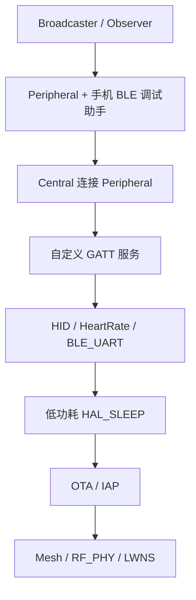
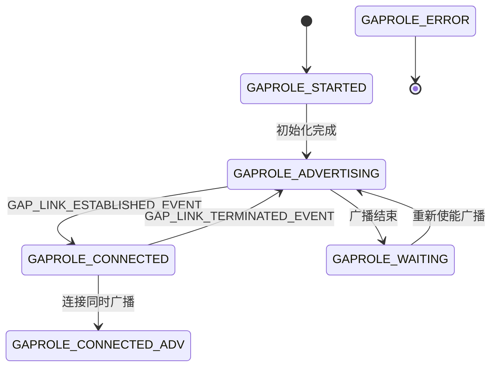
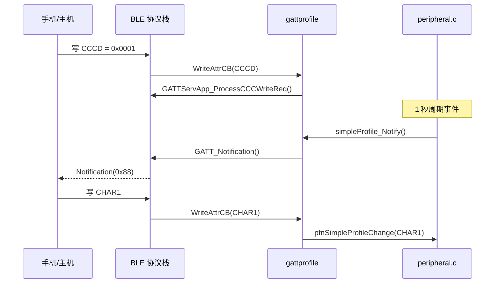
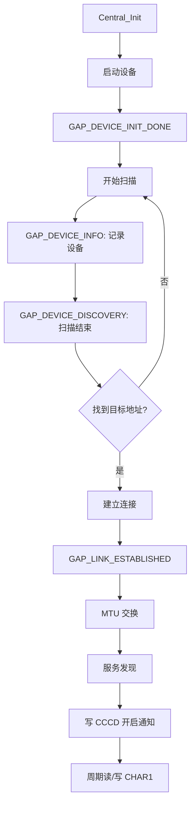
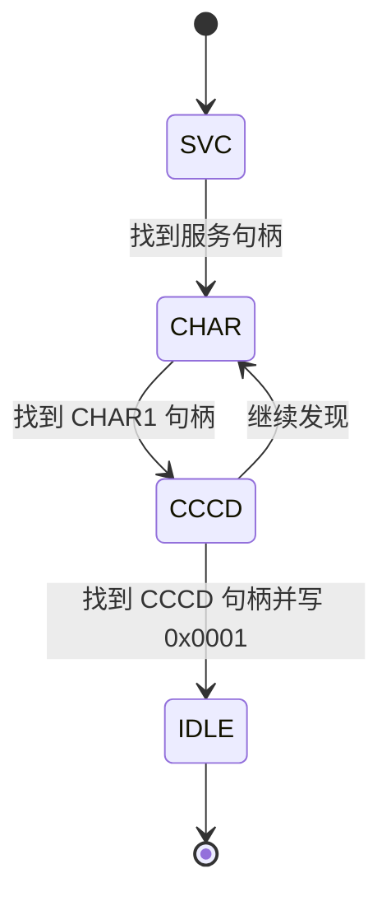
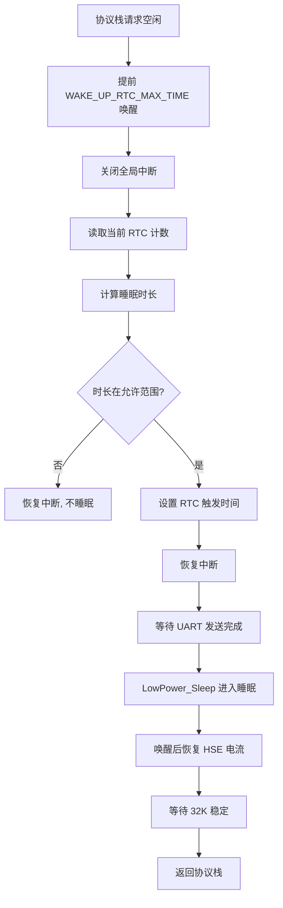
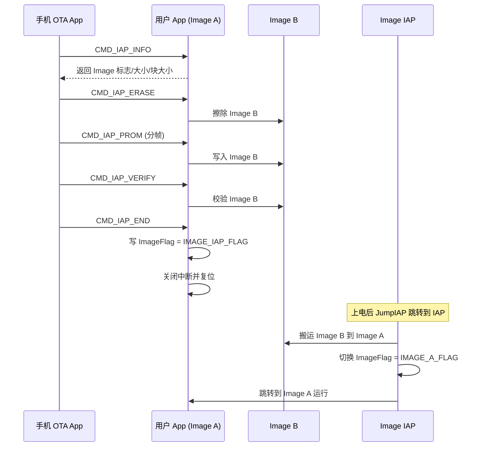

# CH592 BLE 例程分析学习

> 本文基于 `CH592EVT/EXAM/BLE` 目录下的官方 EVT 源码整理，重点分析 CH592 的 BLE 软件架构、TMOS 任务模型、Peripheral/Central 主从机例程、HID、标准 Profile、低功耗、OTA/IAP、Mesh 与 RF 相关例程。
>
> 代码版本参考：`CH59x_BLE_LIB_V1.4`（`CH59xBLE_LIB.h` 中的 `VER_FILE`），EVT 目录说明日期为 2025.11。
>
> 进阶阅读：[CH592 BLE 工作流程深度分析](CH592_BLE工作流程深度分析.md)，按启动、TMOS 调度、广播/连接、GATT 收发、低功耗、OTA、HID、Mesh 等流程逐层拆解调用链。

---

## 1. CH592EVT 目录与平台概览

### 1.1 顶层目录

```text
CH592EVT
├─ EXAM
│  ├─ SRC                 内核启动、链接脚本、标准外设驱动
│  ├─ BLE                 BLE 协议栈库、HAL、全部 BLE 例程
│  ├─ ADC / I2C / SPI ... 其他外设例程
├─ PUB                    评估板原理图、说明书
├─ CH592_List.txt         例程目录说明（中文）
└─ CH592_List_EN.txt      例程目录说明（英文）
```

BLE 相关的核心目录：

```text
EXAM/BLE
├─ HAL                    BLE 例程共用硬件抽象层
│  ├─ MCU.c               BLE 库初始化、HAL 任务、温度采样
│  ├─ RTC.c               RTC/TMOS 时基初始化
│  ├─ SLEEP.c             低功耗睡眠入口
│  ├─ KEY.c / LED.c       按键、LED
│  └─ include/CONFIG.h    全局配置宏
├─ LIB
│  ├─ libCH59xBLE.a       BLE 协议栈静态库
│  ├─ CH59xBLE_LIB.h      API 与协议栈常量
│  ├─ CH59xBLE_ROM.h      ROM 版本库头文件
│  ├─ CH59xBLE_ROM*.hex   ROM 版本相关镜像
│  └─ ble_task_scheduler.S
├─ Peripheral             从机角色 + 自定义 GATT 服务（最核心入门例程）
├─ Central                主机角色 + 服务发现/读写
├─ HID_Keyboard           蓝牙键盘（HID over GATT）
├─ HeartRate              标准心率计 Profile
├─ BLE_UART               蓝牙串口透传
├─ BackupUpgrade_OTA      A/B 双备份 OTA
├─ MESH                   低功耗蓝牙 Mesh
├─ RF_PHY                 非标准 2.4G 收发
└─ LWNS                   轻量级无线网络协议栈
```

### 1.2 CH592 关键资源

| 项目         | 典型值 / 说明                                             |
| ------------ | --------------------------------------------------------- |
| 内核         | 32 位 RISC-V，最高 60MHz                                  |
| Flash        | 448KB（OTA 例程按 4K + 216K + 216K + 12K 划分）           |
| RAM          | 26KB（普通工程链接脚本 `Ld/Link.ld`）                     |
| BLE 特性     | 1M/2M PHY、扩展广播、周期广播、CTE 等，具体以库头文件为准 |
| 协议栈 RAM   | `BLE_MEMHEAP_SIZE`，默认 `1024 * 6`                       |
| 默认 ATT MTU | 23（`BLE_BUFF_MAX_LEN = 27`）                             |
| 默认发射功率 | 0dBm（`LL_TX_POWEER_0_DBM`）                              |
| 调试串口     | UART1，PA9(TXD)，默认 115200                              |

> 注意：CH592 的 BLE 协议栈以静态库形式提供，应用层通过 `GAPRole_*`、`GATT_*`、`GAPBondMgr_*` 等 API 使用协议栈。绝大多数例程不需要直接操作 Link Layer。

---

## 2. BLE 例程全景与学习路线

### 2.1 按功能分类

| 分类          | 例程                                         | 学习重点                         |
| ------------- | -------------------------------------------- | -------------------------------- |
| 四种 GAP 角色 | `Broadcaster`                                | 只广播，不连接；广播数据格式     |
|               | `Observer`                                   | 只扫描，不连接；扫描结果处理     |
|               | `Peripheral`                                 | 从机广播、连接、GATT 服务、通知  |
|               | `Central`                                    | 主机扫描、连接、服务发现、读写   |
| 多连接        | `CentPeri`                                   | 主从一体                         |
|               | `MultiCentral`                               | 一个主机连多个从机               |
|               | `MultiCentPeri`                              | 多主机 + 多从机                  |
| 标准 Profile  | `HeartRate`                                  | 心率测量、Battery Service        |
|               | `CyclingSensor`                              | 骑行速度/踏频                    |
|               | `RunningSensor`                              | 跑步速度/步频                    |
| HID           | `HID_Keyboard`                               | HID over GATT、报告描述符        |
|               | `HID_Mouse` / `HID_Consumer` / `HID_Touch`   | 鼠标、消费者控制、触摸笔         |
| 透传/组合     | `BLE_UART`                                   | BLE 与 UART 双向透传、MTU 自适应 |
|               | `BLE_USB`                                    | BLE + USB CDC 转发               |
|               | `IoCHub_NET`                                 | BLE + IoChub 灯控                |
| OTA/IAP       | `BackupUpgrade_*`                            | A/B 双备份无线升级               |
|               | `OnlyUpdateApp_*`                            | 固定库、仅更新用户 App           |
|               | `RemoteController_*`                         | 遥控器例程及配套 IAP             |
| Mesh          | `MESH/adv_*`                                 | Mesh 节点、天猫精灵灯、厂商模型  |
|               | `MESH/provisioner_*`                         | Mesh 配网器                      |
| 非标 RF       | `RF_PHY`                                     | 直接使用 2.4G 收发               |
|               | `RF_PHY_Hop`                                 | 跳频收发                         |
|               | `LWNS`                                       | 轻量级无线网络协议栈             |
| 周期广播      | `SYNC_ADV` / `SYNC_SCAN`                     | 周期广播与同步扫描               |
| 性能/测试     | `SpeedTest_Central` / `SpeedTest_Peripheral` | 吞吐量测试                       |
|               | `Direct_Test_Mode`                           | DTM 射频测试                     |
| iOS 通知      | `peripheral_ancs_client`                     | Apple 通知中心服务客户端         |

### 2.2 推荐学习路线



建议先只关注 `Peripheral`，把广播、连接、服务、通知跑通；再对照 `Central` 理解主机侧如何发现服务和写 CCCD；最后再看 HID、OTA、Mesh 等组合型例程。

---

## 3. BLE 工程骨架与运行模型

### 3.1 一个典型 BLE 工程的文件组织

以 `EXAM/BLE/Peripheral` 为例：

```text
Peripheral
├─ APP
│  ├─ peripheral_main.c      main()、MEM_BUF、主循环
│  ├─ peripheral.c           GAP 从机状态机、广播、连接、通知
│  └─ include/peripheral.h   任务事件位、连接信息结构体
├─ Profile
│  ├─ gattprofile.c          自定义 GATT 服务实现
│  ├─ devinfoservice.c       设备信息服务
│  └─ include/
├─ Ld/Link.ld               链接脚本
├─ Startup/startup_CH592.S  启动文件
├─ HAL / LIB / SRC          通过工程链接引用公共目录
└─ Peripheral.wvproj        MounRiver Studio 工程
```

其它例程基本遵循同一结构：

- `xxx_main.c`：入口，初始化 BLE 库、HAL、GAP Role、应用任务。
- `xxx.c`：应用任务事件处理、GAP 回调、定时任务。
- `Profile/`：GATT 服务、标准 Profile 或 HID 设备框架。
- `HAL/`：所有 BLE 例程共用。

### 3.2 `main()` 的固定六步

以 `Peripheral/APP/peripheral_main.c` 为例：

```c
int main(void)
{
#if(defined(DCDC_ENABLE)) && (DCDC_ENABLE == TRUE)
    PWR_DCDCCfg(ENABLE);
#endif
    SetSysClock(CLK_SOURCE_PLL_60MHz);

#if(defined(HAL_SLEEP)) && (HAL_SLEEP == TRUE)
    GPIOA_ModeCfg(GPIO_Pin_All, GPIO_ModeIN_PU);
    GPIOB_ModeCfg(GPIO_Pin_All, GPIO_ModeIN_PU);
#endif

#ifdef DEBUG
    GPIOA_SetBits(bTXD1);
    GPIOA_ModeCfg(bTXD1, GPIO_ModeOut_PP_5mA);
    UART1_DefInit();
#endif

    PRINT("%s\n", VER_LIB);
    CH59x_BLEInit();          // 1. 初始化 BLE 协议栈
    HAL_Init();               // 2. 初始化 HAL 任务、RTC、睡眠、校准
    GAPRole_PeripheralInit(); // 3. 初始化 GAP 从机角色
    Peripheral_Init();        // 4. 初始化应用任务和 GATT 服务
    Main_Circulation();       // 5. 进入 TMOS 主循环
}
```

`Main_Circulation()` 通常只有一句话：

```c
__HIGH_CODE
__attribute__((noinline))
void Main_Circulation()
{
    while(1)
    {
        TMOS_SystemProcess();
    }
}
```

`BLE_UART` 在此基础上增加了串口轮询：

```c
while(1)
{
    TMOS_SystemProcess();
    app_uart_process();
}
```

> 主循环中不能放长阻塞操作。BLE 的连接事件、协议栈定时器都依赖 `TMOS_SystemProcess()` 及时运行。

### 3.3 TMOS 任务与事件模型

CH592 的 BLE 例程使用 TMOS（类似 TI OSAL）作为轻量级任务调度器。

核心 API：

| API                                       | 作用                                |
| ----------------------------------------- | ----------------------------------- |
| `TMOS_ProcessEventRegister(handler)`      | 注册任务事件处理函数，返回 `taskID` |
| `tmos_set_event(taskID, event)`           | 立即触发某个事件                    |
| `tmos_start_task(taskID, event, timeout)` | 延时触发事件，timeout 单位为 625us  |
| `tmos_start_reload_task(...)`             | 周期触发事件                        |
| `tmos_stop_task(taskID, event)`           | 停止某个定时事件                    |
| `tmos_msg_send(taskID, msg)`              | 向任务发送消息                      |
| `tmos_msg_receive(taskID)`                | 接收消息                            |
| `TMOS_SystemProcess()`                    | 主循环中运行调度器                  |

事件位是 16 位位图。每个任务的事件处理函数返回**未处理的事件位**，例如：

```c
uint16_t Peripheral_ProcessEvent(uint8_t task_id, uint16_t events)
{
    if(events & SYS_EVENT_MSG)
    {
        uint8_t *pMsg;
        if((pMsg = tmos_msg_receive(Peripheral_TaskID)) != NULL)
        {
            Peripheral_ProcessTMOSMsg((tmos_event_hdr_t *)pMsg);
            tmos_msg_deallocate(pMsg);
        }
        return (events ^ SYS_EVENT_MSG);
    }

    if(events & SBP_START_DEVICE_EVT)
    {
        GAPRole_PeripheralStartDevice(Peripheral_TaskID,
                                      &Peripheral_BondMgrCBs,
                                      &Peripheral_PeripheralCBs);
        return (events ^ SBP_START_DEVICE_EVT);
    }

    return 0;
}
```

`Peripheral` 例程中定义的应用事件：

| 事件                   |       值 | 作用               |
| ---------------------- | -------: | ------------------ |
| `SBP_START_DEVICE_EVT` | `0x0001` | 启动 GAP 从机设备  |
| `SBP_PERIODIC_EVT`     | `0x0002` | 周期任务，发送通知 |
| `SBP_READ_RSSI_EVT`    | `0x0004` | 周期读取 RSSI      |
| `SBP_PARAM_UPDATE_EVT` | `0x0008` | 请求更新连接参数   |
| `SBP_PHY_UPDATE_EVT`   | `0x0010` | 请求切换 2M PHY    |

时间换算：

```c
#define SYSTEM_TIME_MICROSEN 625
#define MS1_TO_SYSTEM_TIME(x) ((x) * 1000 / 625)
```

例如：

- `SBP_PERIODIC_EVT_PERIOD = 1600` → `1600 × 625us = 1s`
- `SBP_READ_RSSI_EVT_PERIOD = 3200` → `2s`
- `SBP_PARAM_UPDATE_DELAY = 6400` → `4s`
- `tmos_start_task(halTaskID, HAL_REG_INIT_EVENT, 800)` → `500ms`

### 3.4 BLE 协议栈初始化 `CH59x_BLEInit()`

`HAL/MCU.c` 中的 `CH59x_BLEInit()` 是协议栈的初始化入口，主要做：

1. 检查库版本与头文件版本是否一致。
2. 配置 SysTick 和 BLE 中断优先级。
3. 填充 `bleConfig_t`。
4. 配置 SNV（绑定信息存储）。
5. 配置 MAC 地址。
6. 调用 `BLE_LibInit(&cfg)`。

关键配置：

```c
cfg.MEMAddr = (uint32_t)MEM_BUF;
cfg.MEMLen  = BLE_MEMHEAP_SIZE;
cfg.BufMaxLen = BLE_BUFF_MAX_LEN;
cfg.BufNumber = BLE_BUFF_NUM;
cfg.TxNumEvent = BLE_TX_NUM_EVENT;
cfg.TxPower = BLE_TX_POWER;
cfg.ConnectNumber = (PERIPHERAL_MAX_CONNECTION & 3) |
                    (CENTRAL_MAX_CONNECTION << 2);
cfg.srandCB = SYS_GetSysTickCnt;
cfg.tsCB = HAL_GetInterTempValue;
cfg.rcCB = Lib_Calibration_LSI;
cfg.idleCB = CH59x_LowPower;   // HAL_SLEEP == TRUE 时
```

`MEM_BUF` 定义在每个例程的 `main.c` 中：

```c
__attribute__((aligned(4))) uint32_t MEM_BUF[BLE_MEMHEAP_SIZE / 4];
```

> 协议栈的内存堆不由链接器分配，而是由 `MEM_BUF` 提供。默认 6KB，至少需要 4KB。多连接或大 MTU 时需要适当增加。

### 3.5 `CONFIG.h` 常用配置宏

| 宏                          | 默认值                         | 说明                                                 |
| --------------------------- | ------------------------------ | ---------------------------------------------------- |
| `BLE_MAC`                   | `FALSE`                        | 是否使用自定义 MAC                                   |
| `DCDC_ENABLE`               | `FALSE`                        | 是否开启 DCDC                                        |
| `HAL_SLEEP`                 | `FALSE`                        | 是否开启低功耗睡眠                                   |
| `BLE_SNV`                   | `TRUE`                         | 是否保存绑定信息                                     |
| `BLE_SNV_ADDR`              | `0x77000 - FLASH_ROM_MAX_SIZE` | SNV 保存地址                                         |
| `BLE_SNV_BLOCK`             | `256`                          | SNV 块大小                                           |
| `BLE_SNV_NUM`               | `1`                            | SNV 块数量                                           |
| `CLK_OSC32K`                | `1`                            | 32K 时钟选择：0 外部，1 内部 32000Hz，2 内部 32768Hz |
| `BLE_MEMHEAP_SIZE`          | `1024 * 6`                     | BLE 协议栈 RAM                                       |
| `BLE_BUFF_MAX_LEN`          | `27`                           | 单包最大长度，27 对应 ATT MTU 23                     |
| `BLE_BUFF_NUM`              | `5`                            | 控制器缓存包数量                                     |
| `BLE_TX_NUM_EVENT`          | `1`                            | 每个连接事件最多发送包数                             |
| `BLE_TX_POWER`              | `LL_TX_POWEER_0_DBM`           | 发射功率                                             |
| `TEM_SAMPLE`                | `TRUE`                         | 温度变化校准                                         |
| `BLE_CALIBRATION_ENABLE`    | `TRUE`                         | 定时校准 RF                                          |
| `BLE_CALIBRATION_PERIOD`    | `120000`                       | 校准周期 120s                                        |
| `PERIPHERAL_MAX_CONNECTION` | `1`                            | 最多从机连接数                                       |
| `CENTRAL_MAX_CONNECTION`    | `3`                            | 最多主机连接数                                       |

> `CLK_OSC32K` 的注释明确要求：**不要直接在 `CONFIG.h` 中改**，而应在 MounRiver Studio 工程的预处理宏中修改。包含主机角色的工程必须使用外部 32K 晶振。

---

## 4. BLE 核心概念与代码映射

### 4.1 四种 GAP 角色

| 角色        | 例程          | 行为                               |
| ----------- | ------------- | ---------------------------------- |
| Broadcaster | `Broadcaster` | 只发送广播，不接收连接             |
| Observer    | `Observer`    | 只扫描广播，不发起连接             |
| Peripheral  | `Peripheral`  | 广播并接受连接，通常是 GATT Server |
| Central     | `Central`     | 扫描并主动连接，通常是 GATT Client |

主从机例程的主函数差异：

```c
// Broadcaster
CH59x_BLEInit();
HAL_Init();
GAPRole_BroadcasterInit();
Broadcaster_Init();

// Observer
CH59x_BLEInit();
HAL_Init();
GAPRole_ObserverInit();
Observer_Init();

// Peripheral
CH59x_BLEInit();
HAL_Init();
GAPRole_PeripheralInit();
Peripheral_Init();

// Central
CH59x_BLEInit();
HAL_Init();
GAPRole_CentralInit();
Central_Init();
```

### 4.2 广播数据格式

以 `Peripheral` 的 `advertData` 为例：

```c
static uint8_t advertData[] = {
    // Flags
    0x02,
    GAP_ADTYPE_FLAGS,
    DEFAULT_DISCOVERABLE_MODE | GAP_ADTYPE_FLAGS_BREDR_NOT_SUPPORTED,

    // 16-bit Service UUID
    0x03,
    GAP_ADTYPE_16BIT_MORE,
    LO_UINT16(SIMPLEPROFILE_SERV_UUID),
    HI_UINT16(SIMPLEPROFILE_SERV_UUID)
};
```

广播数据采用 **Length + AD Type + AD Data** 格式：

| 字节                                | 含义                                   |
| ----------------------------------- | -------------------------------------- |
| `0x02`                              | 后续长度：AD Type 1 字节 + 数据 1 字节 |
| `GAP_ADTYPE_FLAGS`                  | 广播标志类型                           |
| `0x06`                              | 通用可发现 + 不支持 BR/EDR             |
| `0x03`                              | 后续长度：AD Type 1 字节 + UUID 2 字节 |
| `GAP_ADTYPE_16BIT_MORE`             | 16-bit Service UUID，不完整列表        |
| `LO_UINT16(...)` / `HI_UINT16(...)` | 小端 UUID                              |

扫描响应 `scanRspData` 中放置完整设备名、连接间隔范围、发射功率等。

传统广播包和扫描响应包各自最大 31 字节。设备名较长时通常放在扫描响应中。

### 4.3 扫描与连接

`Central` 的流程：

1. `GAPRole_CentralStartDiscovery()` 开始扫描。
2. 收到 `GAP_DEVICE_INFO_EVENT`，把设备地址加入列表。
3. 收到 `GAP_DEVICE_DISCOVERY_EVENT`，在列表中查找目标地址。
4. 找到后调用 `GAPRole_CentralEstablishLink()`。
5. 同时启动 `ESTABLISH_LINK_TIMEOUT_EVT`，防止连接一直不返回。

目标地址定义：

```c
static uint8_t PeerAddrDef[B_ADDR_LEN] = {0x02, 0x02, 0x03, 0xE4, 0xC2, 0x84};
```

这是小端存储，对应实际地址 `84:C2:E4:03:02:02`。

> 使用 `Central` 例程时，必须把 `PeerAddrDef` 改成目标从机的实际地址。

### 4.4 连接参数

| 参数                 | 单位       | 说明                   |
| -------------------- | ---------- | ---------------------- |
| Connection Interval  | 1.25ms     | 连接事件周期           |
| Slave Latency        | 连接事件数 | 从机可跳过的连接事件数 |
| Supervision Timeout  | 10ms       | 超时断连               |
| Advertising Interval | 0.625ms    | 广播周期               |
| Scan Duration        | 0.625ms    | 扫描持续时间           |

`Peripheral` 默认值：

```c
#define DEFAULT_DESIRED_MIN_CONN_INTERVAL 6    // 7.5ms
#define DEFAULT_DESIRED_MAX_CONN_INTERVAL 100  // 125ms
#define DEFAULT_DESIRED_SLAVE_LATENCY     0
#define DEFAULT_DESIRED_CONN_TIMEOUT      100  // 1s
```

连接建立后，从机会延时一段时间再请求更新参数：

```c
tmos_start_task(Peripheral_TaskID, SBP_PARAM_UPDATE_EVT, SBP_PARAM_UPDATE_DELAY);
```

对应事件处理：

```c
GAPRole_PeripheralConnParamUpdateReq(peripheralConnList.connHandle,
                                     DEFAULT_DESIRED_MIN_CONN_INTERVAL,
                                     DEFAULT_DESIRED_MAX_CONN_INTERVAL,
                                     DEFAULT_DESIRED_SLAVE_LATENCY,
                                     DEFAULT_DESIRED_CONN_TIMEOUT,
                                     Peripheral_TaskID);
```

### 4.5 GATT 层次结构

```text
Service（服务，例如 0xFFE0）
├─ Characteristic 1（声明 + 值 + 可选描述符）
├─ Characteristic 2
│  ├─ Characteristic Declaration
│  ├─ Characteristic Value
│  ├─ Client Characteristic Configuration（CCCD）
│  └─ User Description
└─ ...
```

`Peripheral` 的 `gattprofile.c` 中，属性表 `simpleProfileAttrTbl[]` 决定服务结构：

| 属性                         | 权限       | 作用          |
| ---------------------------- | ---------- | ------------- |
| Primary Service              | Read       | 服务声明      |
| Characteristic Declaration   | Read       | 属性、值句柄  |
| Characteristic Value         | Read/Write | 实际数据      |
| Client Characteristic Config | Read/Write | 通知/指示开关 |
| User Description             | Read       | 用户可读描述  |

### 4.6 CCCD 与通知

CCCD 是 Client Characteristic Configuration Descriptor，用于让客户端开关通知或指示。

从机需要为每个连接维护一份 CCCD：

```c
static gattCharCfg_t simpleProfileChar4Config[PERIPHERAL_MAX_CONNECTION];
```

初始化：

```c
GATTServApp_InitCharCfg(INVALID_CONNHANDLE, simpleProfileChar4Config);
```

写 CCCD 时由 GATT Server App 处理：

```c
case GATT_CLIENT_CHAR_CFG_UUID:
    status = GATTServApp_ProcessCCCWriteReq(connHandle, pAttr, pValue, len,
                                            offset, GATT_CLIENT_CFG_NOTIFY);
    break;
```

发送通知前先检查 CCCD：

```c
bStatus_t simpleProfile_Notify(uint16_t connHandle, attHandleValueNoti_t *pNoti)
{
    uint16_t value = GATTServApp_ReadCharCfg(connHandle, simpleProfileChar4Config);

    if(value & GATT_CLIENT_CFG_NOTIFY)
    {
        pNoti->handle = simpleProfileAttrTbl[SIMPLEPROFILE_CHAR4_VALUE_POS].handle;
        return GATT_Notification(connHandle, pNoti, FALSE);
    }
    return bleIncorrectMode;
}
```

连接断开时需要清除 CCCD：

```c
GATTServApp_InitCharCfg(connHandle, simpleProfileChar4Config);
```

### 4.7 MTU 与通知长度

默认：

```text
ATT_MTU = 23
通知最大负载 = MTU - 3 = 20 字节
```

`BLE_BUFF_MAX_LEN` 默认 27，包含 4 字节协议头，因此对应 MTU 23。

如果要提高吞吐量：

```c
#define BLE_BUFF_MAX_LEN 251   // 对应 MTU 247
```

主机连接后主动发起 MTU 交换：

```c
attExchangeMTUReq_t req = {
    .clientRxMTU = BLE_BUFF_MAX_LEN - 4,
};
GATT_ExchangeMTU(centralConnHandle, &req, centralTaskId);
```

从机在 `ATT_MTU_UPDATED_EVENT` 中记录协商结果：

```c
if(pMsgEvent->method == ATT_MTU_UPDATED_EVENT)
{
    peripheralMTU = pMsgEvent->msg.exchangeMTUReq.clientRxMTU;
}
```

发送通知前检查长度：

```c
if(len > (peripheralMTU - 3))
{
    PRINT("Too large noti\n");
    return;
}
```

### 4.8 配对与绑定

`GAPBondMgr` 负责配对、加密、绑定信息存储。

从机典型配置：

```c
uint32_t passkey = 0;
uint8_t pairMode = GAPBOND_PAIRING_MODE_WAIT_FOR_REQ;
uint8_t mitm = TRUE;
uint8_t ioCap = GAPBOND_IO_CAP_DISPLAY_ONLY;
uint8_t bonding = TRUE;

GAPBondMgr_SetParameter(GAPBOND_PERI_DEFAULT_PASSCODE, sizeof(uint32_t), &passkey);
GAPBondMgr_SetParameter(GAPBOND_PERI_PAIRING_MODE, sizeof(uint8_t), &pairMode);
GAPBondMgr_SetParameter(GAPBOND_PERI_MITM_PROTECTION, sizeof(uint8_t), &mitm);
GAPBondMgr_SetParameter(GAPBOND_PERI_IO_CAPABILITIES, sizeof(uint8_t), &ioCap);
GAPBondMgr_SetParameter(GAPBOND_PERI_BONDING_ENABLED, sizeof(uint8_t), &bonding);
```

绑定信息通过 SNV 保存到 DataFlash。`BLE_SNV_ADDR` 必须避开 BLE 协议栈和其他数据区域。

---

## 5. Peripheral 例程精读

### 5.1 文件职责

| 文件                       | 职责                             |
| -------------------------- | -------------------------------- |
| `APP/peripheral_main.c`    | `main()`、`MEM_BUF`、主循环      |
| `APP/peripheral.c`         | GAP 从机状态机、广播、连接、通知 |
| `APP/include/peripheral.h` | 事件位、连接信息结构体           |
| `Profile/gattprofile.c`    | 自定义服务 FFE0，特征 FFE1~FFE5  |
| `Profile/devinfoservice.c` | 设备信息服务                     |
| `HAL/*`                    | 公共硬件抽象                     |

### 5.2 广播数据与设备名

```c
static uint8_t attDeviceName[GAP_DEVICE_NAME_LEN] = "Simple Peripheral";
```

扫描响应中包含完整设备名、连接间隔范围、发射功率。

广播数据中包含：

- Flags
- 16-bit Service UUID `0xFFE0`

### 5.3 `Peripheral_Init()` 初始化流程

```text
注册 TMOS 任务
  ↓
设置 GAPRole 参数：广播使能、广播数据、扫描响应、连接间隔
  ↓
设置 GAP 参数：广播间隔、扫描请求通知
  ↓
配置 Bond Manager：passkey、配对模式、MITM、IO 能力、绑定
  ↓
注册 GATT 服务：GGS、GATTServApp、DevInfo、SimpleProfile
  ↓
设置设备名和各特征初值
  ↓
初始化连接信息
  ↓
注册应用回调和广播回调
  ↓
触发 SBP_START_DEVICE_EVT
```

关键代码：

```c
GAPRole_SetParameter(GAPROLE_ADVERT_ENABLED, sizeof(uint8_t), &initial_advertising_enable);
GAPRole_SetParameter(GAPROLE_SCAN_RSP_DATA, sizeof(scanRspData), scanRspData);
GAPRole_SetParameter(GAPROLE_ADVERT_DATA, sizeof(advertData), advertData);
GAPRole_SetParameter(GAPROLE_MIN_CONN_INTERVAL, sizeof(uint16_t), &desired_min_interval);
GAPRole_SetParameter(GAPROLE_MAX_CONN_INTERVAL, sizeof(uint16_t), &desired_max_interval);

GAP_SetParamValue(TGAP_DISC_ADV_INT_MIN, advInt);
GAP_SetParamValue(TGAP_DISC_ADV_INT_MAX, advInt);
GAP_SetParamValue(TGAP_ADV_SCAN_REQ_NOTIFY, ENABLE);
```

添加服务：

```c
GGS_AddService(GATT_ALL_SERVICES);           // GAP
GATTServApp_AddService(GATT_ALL_SERVICES);   // GATT
DevInfo_AddService();                        // Device Information
SimpleProfile_AddService(GATT_ALL_SERVICES); // 自定义服务
```

### 5.4 GAP 状态机

`peripheralStateNotificationCB()` 根据 `newState & GAPROLE_STATE_ADV_MASK` 处理状态：



主要事件：

| 状态                  | 事件                               | 处理                       |
| --------------------- | ---------------------------------- | -------------------------- |
| `GAPROLE_STARTED`     | 初始化完成                         | 打印 `Initialized`         |
| `GAPROLE_ADVERTISING` | `GAP_MAKE_DISCOVERABLE_DONE_EVENT` | 打印 `Advertising`         |
| `GAPROLE_ADVERTISING` | `GAP_LINK_TERMINATED_EVENT`        | 清理连接并重新广播         |
| `GAPROLE_CONNECTED`   | `GAP_LINK_ESTABLISHED_EVENT`       | 保存连接句柄、启动定时任务 |
| `GAPROLE_WAITING`     | `GAP_LINK_ESTABLISHED_EVENT`       | 根据状态判断是否失败       |
| `GAPROLE_ERROR`       | -                                  | 打印错误                   |

### 5.5 连接建立后的动作

```c
peripheralConnList.connHandle = event->connectionHandle;
peripheralConnList.connInterval = event->connInterval;
peripheralConnList.connSlaveLatency = event->connLatency;
peripheralConnList.connTimeout = event->connTimeout;
peripheralMTU = ATT_MTU_SIZE;

// 周期通知
tmos_start_task(Peripheral_TaskID, SBP_PERIODIC_EVT, SBP_PERIODIC_EVT_PERIOD);
// 请求更新连接参数
tmos_start_task(Peripheral_TaskID, SBP_PARAM_UPDATE_EVT, SBP_PARAM_UPDATE_DELAY);
// 周期读取 RSSI
tmos_start_task(Peripheral_TaskID, SBP_READ_RSSI_EVT, SBP_READ_RSSI_EVT_PERIOD);
```

如果已经连接，还会拒绝新的连接：

```c
if(peripheralConnList.connHandle != GAP_CONNHANDLE_INIT)
{
    GAPRole_TerminateLink(pEvent->linkCmpl.connectionHandle);
    PRINT("Connection max...\n");
}
```

### 5.6 周期通知

`performPeriodicTask()` 每秒发送一次 `0x88`：

```c
static void performPeriodicTask(void)
{
    uint8_t notiData[SIMPLEPROFILE_CHAR4_LEN] = {0x88};
    peripheralChar4Notify(notiData, SIMPLEPROFILE_CHAR4_LEN);
}
```

`peripheralChar4Notify()` 展示了标准的通知发送流程：

```c
attHandleValueNoti_t noti;
if(len > (peripheralMTU - 3))
{
    PRINT("Too large noti\n");
    return;
}

noti.len = len;
noti.pValue = GATT_bm_alloc(peripheralConnList.connHandle,
                            ATT_HANDLE_VALUE_NOTI, noti.len, NULL, 0);
if(noti.pValue)
{
    tmos_memcpy(noti.pValue, pValue, noti.len);
    if(simpleProfile_Notify(peripheralConnList.connHandle, &noti) != SUCCESS)
    {
        GATT_bm_free((gattMsg_t *)&noti, ATT_HANDLE_VALUE_NOTI);
    }
}
```

> 通知数据必须通过 `GATT_bm_alloc()` 从协议栈内存池分配，失败时释放。不要传栈上的临时缓冲区指针。

### 5.7 自定义 GATT 服务 FFE0

`Profile/include/gattprofile.h`：

```c
#define SIMPLEPROFILE_SERV_UUID     0xFFE0

#define SIMPLEPROFILE_CHAR1_UUID    0xFFE1
#define SIMPLEPROFILE_CHAR2_UUID    0xFFE2
#define SIMPLEPROFILE_CHAR3_UUID    0xFFE3
#define SIMPLEPROFILE_CHAR4_UUID    0xFFE4
#define SIMPLEPROFILE_CHAR5_UUID    0xFFE5

#define SIMPLEPROFILE_CHAR1_LEN     1
#define SIMPLEPROFILE_CHAR2_LEN     1
#define SIMPLEPROFILE_CHAR3_LEN     1
#define SIMPLEPROFILE_CHAR4_LEN     1
#define SIMPLEPROFILE_CHAR5_LEN     5
```

五个特征的属性：

| 特征  | 属性         | 权限                      | 长度 | 说明           |
| ----- | ------------ | ------------------------- | ---: | -------------- |
| CHAR1 | Read + Write | 可读可写                  |    1 | 读写测试       |
| CHAR2 | Read         | 只读                      |    1 | 只读测试       |
| CHAR3 | Write        | 只写                      |    1 | 只写测试       |
| CHAR4 | Notify       | 通知                      |    1 | 周期通知       |
| CHAR5 | Read         | `GATT_PERMIT_AUTHEN_READ` |    5 | 需要认证才能读 |

属性表片段：

```c
static gattAttribute_t simpleProfileAttrTbl[] = {
    // Service
    {
        {ATT_BT_UUID_SIZE, primaryServiceUUID},
        GATT_PERMIT_READ,
        0,
        (uint8_t *)&simpleProfileService
    },

    // Characteristic 1 Declaration
    {
        {ATT_BT_UUID_SIZE, characterUUID},
        GATT_PERMIT_READ,
        0,
        &simpleProfileChar1Props
    },

    // Characteristic 1 Value
    {
        {ATT_BT_UUID_SIZE, simpleProfilechar1UUID},
        GATT_PERMIT_READ | GATT_PERMIT_WRITE,
        0,
        simpleProfileChar1
    },

    // Characteristic 1 User Description
    {
        {ATT_BT_UUID_SIZE, charUserDescUUID},
        GATT_PERMIT_READ,
        0,
        simpleProfileChar1UserDesp
    },

    // ... CHAR2 ~ CHAR5
};
```

### 5.8 读写回调

读回调根据 UUID 返回对应特征值，并处理 `maxLen`：

```c
case SIMPLEPROFILE_CHAR1_UUID:
    if(maxLen > SIMPLEPROFILE_CHAR1_LEN)
    {
        *pLen = SIMPLEPROFILE_CHAR1_LEN;
    }
    else
    {
        *pLen = maxLen;
    }
    tmos_memcpy(pValue, pAttr->pValue, *pLen);
    break;
```

写回调校验长度、写入值，并通知应用层：

```c
if(status == SUCCESS)
{
    tmos_memcpy(pAttr->pValue, pValue, SIMPLEPROFILE_CHAR1_LEN);
    notifyApp = SIMPLEPROFILE_CHAR1;
}
```

最后触发应用回调：

```c
if((notifyApp != 0xFF) && simpleProfile_AppCBs &&
   simpleProfile_AppCBs->pfnSimpleProfileChange)
{
    simpleProfile_AppCBs->pfnSimpleProfileChange(notifyApp, pValue, len);
}
```

### 5.9 数据流



### 5.10 可做的实验

1. 修改 `attDeviceName` 和广播数据，观察手机端名称变化。
2. 修改 `SBP_PERIODIC_EVT_PERIOD`，观察通知频率。
3. 把 CHAR4 的通知长度从 1 字节改成多字节，配合 MTU 交换观察限制。
4. 用手机 BLE 调试助手读 CHAR5，验证认证读权限。
5. 修改 `DEFAULT_ADVERTISING_INTERVAL`，观察广播间隔和功耗。

---

## 6. Central 例程精读

### 6.1 主机流程



### 6.2 初始化

```c
centralTaskId = TMOS_ProcessEventRegister(Central_ProcessEvent);

GAP_SetParamValue(TGAP_DISC_SCAN, DEFAULT_SCAN_DURATION);
GAP_SetParamValue(TGAP_CONN_EST_INT_MIN, DEFAULT_MIN_CONNECTION_INTERVAL);
GAP_SetParamValue(TGAP_CONN_EST_INT_MAX, DEFAULT_MAX_CONNECTION_INTERVAL);
GAP_SetParamValue(TGAP_CONN_EST_SUPERV_TIMEOUT, DEFAULT_CONNECTION_TIMEOUT);

GATT_InitClient();
GATT_RegisterForInd(centralTaskId);
tmos_set_event(centralTaskId, START_DEVICE_EVT);
```

### 6.3 扫描与连接

```c
case GAP_DEVICE_INIT_DONE_EVENT:
    GAPRole_CentralStartDiscovery(DEFAULT_DISCOVERY_MODE,
                                  DEFAULT_DISCOVERY_ACTIVE_SCAN,
                                  DEFAULT_DISCOVERY_WHITE_LIST);
    break;

case GAP_DEVICE_INFO_EVENT:
    centralAddDeviceInfo(pEvent->deviceInfo.addr, pEvent->deviceInfo.addrType);
    break;

case GAP_DEVICE_DISCOVERY_EVENT:
    for(i = 0; i < centralScanRes; i++)
    {
        if(tmos_memcmp(PeerAddrDef, centralDevList[i].addr, B_ADDR_LEN))
            break;
    }

    if(i == centralScanRes)
    {
        centralScanRes = 0;
        GAPRole_CentralStartDiscovery(...);
    }
    else
    {
        GAPRole_CentralEstablishLink(DEFAULT_LINK_HIGH_DUTY_CYCLE,
                                     DEFAULT_LINK_WHITE_LIST,
                                     centralDevList[i].addrType,
                                     centralDevList[i].addr);
        tmos_start_task(centralTaskId, ESTABLISH_LINK_TIMEOUT_EVT,
                        ESTABLISH_LINK_TIMEOUT);
    }
    break;
```

### 6.4 连接后动作

```c
centralState = BLE_STATE_CONNECTED;
centralConnHandle = pEvent->linkCmpl.connectionHandle;
centralProcedureInProgress = TRUE;

attExchangeMTUReq_t req = {
    .clientRxMTU = BLE_BUFF_MAX_LEN - 4,
};
GATT_ExchangeMTU(centralConnHandle, &req, centralTaskId);

tmos_start_task(centralTaskId, START_SVC_DISCOVERY_EVT, DEFAULT_SVC_DISCOVERY_DELAY);
tmos_start_task(centralTaskId, START_PARAM_UPDATE_EVT, DEFAULT_PARAM_UPDATE_DELAY);
tmos_start_task(centralTaskId, START_PHY_UPDATE_EVT, DEFAULT_PHY_UPDATE_DELAY);
tmos_start_task(centralTaskId, START_READ_RSSI_EVT, DEFAULT_RSSI_PERIOD);
```

### 6.5 服务发现状态机

`centralDiscState` 有三种状态：

| 状态                  | 动作                                       |
| --------------------- | ------------------------------------------ |
| `BLE_DISC_STATE_SVC`  | `GATT_DiscPrimaryServiceByUUID()` 查找服务 |
| `BLE_DISC_STATE_CHAR` | `GATT_ReadUsingCharUUID()` 查找 CHAR1      |
| `BLE_DISC_STATE_CCCD` | `GATT_ReadUsingCharUUID()` 查找 CCCD       |



发现服务：

```c
uint8_t uuid[ATT_BT_UUID_SIZE] = {
    LO_UINT16(SIMPLEPROFILE_SERV_UUID),
    HI_UINT16(SIMPLEPROFILE_SERV_UUID)
};

GATT_DiscPrimaryServiceByUUID(centralConnHandle, uuid,
                              ATT_BT_UUID_SIZE, centralTaskId);
```

发现特征：

```c
req.startHandle = centralSvcStartHdl;
req.endHandle = centralSvcEndHdl;
req.type.len = ATT_BT_UUID_SIZE;
req.type.uuid[0] = LO_UINT16(SIMPLEPROFILE_CHAR1_UUID);
req.type.uuid[1] = HI_UINT16(SIMPLEPROFILE_CHAR1_UUID);

GATT_ReadUsingCharUUID(centralConnHandle, &req, centralTaskId);
```

写 CCCD：

```c
req.handle = centralCCCDHdl;
req.len = 2;
req.pValue[0] = 1;
req.pValue[1] = 0;
GATT_WriteCharValue(centralConnHandle, &req, centralTaskId);
```

### 6.6 读写切换

```c
if(centralDoWrite)
{
    attWriteReq_t req;
    req.cmd = FALSE;
    req.sig = FALSE;
    req.handle = centralCharHdl;
    req.len = 1;
    req.pValue = GATT_bm_alloc(centralConnHandle, ATT_WRITE_REQ, req.len, NULL, 0);
    if(req.pValue != NULL)
    {
        *req.pValue = centralCharVal;
        if(GATT_WriteCharValue(centralConnHandle, &req, centralTaskId) == SUCCESS)
        {
            centralProcedureInProgress = TRUE;
            centralDoWrite = !centralDoWrite;
            tmos_start_task(centralTaskId, START_READ_OR_WRITE_EVT,
                            DEFAULT_READ_OR_WRITE_DELAY);
        }
        else
        {
            GATT_bm_free((gattMsg_t *)&req, ATT_WRITE_REQ);
        }
    }
}
else
{
    attReadReq_t req;
    req.handle = centralCharHdl;
    if(GATT_ReadCharValue(centralConnHandle, &req, centralTaskId) == SUCCESS)
    {
        centralProcedureInProgress = TRUE;
        centralDoWrite = !centralDoWrite;
    }
}
```

### 6.7 GATT 消息处理

`centralProcessGATTMsg()` 处理：

- `ATT_EXCHANGE_MTU_RSP` / `ATT_ERROR_RSP`
- `ATT_MTU_UPDATED_EVENT`
- `ATT_READ_RSP` / `ATT_ERROR_RSP`
- `ATT_WRITE_RSP` / `ATT_ERROR_RSP`
- `ATT_HANDLE_VALUE_NOTI`
- 服务发现过程中的 `ATT_FIND_BY_TYPE_VALUE_RSP`、`ATT_READ_BY_TYPE_RSP`

每次处理完 GATT 消息后释放内存：

```c
GATT_bm_free(&pMsg->msg, pMsg->method);
```

> `Central` 与 `Peripheral` 必须配套使用。默认目标地址是 `84:C2:E4:03:02:02`，如果你的从机 MAC 不同，需要修改 `PeerAddrDef`。

---

## 7. HID 键盘例程精读

### 7.1 工程结构

```text
HID_Keyboard
├─ APP
│  ├─ hidkbd_main.c        main()
│  ├─ hidkbd.c             键盘应用逻辑
│  └─ include/
├─ Profile
│  ├─ hidkbdservice.c      HID over GATT 服务
│  ├─ hiddev.c             HID 设备通用框架
│  ├─ battservice.c        电池服务
│  ├─ devinfoservice.c     设备信息服务
│  ├─ scanparamservice.c   扫描参数服务
│  └─ include/
```

主函数：

```c
CH59x_BLEInit();
HAL_Init();
GAPRole_PeripheralInit();
HidDev_Init();
HidEmu_Init();
```

### 7.2 HID 服务

HID 服务包含：

| 特征                 | UUID     | 说明                   |
| -------------------- | -------- | ---------------------- |
| HID Information      | `0x2A4A` | HID 版本、国家码、标志 |
| Report Map           | `0x2A4B` | USB HID 报告描述符     |
| HID Control Point    | `0x2A4C` | 挂起/恢复              |
| Report               | `0x2A4D` | 输入/输出报告          |
| Protocol Mode        | `0x2A4E` | Boot/Report 模式       |
| Boot Keyboard Input  | `0x2A22` | Boot 模式输入          |
| Boot Keyboard Output | `0x2A32` | Boot 模式输出          |

键盘报告描述符关键部分：

```c
static const uint8_t hidReportMap[] = {
    0x05, 0x01,       // Usage Page (Generic Desktop)
    0x09, 0x06,       // Usage (Keyboard)
    0xA1, 0x01,       // Collection (Application)

    0x05, 0x07,       // Usage Page (Key Codes)
    0x19, 0xE0,       // Usage Minimum (224)
    0x29, 0xE7,       // Usage Maximum (231)
    0x15, 0x00,       // Logical Minimum (0)
    0x25, 0x01,       // Logical Maximum (1)
    0x75, 0x01,       // Report Size (1)
    0x95, 0x08,       // Report Count (8)
    0x81, 0x02,       // Input (Data, Variable, Absolute)

    // ... 保留字节、LED 输出、6 字节按键数组

    0xC0              // End Collection
};
```

输入报告为 8 字节：

```text
byte 0: 修饰键
byte 1: 保留
byte 2~7: 6 个按键码
```

### 7.3 发送报告

```c
static void hidEmuSendKbdReport(uint8_t keycode)
{
    uint8_t buf[8];

    buf[0] = 0;       // Modifier
    buf[1] = 0;       // Reserved
    buf[2] = keycode; // Keycode 1
    buf[3] = 0;
    buf[4] = 0;
    buf[5] = 0;
    buf[6] = 0;
    buf[7] = 0;

    HidDev_Report(HID_RPT_ID_KEY_IN, HID_REPORT_TYPE_INPUT, 8, buf);
}
```

周期发送：

```c
if(events & START_REPORT_EVT)
{
    hidEmuSendKbdReport(send_char);
    send_char++;
    if(send_char >= 29)
        send_char = 4;
    hidEmuSendKbdReport(0x00);
    tmos_start_task(hidEmuTaskId, START_REPORT_EVT, 2000);
    return (events ^ START_REPORT_EVT);
}
```

### 7.4 HID 回调

```c
static hidDevCB_t hidEmuHidCBs = {
    hidEmuRptCB,
    hidEmuEvtCB,
    NULL,
    hidEmuStateCB
};

HidDev_Register(&hidEmuCfg, &hidEmuHidCBs);
```

报告回调处理：

- `HID_DEV_OPER_WRITE`：主机写输出报告（例如键盘 LED）。
- `HID_DEV_OPER_READ`：主机读报告。
- `HID_DEV_OPER_ENABLE`：通知被使能，启动发送任务。

```c
else if(oper == HID_DEV_OPER_ENABLE)
{
    tmos_start_task(hidEmuTaskId, START_REPORT_EVT, 500);
}
```

### 7.5 广播与连接

HID 键盘广播数据包含：

- Flags
- Appearance：`GAP_APPEARE_HID_KEYBOARD`
- 扫描响应中包含设备名、连接间隔范围、HID 和 Battery Service UUID

连接后：

```c
hidEmuConnHandle = event->connectionHandle;
tmos_start_task(hidEmuTaskId, START_PARAM_UPDATE_EVT, START_PARAM_UPDATE_EVT_DELAY);
```

`HidDev` 框架内部还会根据绑定数量在快速广播和慢速广播之间切换。

### 7.6 学习要点

- HID 是标准的 GATT 服务，不是自定义协议。
- 报告描述符必须与报告数据格式严格匹配。
- HID 设备通常需要绑定，`HidDev` 会管理配对、加密和报告使能。
- 键盘的按键码和修饰键遵循 USB HID Usage Tables。

---

## 8. 标准 Profile 例程

### 8.1 心率计 `HeartRate`

初始化顺序：

```c
GGS_AddService(GATT_ALL_SERVICES);
GATTServApp_AddService(GATT_ALL_SERVICES);
HeartRate_AddService(GATT_ALL_SERVICES);
DevInfo_AddService();
Batt_AddService();

HeartRate_Register(heartRateCB);
Batt_Register(heartRateBattCB);
```

周期通知：

```c
static void heartRateMeasNotify(void)
{
    heartRateMeas.pValue = GATT_bm_alloc(gapConnHandle,
                                         ATT_HANDLE_VALUE_NOTI,
                                         HEARTRATE_MEAS_LEN, NULL, 0);
    if(heartRateMeas.pValue != NULL)
    {
        uint8_t *p = heartRateMeas.pValue;
        uint8_t flags = heartRateFlags[heartRateFlagsIdx];

        *p++ = flags;
        *p++ = heartRateBpm;

        if(flags & HEARTRATE_FLAGS_FORMAT_UINT16)
        {
            *p++ = 0;
        }
        if(flags & HEARTRATE_FLAGS_ENERGY_EXP)
        {
            *p++ = LO_UINT16(heartRateEnergy);
            *p++ = HI_UINT16(heartRateEnergy);
        }
        if(flags & HEARTRATE_FLAGS_RR)
        {
            *p++ = LO_UINT16(heartRateRrInterval1);
            *p++ = HI_UINT16(heartRateRrInterval1);
            *p++ = LO_UINT16(heartRateRrInterval2);
            *p++ = HI_UINT16(heartRateRrInterval2);
        }

        heartRateMeas.len = (uint8_t)(p - heartRateMeas.pValue);
        if(HeartRate_MeasNotify(gapConnHandle, &heartRateMeas) != SUCCESS)
        {
            GATT_bm_free((gattMsg_t *)&heartRateMeas, ATT_HANDLE_VALUE_NOTI);
        }
    }
}
```

心率转 RR 间期：

```c
#define HEARTRATE_BPM_TO_RR(bpm) ((uint16_t)60 * 1024 / (uint16_t)(bpm))
```

### 8.2 骑行/跑步传感器

`CyclingSensor` 和 `RunningSensor` 与 `HeartRate` 结构类似：

- 都是 Peripheral + 标准 GATT Profile。
- 连接后按周期构造测量数据并发送通知。
- 通常还带 Battery Service 和 Device Information Service。

它们适合作为“传感器类产品”的模板：

1. 替换 Profile 为对应的标准服务。
2. 替换测量数据结构。
3. 替换数据采集逻辑（ADC、传感器 I2C/SPI、定时器等）。
4. 保留广播、连接、通知、电池、OTA 的框架。

### 8.3 常见标准 Profile 与 UUID

| Profile                   | Service UUID | 典型用途             |
| ------------------------- | -----------: | -------------------- |
| Heart Rate                |     `0x180D` | 心率带、手表         |
| Battery                   |     `0x180F` | 电量                 |
| Device Information        |     `0x180A` | 厂商、型号、固件版本 |
| HID                       |     `0x1812` | 键盘、鼠标           |
| Running Speed and Cadence |     `0x1814` | 跑步传感器           |
| Cycling Speed and Cadence |     `0x1816` | 骑行传感器           |
| Scan Parameters           |     `0x1813` | HID 设备扫描参数     |

---

## 9. 低功耗设计

### 9.1 影响功耗的主要因素

| 因素          | 影响                                      |
| ------------- | ----------------------------------------- |
| 广播间隔      | 间隔越短，平均功耗越高                    |
| 广播持续时间  | 有限广播可降低长期功耗                    |
| 连接间隔      | 间隔越长，功耗越低，但延迟越大            |
| Slave Latency | 允许从机跳过连接事件，显著降低功耗        |
| 发射功率      | 0dBm 默认，降低功率可省电但缩短距离       |
| DCDC          | 开启可提高电源效率                        |
| 睡眠          | `HAL_SLEEP` 让 MCU 在空闲时进入低功耗模式 |
| 校准          | 定期校准 RF/32K，单次耗时小于 10ms        |

### 9.2 开启睡眠

在工程预处理宏中定义：

```c
HAL_SLEEP=TRUE
DCDC_ENABLE=TRUE
```

`main()` 中会把所有 GPIO 配置为上拉输入：

```c
GPIOA_ModeCfg(GPIO_Pin_All, GPIO_ModeIN_PU);
GPIOB_ModeCfg(GPIO_Pin_All, GPIO_ModeIN_PU);
```

`HAL_Init()` 中调用 `HAL_SleepInit()`：

```c
R8_SLP_WAKE_CTRL |= RB_SLP_RTC_WAKE; // RTC 唤醒
R8_RTC_MODE_CTRL |= RB_RTC_TRIG_EN;  // 触发模式
PFIC_EnableIRQ(RTC_IRQn);
```

`CH59x_BLEInit()` 把 `cfg.idleCB` 设置为 `CH59x_LowPower`，协议栈空闲时调用。

### 9.3 `CH59x_LowPower()` 流程



关键代码：

```c
if(time <= WAKE_UP_RTC_MAX_TIME)
{
    time = time + (RTC_MAX_COUNT - WAKE_UP_RTC_MAX_TIME);
}
else
{
    time = time - WAKE_UP_RTC_MAX_TIME;
}

SYS_DisableAllIrq(&irq_status);
time_curr = RTC_GetCycle32k();

if(time < time_curr)
{
    time_sleep = time + (RTC_MAX_COUNT - time_curr);
}
else
{
    time_sleep = time - time_curr;
}

if((time_sleep < SLEEP_RTC_MIN_TIME) ||
   (time_sleep > SLEEP_RTC_MAX_TIME))
{
    SYS_RecoverIrq(irq_status);
    return 2;
}

RTC_SetTignTime(time);
SYS_RecoverIrq(irq_status);

LowPower_Sleep(RB_PWR_RAM2K | RB_PWR_RAM24K | RB_PWR_EXTEND | RB_XT_PRE_EN);
HSECFG_Current(HSE_RCur_100);
```

> `LowPower_Sleep()` 的参数决定保留哪些 RAM 和电源域。不同睡眠模式（睡眠/下电/暂停/空闲）的唤醒时间、RAM 保持能力不同，可参考 `EXAM/PM` 例程。

### 9.4 连接参数与功耗的权衡

| 场景                         | 建议                                  |
| ---------------------------- | ------------------------------------- |
| 实时性高（HID、手柄）        | 连接间隔 7.5~15ms，Latency 0          |
| 周期上报（心率、传感器）     | 连接间隔 50~500ms，Latency 可适当增大 |
| 超低功耗（信标、环境传感器） | 长连接间隔 + 大 Latency + 长广播间隔  |
| OTA/吞吐测试                 | 短连接间隔 + 2M PHY + 大 MTU          |

### 9.5 32K 时钟选择

```c
CLK_OSC32K = 0   // 外部 32768Hz
CLK_OSC32K = 1   // 内部 32000Hz（默认）
CLK_OSC32K = 2   // 内部 32768Hz
```

> 包含主机角色的工程必须使用外部 32K，原因是主机需要精确的时序来维持连接和扫描窗口。

### 9.6 校准

`HAL_ProcessEvent()` 中周期执行：

```c
if(events & HAL_REG_INIT_EVENT)
{
    BLE_RegInit();          // 校准 RF
    Lib_Calibration_LSI();  // 校准内部 RC
    tmos_start_task(halTaskID, HAL_REG_INIT_EVENT,
                    MS1_TO_SYSTEM_TIME(BLE_CALIBRATION_PERIOD));
    return (events ^ HAL_REG_INIT_EVENT);
}
```

温度采样回调 `HAL_GetInterTempValue()` 用于温度变化超过阈值时重新校准 RF 和内部 RC。

---

## 10. OTA / IAP 无线升级

CH592 EVT 提供两套无线升级方案。

### 10.1 两套方案对比

| 方案             | 例程                                                                       | 特点                                                                         |
| ---------------- | -------------------------------------------------------------------------- | ---------------------------------------------------------------------------- |
| A/B 双备份升级   | `BackupUpgrade_JumpIAP` + `BackupUpgrade_OTA` + `BackupUpgrade_IAP`        | 新固件先写入备份区，校验后由 IAP 搬运到运行区；可回滚，安全性高              |
| 固定库仅更新 App | `OnlyUpdateApp_JumpIAP` + `OnlyUpdateApp_Peripheral` + `OnlyUpdateApp_IAP` | 用户 App 区域较小，IAP 直接在 App 区升级；结构简单，但升级过程中掉电风险更高 |

### 10.2 A/B 双备份 Flash 布局

`BackupUpgrade_OTA/APP/include/ota.h`：

```c
#define IMAGE_SIZE          216 * 1024

#define IMAGE_A_FLAG         0x01
#define IMAGE_A_START_ADD    4 * 1024
#define IMAGE_A_SIZE         IMAGE_SIZE

#define IMAGE_B_FLAG         0x02
#define IMAGE_B_START_ADD    (IMAGE_A_START_ADD + IMAGE_SIZE)
#define IMAGE_B_SIZE         IMAGE_SIZE

#define IMAGE_IAP_FLAG       0x03
#define IMAGE_IAP_START_ADD  (IMAGE_B_START_ADD + IMAGE_SIZE)
#define IMAGE_IAP_SIZE       12 * 1024
```

布局：

```text
0x00000  +----------------------+
         | JumpIAP (4K)         |  启动后跳转到 0x6D000
0x01000  +----------------------+
         | Image A (216K)       |  正常运行的用户 App
0x37000  +----------------------+
         | Image B (216K)       |  OTA 备份区
0x6D000  +----------------------+
         | Image IAP (12K)      |  搬运/升级程序
0x70000  +----------------------+
```

`BackupUpgrade_JumpIAP/Startup/startup_CH592.S`：

```asm
_start:
    j 0x6D000
```

即上电后直接跳转到 IAP 区。

### 10.3 Image 标志

OTA 信息保存在 DataFlash：

```c
#define OTA_DATAFLASH_ADD  (0x00076000 - FLASH_ROM_MAX_SIZE)

typedef struct
{
    unsigned char ImageFlag;
    unsigned char Revd[3];
} OTADataFlashInfo_t;
```

标志含义：

| 标志             |     值 | 含义                   |
| ---------------- | -----: | ---------------------- |
| `IMAGE_A_FLAG`   | `0x01` | 正常运行 Image A       |
| `IMAGE_B_FLAG`   | `0x02` | Image B 中有待处理固件 |
| `IMAGE_IAP_FLAG` | `0x03` | 需要进入 IAP 搬运固件  |

IAP 启动时读取标志：

```c
void ReadImageFlag(void)
{
    OTADataFlashInfo_t p_image_flash;
    EEPROM_READ(OTA_DATAFLASH_ADD, &p_image_flash, 4);
    CurrImageFlag = p_image_flash.ImageFlag;

    if((CurrImageFlag != IMAGE_A_FLAG) &&
       (CurrImageFlag != IMAGE_B_FLAG) &&
       (CurrImageFlag != IMAGE_IAP_FLAG))
    {
        CurrImageFlag = IMAGE_A_FLAG;
    }
}
```

若标志为 `IMAGE_IAP_FLAG`，IAP 会把 Image B 搬运到 Image A，切换标志为 A，然后跳转到 A：

```c
if(CurrImageFlag == IMAGE_IAP_FLAG)
{
    uint8_t i;
    FLASH_ROM_ERASE(IMAGE_A_START_ADD, IMAGE_A_SIZE);
    for(i = 0; i < IMAGE_A_SIZE / 1024; i++)
    {
        FLASH_ROM_READ(IMAGE_B_START_ADD + (i * 1024), flash_Data, 1024);
        FLASH_ROM_WRITE(IMAGE_A_START_ADD + (i * 1024), flash_Data, 1024);
    }
    SwitchImageFlag(IMAGE_A_FLAG);
    FLASH_ROM_ERASE(IMAGE_B_START_ADD, IMAGE_A_SIZE);
}

jumpApp();
```

### 10.4 OTA 服务

`OTAprofile.c` 使用自定义服务：

```c
#define OTAPROFILE_SERV_UUID    0xFEE0
#define OTAPROFILE_CHAR_UUID    0xFEE1
```

特征属性：

```c
static uint8_t OTAProfileCharProps =
    GATT_PROP_READ | GATT_PROP_WRITE | GATT_PROP_WRITE_NO_RSP;
```

即 OTA 通道同时支持读、写、无响应写。

### 10.5 OTA 协议帧

```c
typedef union
{
    struct
    {
        unsigned char cmd;
        unsigned char len;
        unsigned char addr[2];
        unsigned char block_num[2];
    } erase;

    struct
    {
        unsigned char cmd;
        unsigned char len;
        unsigned char status[2];
    } end;

    struct
    {
        unsigned char cmd;
        unsigned char len;
        unsigned char addr[2];
        unsigned char buf[IAP_LEN - 4];
    } verify;

    struct
    {
        unsigned char cmd;
        unsigned char len;
        unsigned char addr[2];
        unsigned char buf[IAP_LEN - 4];
    } program;

    struct
    {
        unsigned char cmd;
        unsigned char len;
        unsigned char buf[IAP_LEN - 2];
    } info;

    struct
    {
        unsigned char buf[IAP_LEN];
    } other;
} OTA_IAP_CMD_t;
```

命令：

| 命令             |     值 | 说明         |
| ---------------- | -----: | ------------ |
| `CMD_IAP_PROM`   | `0x80` | 编程         |
| `CMD_IAP_ERASE`  | `0x81` | 擦除         |
| `CMD_IAP_VERIFY` | `0x82` | 校验         |
| `CMD_IAP_END`    | `0x83` | 升级结束     |
| `CMD_IAP_INFO`   | `0x84` | 获取设备信息 |

`IAP_LEN` 为 247，与 MTU 247 对应。地址字段按 16 字节单位传输：

```c
OpAdd = (uint32_t)(iap_rec_data.program.addr[0]);
OpAdd |= ((uint32_t)(iap_rec_data.program.addr[1]) << 8);
OpAdd = OpAdd * 16;
OpAdd += IMAGE_A_SIZE;   // 相对地址转换为 Image B 绝对地址
```

### 10.6 OTA 升级流程



结束命令：

```c
case CMD_IAP_END:
{
    DisableAllIRQ();
    SwitchImageFlag(IMAGE_IAP_FLAG);
    mDelaymS(10);
    SYS_ResetExecute();
    break;
}
```

### 10.7 OTA 注意事项

1. **擦除粒度**：`FLASH_ROM_ERASE()` 按块/页操作，地址必须对齐。
2. **先擦后写**：Flash 只能从 1 写 0。
3. **地址校验**：擦除范围不能越过 Image B 边界。
4. **校验**：`FLASH_ROM_VERIFY()` 确认固件完整。
5. **结束前关中断**：避免写标志或复位过程中被中断打断。
6. **DataFlash 地址冲突**：OTA 标志、BLE SNV、用户参数不要重叠。
7. **跳转地址**：JumpIAP 的汇编跳转地址必须与 IAP 链接地址一致。
8. **固件头部**：用户 App 链接地址要与 OTA 布局一致（例如 `0x1000`）。

### 10.8 固定库方案布局

`OnlyUpdateApp_IAP/APP/include/ota.h`：

```c
/* 整个用户 code 区分成四块：4K，44K，16K，128K
   后三块分别叫做 imageA（APP）、imageB（IAP）、LIB */
#define IMAGE_A_START_ADD    0x1000
#define IMAGE_A_SIZE         44 * 1024

#define IMAGE_B_START_ADD    (IMAGE_A_START_ADD + IMAGE_A_SIZE)
#define IMAGE_B_SIZE         16 * 1024

#define IMAGE_OTA_FLAG       0x03
#define jumpApp              ((void (*)(void))((uint32_t *)IMAGE_A_START_ADD))
```

对应 `OnlyUpdateApp_JumpIAP` 启动文件：

```asm
_start:
    j 0xC000
```

即跳转到 `0xC000` 的 IAP。IAP 根据标志决定是直接跳转 App，还是执行升级。

---

## 11. Mesh、LWNS 与 RF_PHY

### 11.1 Mesh 例程结构

```text
MESH
├─ MESH_LIB                Mesh 协议栈库和头文件
├─ adv_ali_light           天猫精灵灯
├─ adv_ali_light_add_lightness
├─ adv_ali_light_add_windspeed
├─ adv_ali_light_multi_element
├─ adv_ali_light_with_peripheral
├─ adv_proxy               代理节点，支持 PB-GATT 配网
├─ adv_vendor              厂商自定义模型
├─ adv_vendor_friend       朋友节点
├─ adv_vendor_low_power    低功耗节点
├─ adv_vendor_self_provision
├─ adv_vendor_self_provision_IAP
├─ provisioner_vendor      配网器
└─ provisioner_vendor_with_peripheral
```

Mesh 例程 `app_main.c` 的初始化：

```c
CH59x_BLEInit();
HAL_Init();
bt_mesh_lib_init();
App_Init();
Main_Circulation();
```

`bt_mesh_lib_init()`：

```c
ret = RF_RoleInit();

#if((CONFIG_BLE_MESH_PROXY) || (CONFIG_BLE_MESH_PB_GATT) || (CONFIG_BLE_MESH_OTA))
ret = GAPRole_PeripheralInit();
#endif

#if(CONFIG_BLE_MESH_PROXY_CLI)
ret = GAPRole_CentralInit();
#endif

MeshTimer_Init();
MeshDeamon_Init();
ble_sm_alg_ecc_init();
```

Mesh 应用通常包含：

| 文件                     | 作用                                      |
| ------------------------ | ----------------------------------------- |
| `app.c`                  | 应用初始化、消息处理                      |
| `app_mesh_config.c`      | Mesh 配置（元素、模型、APPKEY、订阅地址） |
| `app_vendor_model_srv.c` | 厂商模型服务端                            |
| `app_main.c`             | 入口                                      |

### 11.2 Mesh 角色

| 角色        | 说明                                             |
| ----------- | ------------------------------------------------ |
| Node        | 普通 Mesh 节点                                   |
| Provisioner | 配网器，给未配网设备分配地址和密钥               |
| Proxy       | 代理节点，让手机通过 BLE GATT 访问 Mesh          |
| Friend      | 朋友节点，为低功耗节点缓存消息                   |
| LPN         | Low Power Node，低功耗节点，周期性向 Friend 查询 |

### 11.3 LWNS

`LWNS` 是 WCH 提供的轻量级无线网络协议栈，位于 `EXAM/BLE/LWNS`。

支持多种 MAC 适配：

- `lwns_adapter_blemesh_mac.c`：复用 BLE Mesh MAC
- `lwns_adapter_csma_mac.c`：CSMA MAC
- `lwns_adapter_no_mac.c`：无 MAC

示例包括：

| 文件                                          | 说明                  |
| --------------------------------------------- | --------------------- |
| `lwns_broadcast_example.c`                    | 广播                  |
| `lwns_unicast_example.c`                      | 单播                  |
| `lwns_multicast_example.c`                    | 组播                  |
| `lwns_netflood_example.c`                     | 网络泛洪              |
| `lwns_uninetflood_example.c`                  | 单网泛洪              |
| `lwns_multinetflood_example.c`                | 多网泛洪              |
| `lwns_mesh_example.c`                         | Mesh 网络             |
| `lwns_ruc_example.c` / `lwns_rucft_example.c` | 可靠单播/可靠单播分片 |

`app_main.c` 中通过注释切换示例：

```c
lwns_init();

//lwns_broadcast_process_init();
//lwns_multicast_process_init();
//lwns_unicast_process_init();
```

### 11.4 RF_PHY

`RF_PHY` 绕过 BLE 协议栈，直接使用 2.4G 收发。

初始化：

```c
CH59x_BLEInit();
HAL_Init();
RF_RoleInit();
RF_Init();
```

基本 API：

| API                 | 作用                                      |
| ------------------- | ----------------------------------------- |
| `RF_RoleInit()`     | 初始化 RF 角色                            |
| `RF_Config(&cfg)`   | 配置频率、信道、Access Address、CRC、回调 |
| `RF_Tx(buf, len)`   | 发送                                      |
| `RF_Rx(buf, len)`   | 接收                                      |
| `RF_Shut()`         | 关闭 RF                                   |
| `RF_SetChannel()`   | 设置信道                                  |
| `RF_SetFrequency()` | 设置频率                                  |

回调：

```c
void RF_2G4StatusCallBack(uint8_t sta, uint8_t crc, uint8_t *rxBuf)
{
    switch(sta)
    {
        case TX_MODE_TX_FINISH:
        case TX_MODE_TX_FAIL:
        case TX_MODE_RX_DATA:
        case TX_MODE_RX_TIMEOUT:
        case RX_MODE_RX_DATA:
            break;
    }
}
```

注意事项：

- 回调在中断中执行，**不能直接调用 RF 收发 API**，应通过事件/标志通知主循环。
- 等待发送/接收完成时，代码必须运行在 RAM 中（`__HIGH_CODE`），不能执行 Flash 代码，否则影响时序。
- `RF_PHY_Hop` 演示跳频收发。

### 11.5 周期广播同步

- `SYNC_ADV`：广播者发送周期广播。
- `SYNC_SCAN`：观察者扫描并同步到周期广播。

相关 GAP 事件：

```c
GAP_MAKE_PERIODIC_ADV_DONE_EVENT
GAP_SYNC_ESTABLISHED_EVENT
GAP_PERIODIC_ADV_DEVICE_INFO_EVENT
GAP_SYNC_LOST_EVENT
```

适合需要多设备同步采样、同步亮灯等场景。

---

## 12. 编译、烧录与调试

### 12.1 开发环境

- IDE：MounRiver Studio（MRS），基于 Eclipse CDT。
- 工程文件：`.wvproj`、`.cproject`、`.project`。
- 下载工具：WCH-Link。
- 芯片选择：CH592。

### 12.2 工程依赖

以 `Peripheral` 为例，工程会链接公共目录：

```text
APP/include
Profile/include
HAL/include
LIB
Startup
Ld
RVMSIS
StdPeriphDriver/inc
```

链接库：

```text
libCH59xBLE.a
libISP592.a
```

链接脚本：

```text
Ld/Link.ld
```

### 12.3 宏配置

在 MounRiver Studio 中：

```text
Project → Properties → C/C++ General → Path and Symbols → Symbols
```

添加或修改：

```c
DEBUG=1
HAL_SLEEP=TRUE
DCDC_ENABLE=TRUE
CLK_OSC32K=0
BLE_MEMHEAP_SIZE=1024*8
BLE_BUFF_MAX_LEN=251
PERIPHERAL_MAX_CONNECTION=1
CENTRAL_MAX_CONNECTION=3
```

`CONFIG.h` 中多数宏都有 `#ifndef` 保护，工程宏会覆盖默认值。

> `CLK_OSC32K` 的注释要求必须在工程预处理中修改，不要直接改 `CONFIG.h`。

### 12.4 调试串口

默认：

```c
GPIOA_SetBits(bTXD1);
GPIOA_ModeCfg(bTXD1, GPIO_ModeOut_PP_5mA);
UART1_DefInit();
```

- UART1 TX：PA9
- 默认波特率：115200
- `PRINT()` 在 `DEBUG` 宏定义时映射到 `printf`

### 12.5 版本检查

`CH59x_BLEInit()` 会检查：

```c
if(tmos_memcmp(VER_LIB, VER_FILE, strlen(VER_FILE)) == FALSE)
{
    PRINT("head file error...\n");
    while(1);
}
```

如果库文件和头文件版本不一致，程序会停在这里。升级 EVT 时要同时更新 `libCH59xBLE.a` 和 `CH59xBLE_LIB.h`。

### 12.6 下载与运行

1. 连接 WCH-Link。
2. 选择目标芯片 CH592。
3. 编译工程。
4. 下载到 Flash。
5. 复位运行。
6. 用手机 BLE 调试助手或串口助手观察日志。

---

## 13. 实战：新增一个自定义 GATT 服务

下面以在 `Peripheral` 中添加一个 UUID 为 `0xAA00` 的服务为例。

### 13.1 定义 UUID 和参数

```c
#define MY_SERV_UUID     0xAA00
#define MY_CHAR_UUID     0xAA01
#define MY_CHAR_LEN      4
#define MY_SERVICE       0x00000002

#define MY_CHAR         0
```

### 13.2 定义属性和值

```c
static const uint8_t myServUUID[ATT_BT_UUID_SIZE] = {
    LO_UINT16(MY_SERV_UUID), HI_UINT16(MY_SERV_UUID)
};

static const uint8_t myCharUUID[ATT_BT_UUID_SIZE] = {
    LO_UINT16(MY_CHAR_UUID), HI_UINT16(MY_CHAR_UUID)
};

static const gattAttrType_t myService = {
    ATT_BT_UUID_SIZE, myServUUID
};

static uint8_t myCharProps = GATT_PROP_READ | GATT_PROP_NOTIFY;
static uint8_t myCharValue[MY_CHAR_LEN] = {0};
static uint8_t myCharUserDesp[] = "My Characteristic\0";

static gattCharCfg_t myCharConfig[PERIPHERAL_MAX_CONNECTION];
```

### 13.3 属性表

```c
static gattAttribute_t myAttrTbl[] = {
    // Service
    {
        {ATT_BT_UUID_SIZE, primaryServiceUUID},
        GATT_PERMIT_READ,
        0,
        (uint8_t *)&myService
    },

    // Characteristic Declaration
    {
        {ATT_BT_UUID_SIZE, characterUUID},
        GATT_PERMIT_READ,
        0,
        &myCharProps
    },

    // Characteristic Value
    {
        {ATT_BT_UUID_SIZE, myCharUUID},
        GATT_PERMIT_READ,
        0,
        myCharValue
    },

    // CCCD
    {
        {ATT_BT_UUID_SIZE, clientCharCfgUUID},
        GATT_PERMIT_READ | GATT_PERMIT_WRITE,
        0,
        (uint8_t *)myCharConfig
    },

    // User Description
    {
        {ATT_BT_UUID_SIZE, charUserDescUUID},
        GATT_PERMIT_READ,
        0,
        myCharUserDesp
    },
};
```

### 13.4 注册服务

```c
bStatus_t MyService_AddService(uint32_t services)
{
    uint8_t status = SUCCESS;

    GATTServApp_InitCharCfg(INVALID_CONNHANDLE, myCharConfig);

    if(services & MY_SERVICE)
    {
        status = GATTServApp_RegisterService(myAttrTbl,
                                             GATT_NUM_ATTRS(myAttrTbl),
                                             GATT_MAX_ENCRYPT_KEY_SIZE,
                                             &myServiceCBs);
    }

    return status;
}
```

在 `Peripheral_Init()` 中调用：

```c
MyService_AddService(GATT_ALL_SERVICES);
```

### 13.5 发送通知

```c
void MyService_Notify(uint16_t connHandle, uint8_t *data, uint16_t len)
{
    attHandleValueNoti_t noti;
    uint16_t cfg = GATTServApp_ReadCharCfg(connHandle, myCharConfig);

    if((cfg & GATT_CLIENT_CFG_NOTIFY) == 0)
    {
        return;
    }

    if(len > (peripheralMTU - 3))
    {
        return;
    }

    noti.len = len;
    noti.handle = myAttrTbl[2].handle;   // Characteristic Value 的句柄
    noti.pValue = GATT_bm_alloc(connHandle, ATT_HANDLE_VALUE_NOTI, len, NULL, 0);

    if(noti.pValue)
    {
        tmos_memcpy(noti.pValue, data, len);
        if(GATT_Notification(connHandle, &noti, FALSE) != SUCCESS)
        {
            GATT_bm_free((gattMsg_t *)&noti, ATT_HANDLE_VALUE_NOTI);
        }
    }
}
```

### 13.6 手机端验证

1. 编译下载。
2. 用 nRF Connect / WCH BLE 调试助手扫描 `Simple Peripheral`。
3. 连接后找到 UUID `0xAA00` 服务。
4. 打开 `0xAA01` 的 Notify。
5. 触发通知，观察数据。

### 13.7 新增服务检查清单

- [ ] UUID 不与已有服务冲突。
- [ ] 属性表以 Service Declaration 开头。
- [ ] 每个特征都有 Declaration。
- [ ] 通知特征必须有 CCCD。
- [ ] `myCharConfig` 数组大小至少为 `PERIPHERAL_MAX_CONNECTION`。
- [ ] `GATTServApp_InitCharCfg()` 在注册前调用。
- [ ] 通知前检查 CCCD。
- [ ] 通知长度不超过 `MTU - 3`。
- [ ] `GATT_bm_alloc()` 失败时不要继续使用空指针。
- [ ] 断连时重置 CCCD。

---

## 14. 常见问题与注意事项

| 问题                       | 原因 / 解决                                                                 |
| -------------------------- | --------------------------------------------------------------------------- |
| 手机搜不到设备             | 检查广播是否使能、广播数据是否合法、天线/供电                               |
| 连接后马上断开             | 检查连接参数是否超出范围、从机是否主动终止、供电是否稳定                    |
| 收不到通知                 | 客户端没有写 CCCD；检查 `GATT_CLIENT_CFG_NOTIFY`                            |
| 通知发送失败               | 数据长度超过 `MTU - 3`；`GATT_bm_alloc()` 失败                              |
| 主机找不到服务             | UUID 字节序错误；服务未注册；服务发现流程未完成                             |
| 主机连不上                 | `PeerAddrDef` 地址不对；目标设备未广播；地址类型不匹配                      |
| 程序停在 `head file error` | `libCH59xBLE.a` 与 `CH59xBLE_LIB.h` 版本不一致                              |
| 低功耗电流偏大             | `HAL_SLEEP` 未开启；GPIO 未配置；广播间隔太短；调试串口未关闭               |
| 主机角色异常               | 使用了内部 32K；应改为外部 32K                                              |
| 绑定信息丢失               | SNV 地址被擦除或与其它数据冲突                                              |
| 多连接异常                 | `PERIPHERAL_MAX_CONNECTION` / `CENTRAL_MAX_CONNECTION` 配置不足；内存堆太小 |
| OTA 升级失败               | Flash 未擦除、地址不对齐、固件链接地址与 OTA 布局不一致                     |
| OTA 后无法启动             | Image 标志错误；IAP 搬运失败；跳转地址错误                                  |
| RF 收发异常                | 在中断中直接调用 API；等待代码不在 RAM；时序被打断                          |
| Mesh 无法配网              | 未使能 Proxy/PB-GATT；配网器与节点密钥不匹配                                |

### 14.1 事件位冲突

TMOS 事件位是 16 位位图。新增事件时不要与已有事件重复：

```c
#define SBP_START_DEVICE_EVT    0x0001
#define SBP_PERIODIC_EVT        0x0002
#define SBP_READ_RSSI_EVT       0x0004
#define SBP_PARAM_UPDATE_EVT    0x0008
#define SBP_PHY_UPDATE_EVT      0x0010
// 新增事件从 0x0020 开始
```

### 14.2 不要阻塞事件处理

事件处理函数应尽快返回。不要在 GAP/GATT 回调中执行长延时、Flash 擦除、大量打印等操作。耗时操作应拆分为事件或状态机。

### 14.3 GATT 内存管理

- 发送通知/读写请求前使用 `GATT_bm_alloc()` 分配。
- 发送失败后使用 `GATT_bm_free()` 释放。
- 处理完接收到的 GATT 消息后释放 `pMsg`。

### 14.4 广播数据长度

传统广播和扫描响应各最大 31 字节。超过时需要：

- 精简设备名；
- 使用扩展广播；
- 把部分信息放到扫描响应或 GATT 服务中。

### 14.5 MAC 地址字节序

`PeerAddrDef` 和 `MacAddr` 在代码中是**小端**存储。打印或填写手机端地址时要注意反转。

### 14.6 Flash 与 DataFlash

- 代码区、DataFlash、SNV、OTA 标志的地址不能重叠。
- 擦除前确认页/块对齐。
- 写入前必须擦除。
- 掉电前确保关键标志已经写入。

---

## 15. 常用 API 速查

### 15.1 TMOS

| API                                                 | 说明         |
| --------------------------------------------------- | ------------ |
| `TMOS_ProcessEventRegister()`                       | 注册任务     |
| `tmos_set_event()`                                  | 立即触发事件 |
| `tmos_start_task()`                                 | 延时触发     |
| `tmos_start_reload_task()`                          | 周期触发     |
| `tmos_stop_task()`                                  | 停止定时事件 |
| `tmos_msg_send()` / `tmos_msg_receive()`            | 消息         |
| `tmos_memcpy()` / `tmos_memset()` / `tmos_memcmp()` | 内存操作     |
| `TMOS_SystemProcess()`                              | 调度器       |

### 15.2 GAP Role

| API                                      | 说明             |
| ---------------------------------------- | ---------------- |
| `GAPRole_PeripheralInit()`               | 初始化从机角色   |
| `GAPRole_PeripheralStartDevice()`        | 启动从机         |
| `GAPRole_PeripheralConnParamUpdateReq()` | 请求更新连接参数 |
| `GAPRole_CentralInit()`                  | 初始化主机角色   |
| `GAPRole_CentralStartDevice()`           | 启动主机         |
| `GAPRole_CentralStartDiscovery()`        | 开始扫描         |
| `GAPRole_CentralEstablishLink()`         | 建立连接         |
| `GAPRole_BroadcasterInit()`              | 初始化广播者     |
| `GAPRole_BroadcasterStartDevice()`       | 启动广播者       |
| `GAPRole_ObserverInit()`                 | 初始化观察者     |
| `GAPRole_ObserverStartDevice()`          | 启动观察者       |
| `GAPRole_ObserverStartDiscovery()`       | 开始观察扫描     |
| `GAPRole_TerminateLink()`                | 断开连接         |
| `GAPRole_UpdateLink()`                   | 更新连接参数     |
| `GAPRole_UpdatePHY()`                    | 更新 PHY         |
| `GAPRole_ReadRssiCmd()`                  | 读取 RSSI        |

### 15.3 GAP / GGS

| API                      | 说明                   |
| ------------------------ | ---------------------- |
| `GAP_SetParamValue()`    | 设置 GAP 参数          |
| `GAP_GetParamValue()`    | 读取 GAP 参数          |
| `GAP_ConfigDeviceAddr()` | 配置设备地址           |
| `GGS_SetParameter()`     | 设置 GAP GATT 服务参数 |
| `GGS_AddService()`       | 添加 GAP 服务          |

### 15.4 GATT / GATT Server

| API                                  | 说明               |
| ------------------------------------ | ------------------ |
| `GATT_InitClient()`                  | 初始化 GATT Client |
| `GATT_RegisterForInd()`              | 注册通知/指示      |
| `GATT_ExchangeMTU()`                 | MTU 交换           |
| `GATT_DiscPrimaryServiceByUUID()`    | 按 UUID 发现服务   |
| `GATT_ReadUsingCharUUID()`           | 按 UUID 读特征     |
| `GATT_ReadCharValue()`               | 读特征值           |
| `GATT_WriteCharValue()`              | 写特征值           |
| `GATT_WriteNoRsp()`                  | 无响应写           |
| `GATT_Notification()`                | 发送通知           |
| `GATT_Indication()`                  | 发送指示           |
| `GATT_bm_alloc()` / `GATT_bm_free()` | GATT 内存池        |
| `GATTServApp_RegisterService()`      | 注册 GATT 服务     |
| `GATTServApp_AddService()`           | 添加 GATT 服务     |
| `GATTServApp_InitCharCfg()`          | 初始化 CCCD        |
| `GATTServApp_ReadCharCfg()`          | 读取 CCCD          |
| `GATTServApp_ProcessCCCWriteReq()`   | 处理 CCCD 写请求   |

### 15.5 Bond Manager

| API                            | 说明              |
| ------------------------------ | ----------------- |
| `GAPBondMgr_SetParameter()`    | 设置配对/绑定参数 |
| `GAPBondMgr_GetParameter()`    | 读取配对/绑定参数 |
| `GAPBondMgr_PasscodeRsp()`     | 回复 passcode     |
| `GAPBondMgr_PeriSecurityReq()` | 从机发起安全请求  |

### 15.6 RF

| API                                                   | 说明           |
| ----------------------------------------------------- | -------------- |
| `RF_RoleInit()`                                       | 初始化 RF 角色 |
| `RF_Config()`                                         | 配置 RF        |
| `RF_Tx()`                                             | 发送           |
| `RF_Rx()`                                             | 接收           |
| `RF_Shut()`                                           | 关闭 RF        |
| `RF_SetChannel()`                                     | 设置信道       |
| `RF_SetFrequency()`                                   | 设置频率       |
| `RF_FrequencyHoppingTx()` / `RF_FrequencyHoppingRx()` | 跳频收发       |

---

## 16. 学习总结

### 16.1 三条主线

1. **角色主线**：Broadcaster → Observer → Peripheral → Central → 多连接。
2. **数据主线**：广播数据 → 连接 → GATT 服务/特征 → CCCD → 通知/读写。
3. **产品化主线**：低功耗 → 绑定/安全 → OTA → Mesh/传感器/透传。

### 16.2 最值得先读的文件

| 顺序 | 文件                                 | 原因                     |
| ---- | ------------------------------------ | ------------------------ |
| 1    | `Peripheral/APP/peripheral_main.c`   | 最小启动流程             |
| 2    | `Peripheral/APP/peripheral.c`        | 从机状态机和事件模型     |
| 3    | `Peripheral/Profile/gattprofile.c`   | GATT 服务实现模板        |
| 4    | `Central/APP/central.c`              | 主机扫描、连接、服务发现 |
| 5    | `HAL/MCU.c`                          | BLE 库初始化和 HAL       |
| 6    | `HAL/include/CONFIG.h`               | 所有配置宏               |
| 7    | `HID_Keyboard/APP/hidkbd.c`          | HID 应用模板             |
| 8    | `HAL/SLEEP.c`                        | 低功耗入口               |
| 9    | `BackupUpgrade_OTA/APP/peripheral.c` | OTA 实现                 |
| 10   | `MESH/adv_vendor/APP/app_main.c`     | Mesh 启动框架            |

### 16.3 建议的动手实验

1. 用手机 BLE 调试助手连接 `Simple Peripheral`，读/写 FFE1~FFE5。
2. 修改广播名、广播间隔、连接间隔，观察手机端和功耗变化。
3. 新增一个自定义服务和特征，并发送通知。
4. 用两块 CH592 分别运行 `Central` 和 `Peripheral`，完成主从通信。
5. 跑通 `HID_Keyboard`，连接手机或电脑输入字符。
6. 开启 `HAL_SLEEP`，测量不同连接参数下的平均电流。
7. 跑通 `BackupUpgrade_OTA`，观察 Image 标志和 IAP 搬运过程。
8. 尝试 `RF_PHY` 点对点收发，再对比 `BLE_UART` 的透传方式。

---

## 附录：关键源码索引

| 路径                                                        | 说明                   |
| ----------------------------------------------------------- | ---------------------- |
| `CH592EVT/EXAM/BLE/Peripheral/APP/peripheral.c`             | 从机应用               |
| `CH592EVT/EXAM/BLE/Peripheral/Profile/gattprofile.c`        | 自定义 GATT 服务       |
| `CH592EVT/EXAM/BLE/Central/APP/central.c`                   | 主机应用               |
| `CH592EVT/EXAM/BLE/HID_Keyboard/APP/hidkbd.c`               | HID 键盘应用           |
| `CH592EVT/EXAM/BLE/HID_Keyboard/Profile/hiddev.c`           | HID 通用框架           |
| `CH592EVT/EXAM/BLE/HeartRate/APP/heartrate.c`               | 心率计应用             |
| `CH592EVT/EXAM/BLE/BLE_UART/APP/peripheral.c`               | BLE 串口透传           |
| `CH592EVT/EXAM/BLE/HAL/MCU.c`                               | BLE 库初始化、HAL 任务 |
| `CH592EVT/EXAM/BLE/HAL/SLEEP.c`                             | 低功耗睡眠             |
| `CH592EVT/EXAM/BLE/HAL/RTC.c`                               | RTC/TMOS 时基          |
| `CH592EVT/EXAM/BLE/HAL/include/CONFIG.h`                    | 全局配置               |
| `CH592EVT/EXAM/BLE/LIB/CH59xBLE_LIB.h`                      | BLE API 与常量         |
| `CH592EVT/EXAM/BLE/BackupUpgrade_OTA/APP/include/ota.h`     | OTA 布局与协议         |
| `CH592EVT/EXAM/BLE/BackupUpgrade_OTA/APP/peripheral.c`      | OTA 数据处理           |
| `CH592EVT/EXAM/BLE/BackupUpgrade_IAP/APP/peripheral_main.c` | IAP 搬运               |
| `CH592EVT/EXAM/BLE/MESH/adv_vendor/APP/app_main.c`          | Mesh 启动              |
| `CH592EVT/EXAM/BLE/RF_PHY/APP/RF_PHY.c`                     | RF 收发                |
| `CH592EVT/EXAM/BLE/LWNS/APP/app_main.c`                     | LWNS 启动              |

---

> 说明：本文是源码阅读笔记，重点在于建立 CH592 BLE 例程的整体认知和二次开发模板。具体寄存器、时序、射频认证相关细节，请结合 `EXAM/BLE/沁恒低功耗蓝牙软件开发参考手册.PDF`、`WCH蓝牙空中升级（BLE OTA）.PDF` 和芯片数据手册使用。
