# CH592 BLE 工作流程深度分析

> 前置阅读：[CH592 BLE 例程分析学习](CH592_BLE例程分析学习.md)
>
> 本文按“**上电启动 → TMOS 调度 → 广播 → 连接 → GATT 收发 → 主机发现 → 安全 → 低功耗 → OTA → 业务例程**”的顺序，逐层拆解 CH592 BLE 例程的工作流程。
>
> 说明：BLE 协议栈主体位于 `libCH59xBLE.a`，部分内部实现不可见。本文把“**应用可见的调用链和事件**”与“**根据 API 语义推断的协议栈内部行为**”分开描述，凡涉及库内部的地方会明确标注。

---

## 0. 分析边界：三层视角

理解 CH592 BLE 例程，建议分三层看：

```text
┌─────────────────────────────────────────────┐
│ 应用层                                      │
│ main / 应用任务 / 业务状态机 / 定时任务       │
├─────────────────────────────────────────────┤
│ Profile 与 GAP Role 层                      │
│ GAPRole_* / GATT_* / GATTServApp_* / 回调    │
├─────────────────────────────────────────────┤
│ 协议栈与硬件层                              │
│ libCH59xBLE.a / LLE IRQ / RF / RTC / Flash  │
└─────────────────────────────────────────────┘
```

| 视角       | 关注点                    | 典型文件                                            |
| ---------- | ------------------------- | --------------------------------------------------- |
| 启动与调度 | 谁先初始化、事件何时执行  | `startup_CH592.S`、`MCU.c`、`RTC.c`                 |
| 连接与数据 | 广播、连接、GATT 读写通知 | `peripheral.c`、`gattprofile.c`、`central.c`        |
| 产品业务   | 低功耗、OTA、HID、Mesh    | `SLEEP.c`、`peripheral.c`(OTA)、`hiddev.c`、`app.c` |

---

## 1. 从上电到主循环

### 1.1 启动文件做了什么

`CH592EVT/EXAM/SRC/Startup/startup_CH592.S`：

```asm
_start:
    j    handle_reset
```

`handle_reset` 的核心步骤：

```asm
la gp, __global_pointer$
la sp, _eusrstack

/* 1. 将 .highcode 从 Flash 搬运到 RAM */
la a0, _highcode_lma
la a1, _highcode_vma_start
la a2, _highcode_vma_end
...

/* 2. 将 .data 从 Flash 搬运到 RAM */
la a0, _data_lma
la a1, _data_vma
la a2, _edata
...

/* 3. 清空 .bss */
la a0, _sbss
la a1, _ebss
...

/* 4. 配置流水线、嵌套中断、硬件压栈 */
li t0, 0x1f
csrw 0xbc0, t0
li t0, 0x3
csrw 0x804, t0

/* 5. 设置向量表为绝对地址模式 */
la t0, _vector_base
ori t0, t0, 3
csrw mtvec, t0

/* 6. 跳转 main */
la t0, main
csrw mepc, t0
mret
```

关键点：

1. **`.highcode` 会被复制到 RAM 执行**。BLE 中断处理、`Main_Circulation()`、某些 UART/RTC/GPIO 中断都标记了 `__HIGH_CODE`，目的是避免在关键时序中访问 Flash。
2. **向量表也放在 RAM 的 `.highcode` 段**。链接脚本中：

   ```ld
   .highcode :
   {
       *(.vector);
       KEEP(*(SORT_NONE(.vector_handler)))
       *(.highcode);
       *(.highcode.*);
   } >RAM AT>FLASH
   ```

3. **启动文件不初始化 BLE 协议栈**，只准备 C 运行环境，然后进入 `main()`。

### 1.2 启动调用链

以 `Peripheral` 为例：

```text
reset
 └─ handle_reset
     └─ main()
         ├─ PWR_DCDCCfg(ENABLE)            // 可选
         ├─ SetSysClock(CLK_SOURCE_PLL_60MHz)
         ├─ GPIOA/GPIOB 配置为上拉输入     // HAL_SLEEP 时
         ├─ UART1 初始化                    // DEBUG 时
         ├─ PRINT(VER_LIB)
         ├─ CH59x_BLEInit()
         │   ├─ 版本检查
         │   ├─ SysTick_Config()
         │   ├─ PFIC_DisableIRQ(SysTick_IRQn)
         │   ├─ g_LLE_IRQLibHandlerLocation = (uint32_t)LLE_IRQLibHandler
         │   ├─ PFIC_SetPriority(BLEL_IRQn, 0xF0)
         │   ├─ 填充 bleConfig_t
         │   ├─ 配置 SNV 读写回调
         │   ├─ 配置 MAC 地址
         │   └─ BLE_LibInit(&cfg)
         ├─ HAL_Init()
         │   ├─ halTaskID = TMOS_ProcessEventRegister(HAL_ProcessEvent)
         │   ├─ HAL_TimeInit()
         │   │   ├─ 选择内部/外部 32K
         │   │   ├─ RTC_InitTime()
         │   │   └─ TMOS_TimerInit(&conf)
         │   ├─ HAL_SleepInit()             // HAL_SLEEP 时
         │   ├─ HAL_LedInit()               // HAL_LED 时
         │   ├─ HAL_KeyInit()               // HAL_KEY 时
         │   └─ 启动 HAL_REG_INIT_EVENT
         ├─ GAPRole_PeripheralInit()
         ├─ Peripheral_Init()
         │   ├─ TMOS_ProcessEventRegister(Peripheral_ProcessEvent)
         │   ├─ 设置 GAPRole 参数
         │   ├─ 设置 GAP 参数
         │   ├─ 配置 Bond Manager
         │   ├─ 注册 GATT 服务
         │   ├─ 注册应用回调
         │   └─ tmos_set_event(SBP_START_DEVICE_EVT)
         └─ Main_Circulation()
             └─ while(1) TMOS_SystemProcess()
```

### 1.3 初始化顺序为什么重要

| 顺序                                   | 原因                                                     |
| -------------------------------------- | -------------------------------------------------------- |
| `CH59x_BLEInit()` 在 `HAL_Init()` 前   | BLE 库先拿到 `MEM_BUF`、MAC、SNV 回调，再让 HAL 配置时基 |
| `HAL_Init()` 在 GAP Role 前            | TMOS 任务系统和 RTC 时基必须先可用                       |
| `GAPRole_*Init()` 在应用 `*_Init()` 前 | 应用初始化时会调用 `GAPRole_SetParameter()`              |
| 应用初始化只“设置参数”，不直接广播     | 真正的启动通过 `SBP_START_DEVICE_EVT` 交给 TMOS 执行     |
| `Main_Circulation()` 最后              | 之前所有初始化完成，调度器才开始跑事件                   |

`Peripheral_Init()` 的最后一行：

```c
tmos_set_event(Peripheral_TaskID, SBP_START_DEVICE_EVT);
```

这意味着：

- `main()` 返回前不会启动广播。
- 进入 `TMOS_SystemProcess()` 后，调度器发现 `SBP_START_DEVICE_EVT`，调用 `Peripheral_ProcessEvent()`。
- 在事件中才调用 `GAPRole_PeripheralStartDevice()`。

### 1.4 启动失败点

| 检查                 | 代码位置                                    | 失败表现                           |
| -------------------- | ------------------------------------------- | ---------------------------------- |
| 库版本不匹配         | `CH59x_BLEInit()` 的 `VER_LIB` / `VER_FILE` | 打印 `head file error...` 后死循环 |
| `MEM_BUF` 为空或太小 | `cfg.MEMAddr`、`cfg.MEMLen < 4*1024`        | 死循环                             |
| SNV 地址越界         | `BLE_SNV_ADDR + BLOCK*NUM` 检查             | 打印 `SNV config error...`         |
| `BLE_LibInit()` 失败 | 返回非 0                                    | 打印 `LIB init error code`         |
| 32K 时钟选择错误     | 主机角色使用内部 32K                        | 连接/扫描不稳定或失败              |

---

## 2. TMOS 调度流程

### 2.1 四个基本对象

| 对象    | 类型                  | 作用                          |
| ------- | --------------------- | ----------------------------- |
| Task    | `tmosTaskID`          | 一个事件处理函数对应一个任务  |
| Event   | `tmosEvents`（16 位） | 任务内的位图事件              |
| Timer   | `tmosTimer`           | 延时/周期触发事件，单位 625us |
| Message | `tmos_event_hdr_t`    | 任务间传递的堆内存消息        |

### 2.2 注册任务

```c
Peripheral_TaskID = TMOS_ProcessEventRegister(Peripheral_ProcessEvent);
```

返回值是任务 ID。后续所有 `tmos_set_event`、`tmos_start_task`、`tmos_msg_send` 都使用这个 ID。

事件处理函数签名：

```c
uint16_t Peripheral_ProcessEvent(uint8_t task_id, uint16_t events);
```

约定：

- `events` 是待处理事件位图。
- 处理完某个事件后，返回 `events ^ EVENT_BIT`。
- 返回 0 表示全部处理完。
- 返回未处理位表示“下次继续处理”。

### 2.3 定时器时间基准

`CH59xBLE_LIB.h`：

```c
#define SYSTEM_TIME_MICROSEN 625
#define MS1_TO_SYSTEM_TIME(x) ((x) * 1000 / SYSTEM_TIME_MICROSEN)
```

`RTC.c` 中 `HAL_TimeInit()` 把 RTC 32K 计数注册给 TMOS：

```c
conf.ClockAccuracy = CLK_OSC32K ? 1000 : 50;
conf.ClockFrequency = CAB_LSIFQ;
conf.ClockMaxCount = RTC_MAX_COUNT;
conf.getClockValue = SYS_GetClockValue;
TMOS_TimerInit(&conf);
```

因此：

- 1 个 TMOS tick = 625us。
- 1ms ≈ 1.6 tick。
- 1600 tick = 1s。

### 2.4 调度器的可见行为

从 API 语义和例程用法可以抽象为：

```text
TMOS_SystemProcess()
  ├─ 检查定时器链表
  │    └─ 到期定时器 -> 设置对应 task 的 event 位
  ├─ 查找有 event 的任务
  │    └─ 调用 handler(taskID, events)
  ├─ handler 返回未处理的事件位
  └─ 若无事件、无定时器 -> 调用 idleCB（若注册）
```

> 具体链表、堆和优先级实现位于 `libCH59xBLE.a`，应用层只需遵守事件模型。

### 2.5 消息流程

发送：

```c
uint8_t *msg = tmos_msg_allocate(len);
tmos_memcpy(msg, data, len);
tmos_msg_send(taskID, msg);
```

接收：

```c
if(events & SYS_EVENT_MSG)
{
    uint8_t *pMsg = tmos_msg_receive(taskID);
    if(pMsg != NULL)
    {
        // 处理
        tmos_msg_deallocate(pMsg);
    }
    return (events ^ SYS_EVENT_MSG);
}
```

协议栈通过消息把 GAP/GATT 事件投递给应用任务：

- `GAP_MSG_EVENT`
- `GATT_MSG_EVENT`
- `GATT_SERV_MSG_EVENT`

例如 `Peripheral_ProcessTMOSMsg()`：

```c
switch(pMsg->event)
{
    case GAP_MSG_EVENT:
        Peripheral_ProcessGAPMsg((gapRoleEvent_t *)pMsg);
        break;

    case GATT_MSG_EVENT:
        // 处理 MTU 更新等
        break;
}
```

### 2.6 中断与 `__HIGH_CODE`

BLE 低层中断入口在启动向量表中：

```asm
.word LLE_IRQHandler    /* BLEL */
```

`ble_task_scheduler.S` 中的 `LLE_IRQHandler`：

```asm
LLE_IRQHandler:
    addi sp, sp, -32*4
    /* 保存 x1, x4~x31 */
    la a1, g_LLE_IRQLibHandlerLocation
    lw a0, 0(a1)
    jalr x1, 0(a0)
    /* 恢复寄存器 */
    mret
```

流程：

```text
BLEL 中断
  -> LLE_IRQHandler（RAM 中执行）
  -> g_LLE_IRQLibHandlerLocation
  -> 协议栈库内部处理
  -> 产生 GAP/GATT 消息或事件
  -> 主循环 TMOS_SystemProcess 分发给应用
```

`__HIGH_CODE` 的意义：

- 中断和关键函数从 RAM 执行，避免 Flash 等待。
- `Main_Circulation()` 也标记 `__HIGH_CODE`，保证调度循环稳定。
- 低功耗唤醒后，Flash 可能尚未就绪，关键代码必须已在 RAM。

### 2.7 事件位设计

`Peripheral` 的事件位：

```c
#define SBP_START_DEVICE_EVT    0x0001
#define SBP_PERIODIC_EVT        0x0002
#define SBP_READ_RSSI_EVT       0x0004
#define SBP_PARAM_UPDATE_EVT    0x0008
#define SBP_PHY_UPDATE_EVT      0x0010
```

新增事件从 `0x0020` 开始，避免冲突。

### 2.8 一个典型的多事件周期

```text
t=0        SBP_START_DEVICE_EVT
           -> GAPRole_PeripheralStartDevice()
t=启动后    广播
t=连接后    保存连接信息
t=1s       SBP_PERIODIC_EVT -> 发送通知 -> 重新计时
t=2s       SBP_READ_RSSI_EVT -> 读 RSSI -> 重新计时
t=1.5s     SBP_PHY_UPDATE_EVT -> 请求 2M PHY
t=4s       SBP_PARAM_UPDATE_EVT -> 请求更新连接参数
```

---

## 3. 广播工作流程

### 3.1 参数设置阶段

`Peripheral_Init()` 中先设置广播参数：

```c
uint8_t initial_advertising_enable = TRUE;

GAPRole_SetParameter(GAPROLE_ADVERT_ENABLED, sizeof(uint8_t), &initial_advertising_enable);
GAPRole_SetParameter(GAPROLE_SCAN_RSP_DATA, sizeof(scanRspData), scanRspData);
GAPRole_SetParameter(GAPROLE_ADVERT_DATA, sizeof(advertData), advertData);
GAPRole_SetParameter(GAPROLE_MIN_CONN_INTERVAL, sizeof(uint16_t), &desired_min_interval);
GAPRole_SetParameter(GAPROLE_MAX_CONN_INTERVAL, sizeof(uint16_t), &desired_max_interval);
```

广播间隔：

```c
uint16_t advInt = DEFAULT_ADVERTISING_INTERVAL; // 80
GAP_SetParamValue(TGAP_DISC_ADV_INT_MIN, advInt);
GAP_SetParamValue(TGAP_DISC_ADV_INT_MAX, advInt);
```

`80 × 0.625ms = 50ms`。

### 3.2 启动阶段

```text
Peripheral_Init()
  └─ tmos_set_event(SBP_START_DEVICE_EVT)
        ↓
Peripheral_ProcessEvent()
  └─ GAPRole_PeripheralStartDevice(Peripheral_TaskID,
                                   &Peripheral_BondMgrCBs,
                                   &Peripheral_PeripheralCBs)
        ↓
协议栈初始化 GAP 从机
        ↓
GAP_MAKE_DISCOVERABLE_DONE_EVENT
        ↓
peripheralStateNotificationCB(GAPROLE_ADVERTISING, ...)
        ↓
PRINT("Advertising..")
```

### 3.3 广播事件时序

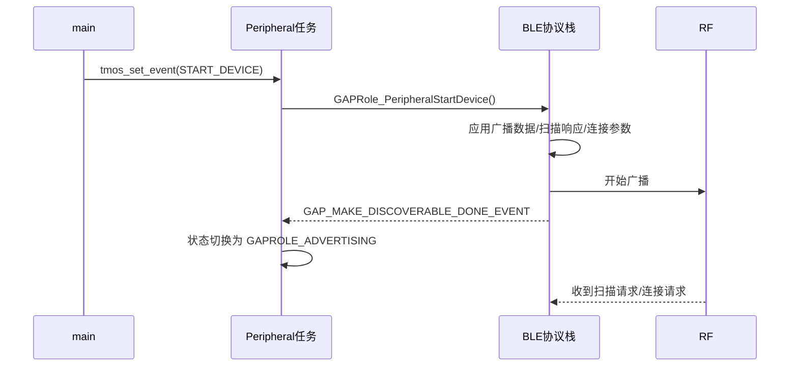

### 3.4 广播停止与重启

| 场景         | 行为                                                                   |
| ------------ | ---------------------------------------------------------------------- |
| 连接建立     | 协议栈自动停止可连接广播                                               |
| 连接断开     | `Peripheral_LinkTerminated()` 重新设置 `GAPROLE_ADVERT_ENABLED = TRUE` |
| 主动停止     | `GAPRole_SetParameter(GAPROLE_ADVERT_ENABLED, FALSE)`                  |
| 广播超时     | 状态进入 `GAPROLE_WAITING`，应用决定是否重新开启                       |
| HID 绑定设备 | 使用白名单/定向广播策略                                                |

`Peripheral_LinkTerminated()`：

```c
if(event->connectionHandle == peripheralConnList.connHandle)
{
    peripheralConnList.connHandle = GAP_CONNHANDLE_INIT;
    peripheralConnList.connInterval = 0;
    peripheralConnList.connSlaveLatency = 0;
    peripheralConnList.connTimeout = 0;

    tmos_stop_task(Peripheral_TaskID, SBP_PERIODIC_EVT);
    tmos_stop_task(Peripheral_TaskID, SBP_READ_RSSI_EVT);

    uint8_t advertising_enable = TRUE;
    GAPRole_SetParameter(GAPROLE_ADVERT_ENABLED,
                         sizeof(uint8_t), &advertising_enable);
}
```

### 3.5 扩展广播与周期广播

`SYNC_ADV` 使用扩展广播 + 周期广播：

```c
uint8_t initial_advertising_enable = TRUE;
uint8_t initial_periodic_advertising_enable = TRUE | (1 << 1);
uint8_t initial_adv_event_type = GAP_ADTYPE_EXT_NONCONN_NONSCAN_UNDIRECT;

GAPRole_SetParameter(GAPROLE_ADVERT_ENABLED, sizeof(uint8_t), &initial_advertising_enable);
GAPRole_SetParameter(GAPROLE_ADV_EVENT_TYPE, sizeof(uint8_t), &initial_adv_event_type);
GAPRole_SetParameter(GAPROLE_PERIODIC_ADVERT_DATA, sizeof(periodicAdvertData), periodicAdvertData);
GAPRole_SetParameter(GAPROLE_PERIODIC_ADVERT_ENABLED, sizeof(uint8_t), &initial_periodic_advertising_enable);
```

周期广播参数：

```c
GAP_SetParamValue(TGAP_PERIODIC_ADV_INT_MIN, DEFAULT_PERIODIC_INTERVAL);
GAP_SetParamValue(TGAP_PERIODIC_ADV_INT_MAX, DEFAULT_PERIODIC_INTERVAL);
GAP_SetParamValue(TGAP_PERIODIC_ADV_PROPERTIES, GAP_PERI_PROPERTIES_INCLUDE_TXPOWER);
GAP_SetParamValue(TGAP_ADV_SECONDARY_PHY, GAP_PHY_VAL_LE_1M);
GAP_SetParamValue(TGAP_ADV_SECONDARY_MAX_SKIP, 0);
GAP_SetParamValue(TGAP_ADV_ADVERTISING_SID, 8);
```

周期广播状态通过 `GAPROLE_PERIODIC_STATE_VALID` 位区分：

```c
if(newState & GAPROLE_PERIODIC_STATE_VALID)
{
    switch(newState & GAPROLE_STATE_PERIODIC_MASK)
    {
        case GAPROLE_PERIODIC_INVALID: ...
        case GAPROLE_PERIODIC_ENABLE:  ...
        case GAPROLE_PERIODIC_WAIT:    ...
        case GAPROLE_PERIODIC_ERROR:   ...
    }
}
```

---

## 4. 连接生命周期

### 4.1 连接建立

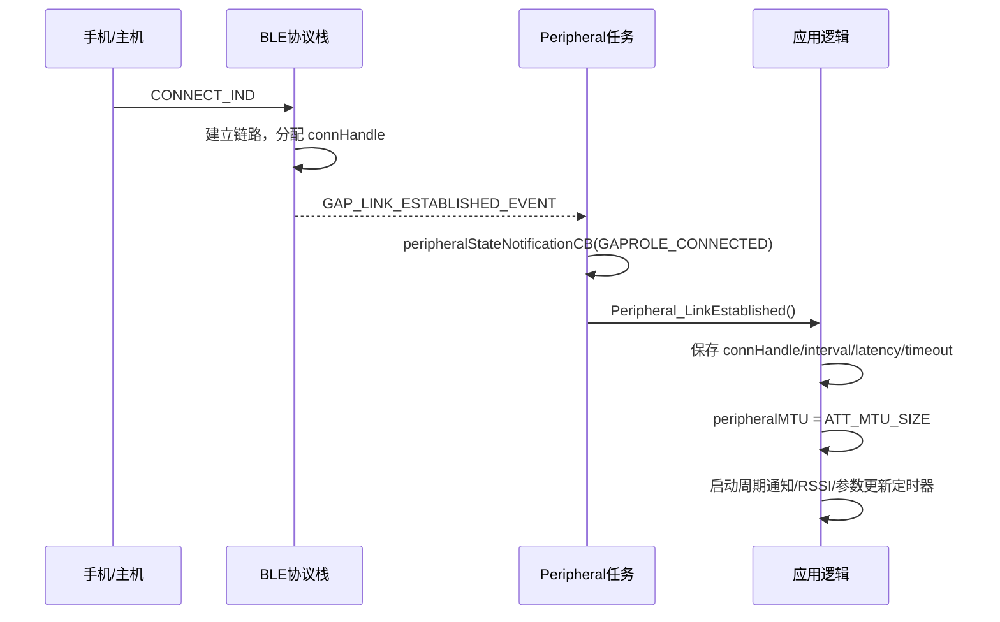

`Peripheral_LinkEstablished()`：

```c
if(peripheralConnList.connHandle != GAP_CONNHANDLE_INIT)
{
    // 已连接，拒绝新连接
    GAPRole_TerminateLink(pEvent->linkCmpl.connectionHandle);
}
else
{
    peripheralConnList.connHandle = event->connectionHandle;
    peripheralConnList.connInterval = event->connInterval;
    peripheralConnList.connSlaveLatency = event->connLatency;
    peripheralConnList.connTimeout = event->connTimeout;
    peripheralMTU = ATT_MTU_SIZE;

    tmos_start_task(Peripheral_TaskID, SBP_PERIODIC_EVT, SBP_PERIODIC_EVT_PERIOD);
    tmos_start_task(Peripheral_TaskID, SBP_PARAM_UPDATE_EVT, SBP_PARAM_UPDATE_DELAY);
    tmos_start_task(Peripheral_TaskID, SBP_READ_RSSI_EVT, SBP_READ_RSSI_EVT_PERIOD);
}
```

### 4.2 连接参数更新

从机发起：

```text
SBP_PARAM_UPDATE_EVT
  -> GAPRole_PeripheralConnParamUpdateReq(connHandle,
                                          minInterval,
                                          maxInterval,
                                          latency,
                                          timeout,
                                          taskID)
  -> 协议栈发送 L2CAP Connection Parameter Update Request
  -> 主机接受/拒绝
  -> peripheralParamUpdateCB(connHandle, interval, latency, timeout)
```

`peripheralParamUpdateCB()`：

```c
if(connHandle == peripheralConnList.connHandle)
{
    peripheralConnList.connInterval = connInterval;
    peripheralConnList.connSlaveLatency = connSlaveLatency;
    peripheralConnList.connTimeout = connTimeout;
    PRINT("Update %x - Int %x \n", connHandle, connInterval);
}
```

参数单位：

| 参数             | 单位       | 约束                                   |
| ---------------- | ---------- | -------------------------------------- |
| Min/Max Interval | 1.25ms     | Min ≤ Max                              |
| Latency          | 连接事件数 | 不能导致超时                           |
| Timeout          | 10ms       | 必须大于 `(1+latency)*interval*2` 左右 |

### 4.3 PHY 更新

```c
GAPRole_UpdatePHY(peripheralConnList.connHandle,
                  0,
                  GAP_PHY_BIT_LE_2M,
                  GAP_PHY_BIT_LE_2M,
                  0);
```

结果通过 `GAP_PHY_UPDATE_EVENT` 返回：

```c
case GAP_PHY_UPDATE_EVENT:
    PRINT("Phy update Rx:%x Tx:%x ..\n",
          pEvent->linkPhyUpdate.connRxPHYS,
          pEvent->linkPhyUpdate.connTxPHYS);
```

### 4.4 断开连接

```text
链路断开
  -> GAP_LINK_TERMINATED_EVENT
  -> peripheralStateNotificationCB(GAPROLE_ADVERTISING 或 GAPROLE_WAITING)
  -> Peripheral_LinkTerminated()
  -> 清理 connList
  -> 停止周期/RSSI 定时器
  -> 重新使能广播
  -> linkDB 通知 Profile 清理 CCCD
```

Profile 侧清理 CCCD：

```c
static void simpleProfile_HandleConnStatusCB(uint16_t connHandle, uint8_t changeType)
{
    if(connHandle != LOOPBACK_CONNHANDLE)
    {
        if((changeType == LINKDB_STATUS_UPDATE_REMOVED) ||
           ((changeType == LINKDB_STATUS_UPDATE_STATEFLAGS) &&
            (!linkDB_Up(connHandle))))
        {
            GATTServApp_InitCharCfg(connHandle, simpleProfileChar4Config);
        }
    }
}
```

### 4.5 从机状态机

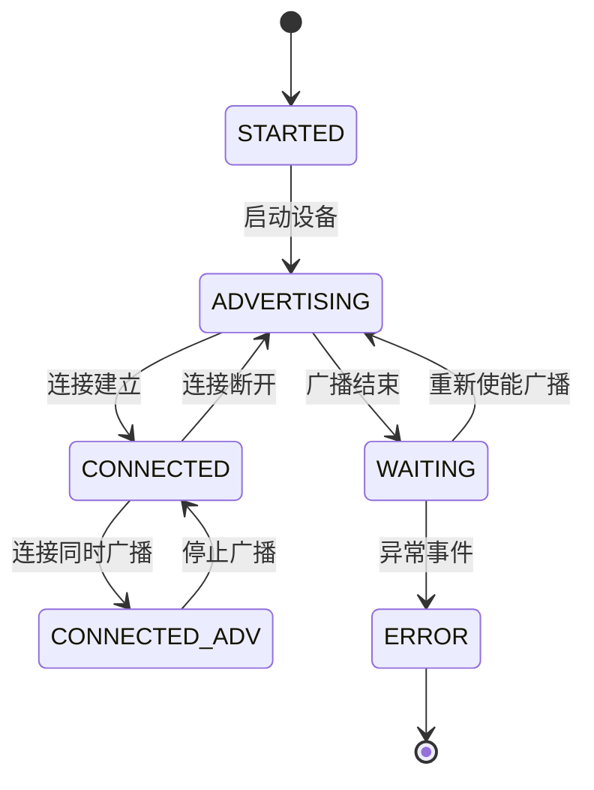

---

## 5. GATT Server 注册与句柄流程

### 5.1 注册调用链

以 `SimpleProfile_AddService()` 为例：

```text
SimpleProfile_AddService(GATT_ALL_SERVICES)
  ├─ GATTServApp_InitCharCfg(INVALID_CONNHANDLE, simpleProfileChar4Config)
  ├─ linkDB_Register(simpleProfile_HandleConnStatusCB)
  └─ GATTServApp_RegisterService(simpleProfileAttrTbl,
                                 GATT_NUM_ATTRS(...),
                                 GATT_MAX_ENCRYPT_KEY_SIZE,
                                 &simpleProfileCBs)
        └─ 协议栈为属性表分配 handle
```

### 5.2 属性表如何变成 handle

属性表顺序决定 handle 顺序：

```c
static gattAttribute_t simpleProfileAttrTbl[] = {
    // 0: Service
    // 1: CHAR1 Declaration
    // 2: CHAR1 Value
    // 3: CHAR1 User Description
    // 4: CHAR2 Declaration
    // 5: CHAR2 Value
    // 6: CHAR2 User Description
    // 7: CHAR3 Declaration
    // 8: CHAR3 Value
    // 9: CHAR3 User Description
    // 10: CHAR4 Declaration
    // 11: CHAR4 Value
    // 12: CHAR4 CCCD
    // 13: CHAR4 User Description
    // 14: CHAR5 Declaration
    // 15: CHAR5 Value
    // 16: CHAR5 User Description
};
```

`SIMPLEPROFILE_CHAR4_VALUE_POS` 定义为 11：

```c
#define SIMPLEPROFILE_CHAR4_VALUE_POS 11
```

发送通知时使用：

```c
pNoti->handle = simpleProfileAttrTbl[SIMPLEPROFILE_CHAR4_VALUE_POS].handle;
```

> 这也是为什么**不要在属性表中间随意插入属性**：插入后索引会变化，所有硬编码索引都要同步修改。

### 5.3 CCCD 生命周期

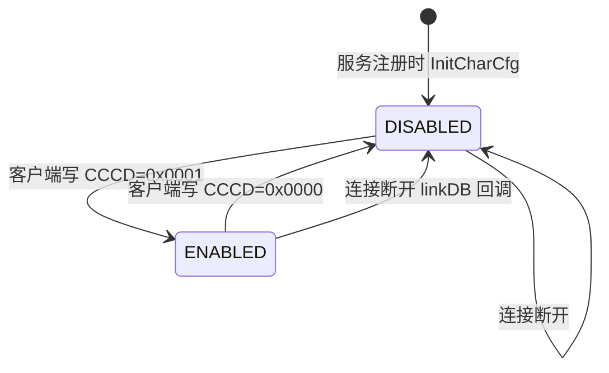

关键 API：

| API                                | 作用                |
| ---------------------------------- | ------------------- |
| `GATTServApp_InitCharCfg()`        | 初始化某连接的 CCCD |
| `GATTServApp_ReadCharCfg()`        | 读取 CCCD           |
| `GATTServApp_ProcessCCCWriteReq()` | 处理客户端写 CCCD   |
| `GATTServApp_WriteCharCfg()`       | 主动修改 CCCD       |

### 5.4 读写分派

```text
对端 ATT 请求
  -> GATT Server App
  -> gattServiceCBs_t.pfnReadAttrCB / pfnWriteAttrCB
  -> Profile 的 simpleProfile_ReadAttrCB / simpleProfile_WriteAttrCB
  -> 应用回调 simpleProfileChangeCB
```

读回调：

```c
static bStatus_t simpleProfile_ReadAttrCB(...)
{
    uint16_t uuid = BUILD_UINT16(pAttr->type.uuid[0], pAttr->type.uuid[1]);

    switch(uuid)
    {
        case SIMPLEPROFILE_CHAR1_UUID:
            *pLen = MIN(maxLen, SIMPLEPROFILE_CHAR1_LEN);
            tmos_memcpy(pValue, pAttr->pValue, *pLen);
            break;
        // ...
    }
}
```

写回调：

```c
static bStatus_t simpleProfile_WriteAttrCB(...)
{
    if(gattPermitAuthorWrite(pAttr->permissions))
        return ATT_ERR_INSUFFICIENT_AUTHOR;

    switch(uuid)
    {
        case SIMPLEPROFILE_CHAR1_UUID:
            if(offset == 0 && len <= SIMPLEPROFILE_CHAR1_LEN)
            {
                tmos_memcpy(pAttr->pValue, pValue, len);
                notifyApp = SIMPLEPROFILE_CHAR1;
            }
            break;

        case GATT_CLIENT_CHAR_CFG_UUID:
            status = GATTServApp_ProcessCCCWriteReq(...);
            break;
    }

    if(notifyApp != 0xFF && simpleProfile_AppCBs)
        simpleProfile_AppCBs->pfnSimpleProfileChange(notifyApp, pValue, len);

    return status;
}
```

### 5.5 多连接下的 CCCD

```c
static gattCharCfg_t simpleProfileChar4Config[PERIPHERAL_MAX_CONNECTION];
```

每个连接一份 CCCD。若 `PERIPHERAL_MAX_CONNECTION` 配置为 1，但实际允许多连接，会导致数组越界。

---

## 6. 通知 / 指示发送流程

### 6.1 Notification 调用链

```text
应用定时事件
  -> performPeriodicTask()
  -> peripheralChar4Notify()
  -> simpleProfile_Notify()
       ├─ GATTServApp_ReadCharCfg() 检查 CCCD
       ├─ pNoti->handle = 属性表句柄
       └─ GATT_Notification()
             -> 协议栈排队
             -> 下一个连接事件由 LLE 发送
             -> RF
```

### 6.2 内存所有权

```c
noti.len = len;
noti.pValue = GATT_bm_alloc(connHandle, ATT_HANDLE_VALUE_NOTI, len, NULL, 0);
if(noti.pValue)
{
    tmos_memcpy(noti.pValue, pValue, noti.len);
    if(simpleProfile_Notify(connHandle, &noti) != SUCCESS)
    {
        GATT_bm_free((gattMsg_t *)&noti, ATT_HANDLE_VALUE_NOTI);
    }
}
```

规则：

- 通知数据必须从协议栈内存池分配。
- 长度必须 ≤ `MTU - 3`。
- `GATT_Notification()` 成功：缓冲区交给协议栈，应用不要再访问。
- `GATT_Notification()` 失败：应用必须 `GATT_bm_free()`。
- `GATT_bm_alloc()` 返回 `NULL`：说明协议栈内存暂时不足，应延后重试，不要死等。

### 6.3 失败原因矩阵

| 返回值/现象            | 原因             | 处理                   |
| ---------------------- | ---------------- | ---------------------- |
| `bleIncorrectMode`     | CCCD 未开启      | 等客户端写 CCCD        |
| `bleNotConnected`      | 连接已断         | 停止发送，等重连       |
| `bleInvalidRange`      | 长度超过 MTU-3   | 分包或提高 MTU         |
| `bleMemAllocError`     | 内存池不足       | 延时重试，降低发送频率 |
| `MSG_BUFFER_NOT_AVAIL` | 控制器缓存满     | 降低发送速率           |
| `blePending`           | 上一个指示未确认 | 不要连续发 Indication  |

### 6.4 Indication 与 Notification

| 特性               | Notification          | Indication             |
| ------------------ | --------------------- | ---------------------- |
| 是否需要客户端确认 | 否                    | 是                     |
| 发送 API           | `GATT_Notification()` | `GATT_Indication()`    |
| 完成事件           | 无                    | `ATT_HANDLE_VALUE_CFM` |
| 吞吐               | 高                    | 低                     |
| 典型用途           | 传感器周期上报        | 重要状态、OTA 确认     |

### 6.5 高频发送：SpeedTest 的工作方式

`SpeedTest_Peripheral` 注册连接事件回调：

```c
LL_ConnectEventRegister(peripheralConnectEventCB);
```

每次连接事件回调中尽可能多地发送通知：

```c
static void peripheralConnectEventCB(uint32_t timeUs)
{
    if(speed_test_enable)
    {
        while(1)
        {
            if(peripheralChar4Notify(speed_test_buf, peripheralMTU - 3))
            {
                break; // 内存或缓存不足，停止本次发送
            }
            else
            {
                peripheralTxDataLen += peripheralMTU - 3;
            }
        }
    }
}
```

提高吞吐量的关键配置：

```c
BLE_BUFF_MAX_LEN     // 增大 MTU
BLE_TX_NUM_EVENT     // 每个连接事件发送更多包
BLE_BUFF_NUM         // 控制器缓存更多包
GAPRole_UpdatePHY()  // 2M PHY
```

### 6.6 通知时序

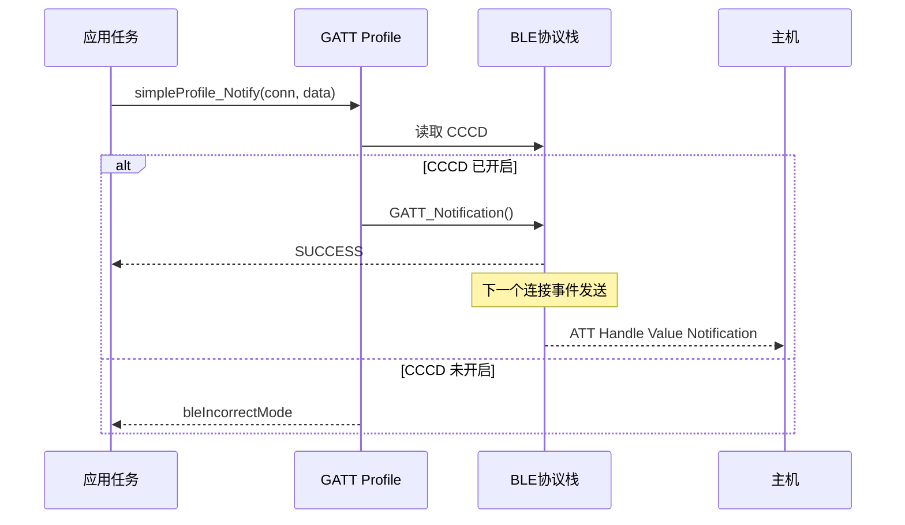

---

## 7. 接收写 / 读流程

### 7.1 对端写特征

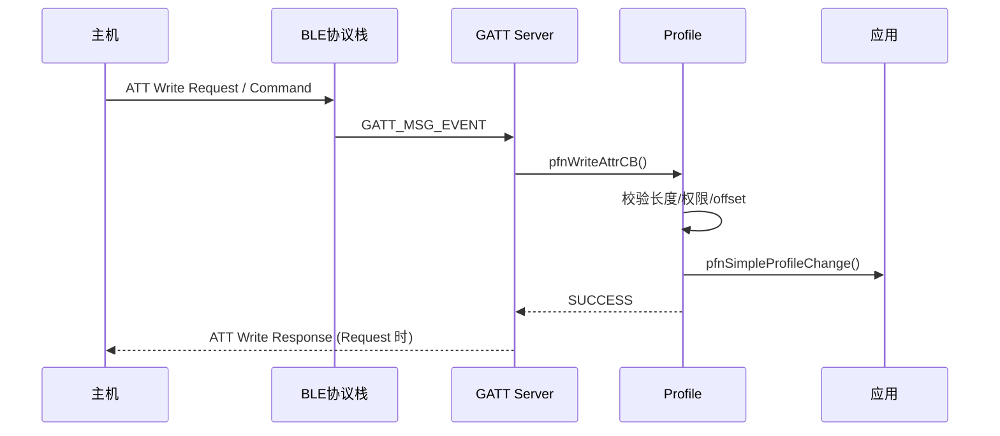

要点：

- 写回调中的 `pValue` 指针只在回调期间有效。
- 如果应用需要异步处理，必须立即复制到自己的缓冲区。
- `BLE_UART` 把数据写入 FIFO；OTA 把数据复制到 `iap_rec_data`；这都是正确做法。

### 7.2 对端读特征

```text
ATT Read Request
  -> pfnReadAttrCB()
  -> 拷贝 pAttr->pValue 到 pValue
  -> 返回长度
  -> 协议栈发送 ATT Read Response
```

读回调需要处理 `maxLen` 和 `offset`：

```c
if(offset > 0)
    return ATT_ERR_ATTR_NOT_LONG;

*pLen = MIN(maxLen, value_len);
tmos_memcpy(pValue, pAttr->pValue, *pLen);
```

### 7.3 长读/长写

- offset > 0 的读：使用 `ATT_READ_BLOB_REQ`，Profile 必须支持 offset。
- 长写：使用 `ATT_PREPARE_WRITE_REQ` + `ATT_EXECUTE_WRITE_REQ`。
- 简单 Profile 通常不支持长读/长写，直接返回 `ATT_ERR_ATTR_NOT_LONG`。
- HID Report Map 是长属性，`HidDev_ReadAttrCB()` 专门处理 offset。

### 7.4 MTU 交换

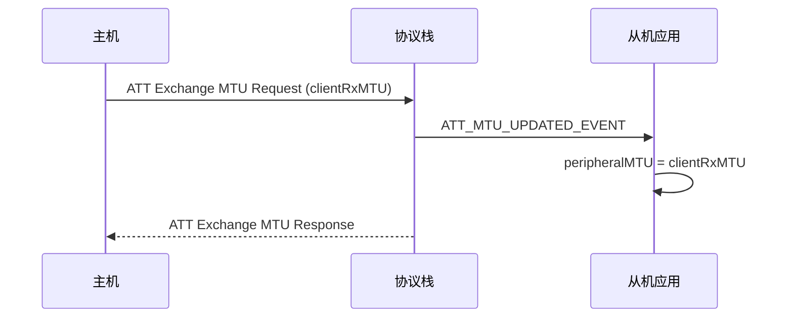

从机侧：

```c
if(pMsgEvent->method == ATT_MTU_UPDATED_EVENT)
{
    peripheralMTU = pMsgEvent->msg.exchangeMTUReq.clientRxMTU;
}
```

主机侧：

```c
attExchangeMTUReq_t req = { .clientRxMTU = BLE_BUFF_MAX_LEN - 4 };
GATT_ExchangeMTU(centralConnHandle, &req, centralTaskId);
```

### 7.5 数据生命周期

| 阶段            | 数据位置               | 生命周期          |
| --------------- | ---------------------- | ----------------- |
| 广播            | 应用静态数组           | 长期              |
| 连接参数        | 协议栈                 | 连接期间          |
| 写回调 `pValue` | 协议栈消息             | 回调期间          |
| 通知 `pValue`   | `GATT_bm_alloc` 内存池 | 发送完成/失败释放 |
| 应用 FIFO       | 应用 RAM               | 由应用管理        |

---

## 8. Central 工作流程

### 8.1 初始化

```text
Central_Init()
  ├─ TMOS_ProcessEventRegister(Central_ProcessEvent)
  ├─ GAP_SetParamValue(...)
  ├─ GAPBondMgr_SetParameter(...)
  ├─ GATT_InitClient()
  ├─ GATT_RegisterForInd(centralTaskId)
  └─ tmos_set_event(START_DEVICE_EVT)
```

### 8.2 扫描流程

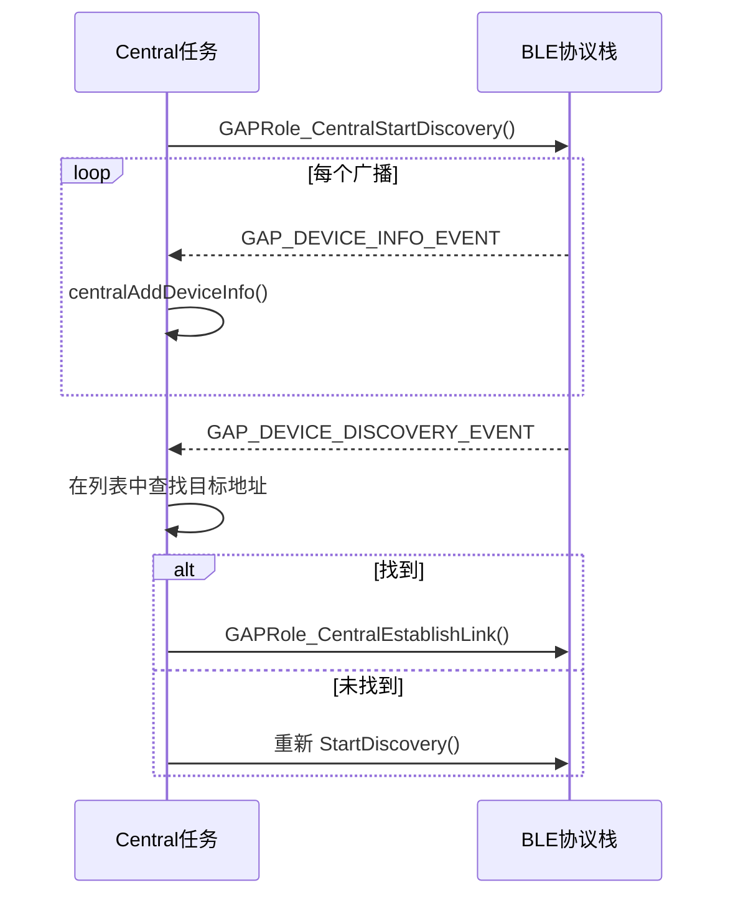

### 8.3 建立连接

```c
GAPRole_CentralEstablishLink(DEFAULT_LINK_HIGH_DUTY_CYCLE,
                             DEFAULT_LINK_WHITE_LIST,
                             centralDevList[i].addrType,
                             centralDevList[i].addr);

tmos_start_task(centralTaskId, ESTABLISH_LINK_TIMEOUT_EVT,
                ESTABLISH_LINK_TIMEOUT);
```

超时事件：

```c
if(events & ESTABLISH_LINK_TIMEOUT_EVT)
{
    GAPRole_TerminateLink(INVALID_CONNHANDLE);
    return (events ^ ESTABLISH_LINK_TIMEOUT_EVT);
}
```

### 8.4 连接后调度

```c
centralState = BLE_STATE_CONNECTED;
centralConnHandle = pEvent->linkCmpl.connectionHandle;

attExchangeMTUReq_t req = { .clientRxMTU = BLE_BUFF_MAX_LEN - 4 };
GATT_ExchangeMTU(centralConnHandle, &req, centralTaskId);

tmos_start_task(centralTaskId, START_SVC_DISCOVERY_EVT, DEFAULT_SVC_DISCOVERY_DELAY);
tmos_start_task(centralTaskId, START_PARAM_UPDATE_EVT, DEFAULT_PARAM_UPDATE_DELAY);
tmos_start_task(centralTaskId, START_PHY_UPDATE_EVT, DEFAULT_PHY_UPDATE_DELAY);
tmos_start_task(centralTaskId, START_READ_RSSI_EVT, DEFAULT_RSSI_PERIOD);
```

### 8.5 服务发现状态机

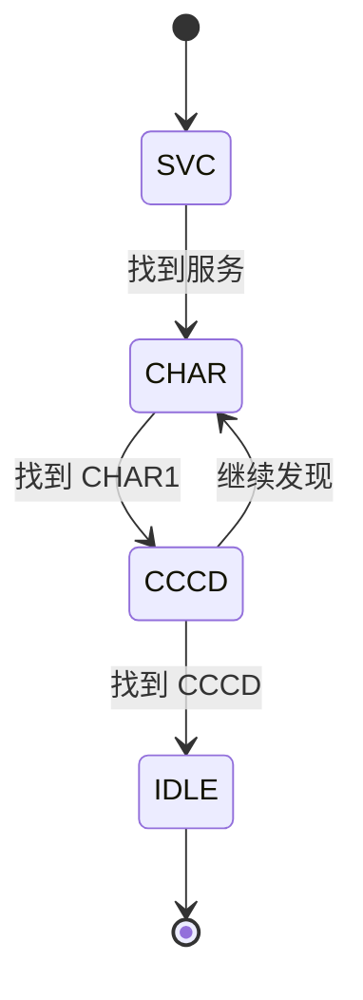

请求/响应配对：

| 阶段 | 请求 API                          | 响应事件                     |
| ---- | --------------------------------- | ---------------------------- |
| 服务 | `GATT_DiscPrimaryServiceByUUID()` | `ATT_FIND_BY_TYPE_VALUE_RSP` |
| 特征 | `GATT_ReadUsingCharUUID()`        | `ATT_READ_BY_TYPE_RSP`       |
| CCCD | `GATT_ReadUsingCharUUID()`        | `ATT_READ_BY_TYPE_RSP`       |

服务发现代码：

```c
uint8_t uuid[ATT_BT_UUID_SIZE] = {
    LO_UINT16(SIMPLEPROFILE_SERV_UUID),
    HI_UINT16(SIMPLEPROFILE_SERV_UUID)
};

centralDiscState = BLE_DISC_STATE_SVC;
GATT_DiscPrimaryServiceByUUID(centralConnHandle, uuid,
                              ATT_BT_UUID_SIZE, centralTaskId);
```

处理服务响应：

```c
if(pMsg->method == ATT_FIND_BY_TYPE_VALUE_RSP &&
   pMsg->msg.findByTypeValueRsp.numInfo > 0)
{
    centralSvcStartHdl = ATT_ATTR_HANDLE(pMsg->msg.findByTypeValueRsp.pHandlesInfo, 0);
    centralSvcEndHdl = ATT_GRP_END_HANDLE(pMsg->msg.findByTypeValueRsp.pHandlesInfo, 0);
}
```

处理特征响应：

```c
if(pMsg->method == ATT_READ_BY_TYPE_RSP &&
   pMsg->msg.readByTypeRsp.numPairs > 0)
{
    centralCharHdl = BUILD_UINT16(pMsg->msg.readByTypeRsp.pDataList[0],
                                  pMsg->msg.readByTypeRsp.pDataList[1]);
}
```

### 8.6 读写流程

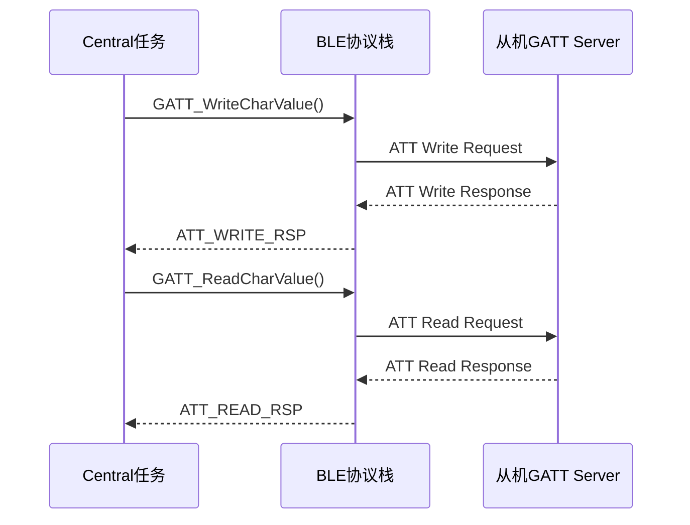

状态保护：

```c
if(centralProcedureInProgress == FALSE)
{
    // 发起下一个读或写
    centralProcedureInProgress = TRUE;
}
```

在响应处理中清除：

```c
if(pMsg->method == ATT_READ_RSP || pMsg->method == ATT_WRITE_RSP)
{
    centralProcedureInProgress = FALSE;
}
```

### 8.7 异常与重试

| 异常         | 处理                                         |
| ------------ | -------------------------------------------- |
| 扫描不到目标 | 重新开始扫描                                 |
| 连接超时     | `GAPRole_TerminateLink(INVALID_CONNHANDLE)`  |
| 连接失败     | 清空扫描结果，重新扫描                       |
| 服务未找到   | 重新发现或断开重连                           |
| 读/写错误    | 打印 `ATT_ERROR_RSP.errCode`，清除进行中标志 |
| 连接断开     | 清理句柄/状态，重新扫描                      |

### 8.8 多连接主机

`MultiCentral` 的关键设计：

```c
static peerAddrDefItem_t PeerAddrDef[CENTRAL_MAX_CONNECTION] = {
    {0x02, 0x02, 0x03, 0xE4, 0xC2, 0x84},
    {0x03, 0x02, 0x03, 0xE4, 0xC2, 0x84},
    {0x04, 0x02, 0x03, 0xE4, 0xC2, 0x84}
};

static centralConnItem_t centralConnList[CENTRAL_MAX_CONNECTION];
```

每个连接条目包含：

```c
typedef struct
{
    uint8_t  taskID;
    uint16_t connHandle;
    uint8_t  state;
    uint8_t  discState;
    uint16_t svcStartHdl;
    uint16_t svcEndHdl;
    uint16_t charHdl;
    uint16_t cccdHdl;
    uint8_t  procedureInProgress;
} centralConnItem_t;
```

连接建立流程：

```text
GAP_LINK_ESTABLISHED_EVENT
  -> 找到空闲 centralConnList 条目
  -> 若没有空位，TerminateLink(新连接)
  -> 保存 connHandle
  -> 为该条目启动服务发现/参数更新/RSSI
  -> 若还有空位，继续扫描下一个目标
```

断开流程：

```text
GAP_LINK_TERMINATED_EVENT
  -> 根据 connHandle 找到条目
  -> 清理状态
  -> 停止该条目的定时任务
  -> 重新扫描
```

### 8.9 主从一体

`CentPeri` 主函数：

```c
CH59x_BLEInit();
HAL_Init();
GAPRole_PeripheralInit();
GAPRole_CentralInit();
Peripheral_Init();
Central_Init();
Main_Circulation();
```

要点：

- 两套 GAP Role 各自初始化。
- 应用任务独立注册。
- `PERIPHERAL_MAX_CONNECTION` 和 `CENTRAL_MAX_CONNECTION` 共同决定连接数。
- `BLE_MEMHEAP_SIZE` 需要足够大，`BLE_BUFF_NUM` 必须大于总连接数。

---

## 9. 配对 / 绑定 / 加密流程

### 9.1 配置

```c
uint32_t passkey = 0;
uint8_t pairMode = GAPBOND_PAIRING_MODE_WAIT_FOR_REQ;
uint8_t mitm = TRUE;
uint8_t ioCap = GAPBOND_IO_CAP_DISPLAY_ONLY;
uint8_t bonding = TRUE;

GAPBondMgr_SetParameter(GAPBOND_PERI_DEFAULT_PASSCODE, sizeof(uint32_t), &passkey);
GAPBondMgr_SetParameter(GAPBOND_PERI_PAIRING_MODE, sizeof(uint8_t), &pairMode);
GAPBondMgr_SetParameter(GAPBOND_PERI_MITM_PROTECTION, sizeof(uint8_t), &mitm);
GAPBondMgr_SetParameter(GAPBOND_PERI_IO_CAPABILITIES, sizeof(uint8_t), &ioCap);
GAPBondMgr_SetParameter(GAPBOND_PERI_BONDING_ENABLED, sizeof(uint8_t), &bonding);
```

### 9.2 配对事件流程

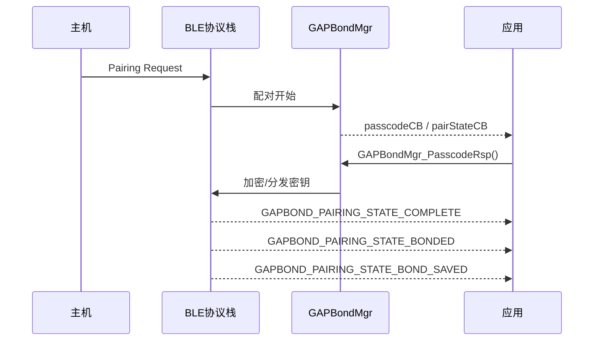

回调：

```c
static gapBondCBs_t Peripheral_BondMgrCBs = {
    NULL, // passcode
    NULL, // pair state
    NULL  // oob
};
```

HID 使用完整回调：

```c
static gapBondCBs_t hidDevBondCB = {
    hidDevPasscodeCB,
    hidDevPairStateCB,
    NULL
};
```

### 9.3 绑定信息存储

`CH59x_BLEInit()` 中配置 SNV：

```c
cfg.SNVAddr = (uint32_t)BLE_SNV_ADDR;
cfg.SNVBlock = (uint32_t)BLE_SNV_BLOCK;
cfg.SNVNum = (uint32_t)BLE_SNV_NUM;
cfg.readFlashCB = Lib_Read_Flash;
cfg.writeFlashCB = Lib_Write_Flash;
```

`Lib_Write_Flash()`：

```c
if(((*(uint32_t *)ROM_CFG_VERISON) & 0xFF) == DEF_CHIP_ID_CH592A)
{
    Lib_Write_Flash_592A(addr, num, pBuf);
}
else
{
    EEPROM_ERASE(addr, num * 4);
    EEPROM_WRITE(addr, pBuf, num * 4);
}
```

注意：

- SNV 地址不能与 OTA 标志、用户参数重叠。
- CH592A 的写 Flash 方式需要保留整块数据，不能直接页擦除。
- `BLE_SNV_NUM` 必须足够大，以保存多个绑定设备。

### 9.4 安全属性权限

| 权限                        | 含义       | 示例           |
| --------------------------- | ---------- | -------------- |
| `GATT_PERMIT_READ`          | 任意读     | 设备名         |
| `GATT_PERMIT_WRITE`         | 任意写     | 简单控制点     |
| `GATT_PERMIT_AUTHEN_READ`   | 需要认证读 | 敏感信息       |
| `GATT_PERMIT_ENCRYPT_READ`  | 需要加密读 | HID Report Map |
| `GATT_PERMIT_ENCRYPT_WRITE` | 需要加密写 | HID 控制点     |

HID 服务大量使用 `GATT_PERMIT_ENCRYPT_READ/WRITE`，因此连接必须完成配对/加密后才能访问报告。

### 9.5 HID 的安全状态

```c
static uint8_t hidDevConnSecure = FALSE;
```

配对完成：

```c
if(state == GAPBOND_PAIRING_STATE_COMPLETE && status == SUCCESS)
{
    hidDevConnSecure = TRUE;
}
```

发送报告前检查：

```c
if(hidDevGapState == GAPROLE_CONNECTED && hidDevConnSecure)
{
    return hidDevSendReport(id, type, len, pData);
}
```

---

## 10. 低功耗工作流程

### 10.1 两条低功耗路径

| 层级       | 入口                                  | 特点                            |
| ---------- | ------------------------------------- | ------------------------------- |
| 协议栈空闲 | `CH59x_LowPower()`                    | 连接/广播之间自动睡眠，保留 RAM |
| 应用主动   | `LowPower_Idle/Halt/Sleep/Shutdown()` | 产品级深度休眠，可能断开连接    |

### 10.2 睡眠决策

`CH59x_BLEInit()`：

```c
#if(defined(HAL_SLEEP)) && (HAL_SLEEP == TRUE)
    cfg.idleCB = CH59x_LowPower;
#endif
```

协议栈在空闲时调用 `idleCB`。但应用任务如果有挂起任务，协议栈不会进入睡眠。

`RemoteController` 用一个“占位事件”阻止睡眠：

```c
if(events & APP_KEEP_WEAK_EVT)
{
    // 必须放在任务列表的最后
    // 用于限制 tmos 任务管理的睡眠，当有任务存在时，蓝牙库不会调用睡眠
    return (events);
}
```

### 10.3 `CH59x_LowPower()` 流程

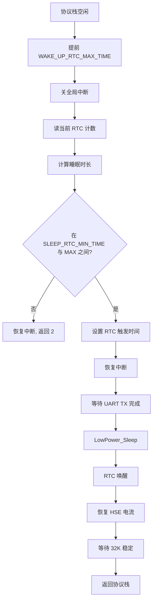

关键代码：

```c
if(time <= WAKE_UP_RTC_MAX_TIME)
{
    time = time + (RTC_MAX_COUNT - WAKE_UP_RTC_MAX_TIME);
}
else
{
    time = time - WAKE_UP_RTC_MAX_TIME;
}

SYS_DisableAllIrq(&irq_status);
time_curr = RTC_GetCycle32k();

if(time < time_curr)
    time_sleep = time + (RTC_MAX_COUNT - time_curr);
else
    time_sleep = time - time_curr;

if((time_sleep < SLEEP_RTC_MIN_TIME) ||
   (time_sleep > SLEEP_RTC_MAX_TIME))
{
    SYS_RecoverIrq(irq_status);
    return 2;
}

RTC_SetTignTime(time);
SYS_RecoverIrq(irq_status);

LowPower_Sleep(RB_PWR_RAM2K | RB_PWR_RAM24K | RB_PWR_EXTEND | RB_XT_PRE_EN);
HSECFG_Current(HSE_RCur_100);
```

### 10.4 唤醒流程

RTC 中断：

```c
__INTERRUPT
__HIGH_CODE
void RTC_IRQHandler(void)
{
    R8_RTC_FLAG_CTRL = (RB_RTC_TMR_CLR | RB_RTC_TRIG_CLR);
    RTCTigFlag = 1;
}
```

`RTCTigFlag` 用于判断是“正常唤醒”还是“尚未睡下去”：

```c
if(!RTCTigFlag)
{
    LowPower_Sleep(...);
    ...
    return 0;
}
return 3;
```

### 10.5 GPIO 唤醒流程（RemoteController）

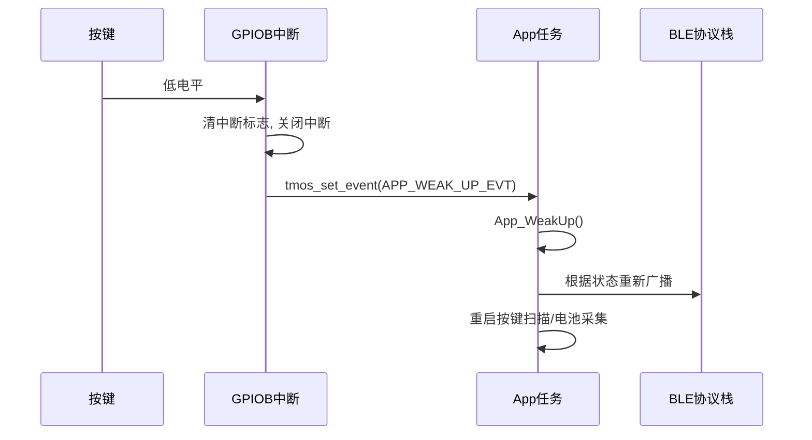

`App_Enter_Sleep()`：

```c
app_sleep_flag = TRUE;

GAPRole_GetParameter(GAPROLE_STATE, &ble_state);
if(ble_state == GAPROLE_CONNECTED)
{
    GAPRole_TerminateLink(hidEmuConnHandle);
}
else if(ble_state == GAPROLE_ADVERTISING)
{
    hidEmu_adv_enable(DISABLE);
}

tmos_stop_task(appTaskId, APP_KEEP_WEAK_EVT);
tmos_stop_task(appTaskId, APP_KEYSCAN_EVT);

GPIOB_ITModeCfg(KEY_BOOT, GPIO_ITMode_LowLevel);
GPIOB_ClearITFlagBit(0xFFFF);
PFIC_EnableIRQ(GPIO_B_IRQn);
PWR_PeriphWakeUpCfg(ENABLE, RB_SLP_GPIO_WAKE, Long_Delay);
```

### 10.6 低功耗模式对比

| 模式     | API                     | RAM 保持 | 唤醒后   | 典型用途 |
| -------- | ----------------------- | -------- | -------- | -------- |
| Idle     | `LowPower_Idle()`       | 全部     | 继续运行 | 短空闲   |
| Halt     | `LowPower_Halt()`       | 全部     | 继续运行 | 较快唤醒 |
| Sleep    | `LowPower_Sleep(flags)` | 按 flags | 继续运行 | BLE 空闲 |
| Shutdown | `LowPower_Shutdown(0)`  | 不保持   | 复位     | 长期存放 |

### 10.7 低功耗检查清单

- [ ] `HAL_SLEEP=TRUE`
- [ ] `DCDC_ENABLE=TRUE`
- [ ] GPIO 全部配置为输入上拉或明确电平
- [ ] 调试串口在量测时关闭
- [ ] 广播间隔不要过短
- [ ] 连接间隔/延迟符合业务
- [ ] 没有挂起的 TMOS 任务阻止睡眠
- [ ] 外部 32K 用于主机角色
- [ ] 定期校准已开启
- [ ] 测量点放在 VDD，排除调试器供电

---

## 11. OTA / IAP 工作流程

### 11.1 A/B 双备份启动决策

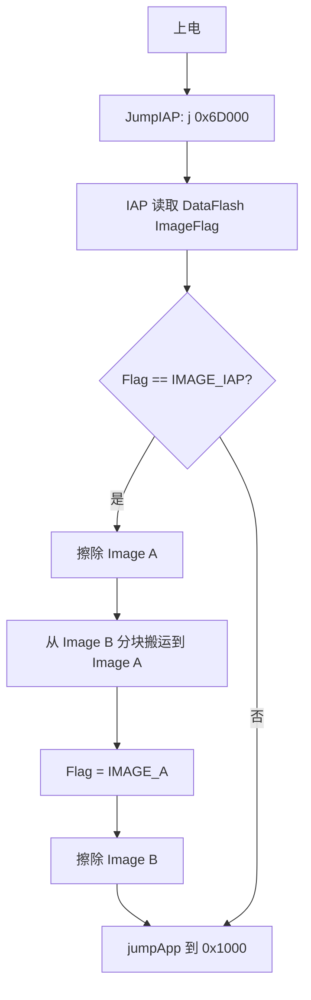

`BackupUpgrade_JumpIAP/Startup/startup_CH592.S`：

```asm
_start:
    j 0x6D000
```

`BackupUpgrade_IAP` 链接地址：

```ld
FLASH (rx) : ORIGIN = 0x0006D000, LENGTH = 12K
```

对应布局：

| 区域                |     起始地址 | 大小 | 链接/跳转     |
| ------------------- | -----------: | ---: | ------------- |
| JumpIAP             | `0x00000000` |   4K | `j 0x6D000`   |
| Image A（用户 App） | `0x00001000` | 216K | 正常跳转目标  |
| Image B（OTA 备份） | `0x00037000` | 216K | OTA 写入目标  |
| Image IAP           | `0x0006D000` |  12K | 搬运/升级程序 |

搬运代码：

```c
if(CurrImageFlag == IMAGE_IAP_FLAG)
{
    uint8_t i;
    FLASH_ROM_ERASE(IMAGE_A_START_ADD, IMAGE_A_SIZE);
    for(i = 0; i < IMAGE_A_SIZE / 1024; i++)
    {
        FLASH_ROM_READ(IMAGE_B_START_ADD + (i * 1024), flash_Data, 1024);
        FLASH_ROM_WRITE(IMAGE_A_START_ADD + (i * 1024), flash_Data, 1024);
    }
    SwitchImageFlag(IMAGE_A_FLAG);
    FLASH_ROM_ERASE(IMAGE_B_START_ADD, IMAGE_A_SIZE);
}

jumpApp();
```

### 11.2 OTA 数据链路

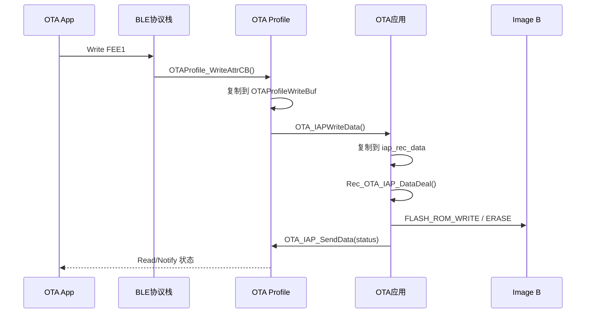

### 11.3 OTA Profile 写回调

```c
case OTAPROFILE_CHAR_UUID:
{
    uint16_t i;
    uint8_t *p_rec_buf;

    OTAProfileWriteLen = len;
    p_rec_buf = pValue;
    for(i = 0; i < OTAProfileWriteLen; i++)
        OTAProfileWriteBuf[i] = p_rec_buf[i];
    break;
}
```

然后触发应用回调：

```c
if(OTAProfileWriteLen && OTAProfile_AppCBs &&
   OTAProfile_AppCBs->pfnOTAProfileWrite)
{
    OTAProfile_AppCBs->pfnOTAProfileWrite(OTAPROFILE_CHAR,
                                          OTAProfileWriteBuf,
                                          OTAProfileWriteLen);
    OTAProfileWriteLen = 0;
}
```

### 11.4 命令处理

| 命令             | 处理                                                           |
| ---------------- | -------------------------------------------------------------- |
| `CMD_IAP_INFO`   | 返回 Image 标志、Image 大小、块大小、芯片 ID；并把连接延迟调低 |
| `CMD_IAP_ERASE`  | 校验地址范围，启动事件驱动的分块擦除                           |
| `CMD_IAP_PROM`   | 地址 ×16 换算，写入 Image B                                    |
| `CMD_IAP_VERIFY` | `FLASH_ROM_VERIFY()` 校验                                      |
| `CMD_IAP_END`    | 关中断、写 `IMAGE_IAP_FLAG`、复位                              |

`CMD_IAP_INFO` 中的连接参数调整：

```c
tmos_stop_task(hidEmuTaskId, START_PARAM_UPDATE_EVT);
GAPRole_PeripheralConnParamUpdateReq(hidEmuConnHandle,
                                     6,
                                     12,
                                     0,
                                     500,
                                     ota_TaskID);
```

目的：升级期间把连接间隔降到 7.5~15ms，Latency 设为 0，提高 OTA 速度。

### 11.5 事件驱动分块擦除

`Peripheral_ProcessEvent()`：

```c
if(events & OTA_FLASH_ERASE_EVT)
{
    status = FLASH_ROM_ERASE(EraseAdd + EraseBlockCnt * FLASH_BLOCK_SIZE,
                             FLASH_BLOCK_SIZE);

    if(status != SUCCESS)
    {
        OTA_IAP_SendCMDDealSta(status);
        return (events ^ OTA_FLASH_ERASE_EVT);
    }

    EraseBlockCnt++;

    if(EraseBlockCnt >= EraseBlockNum)
    {
        OTA_IAP_SendCMDDealSta(status);
        return (events ^ OTA_FLASH_ERASE_EVT);
    }

    return (events); // 保留事件位，调度器下次继续擦除
}
```

> `return (events)` 是这里的关键：不把事件位清掉，TMOS 会再次调度该事件，从而在擦除块之间让出 CPU，避免长时间阻塞。

### 11.6 升级结束与复位

```c
case CMD_IAP_END:
{
    DisableAllIRQ();
    SwitchImageFlag(IMAGE_IAP_FLAG);
    mDelaymS(10);
    SYS_ResetExecute();
    break;
}
```

### 11.7 固定库方案 OnlyUpdateApp

布局：

```text
0x0000  +----------------------+
        | JumpIAP (4K)         |  j 0xC000
0x1000  +----------------------+
        | Image A (44K)        |  用户 App
0xC000  +----------------------+
        | Image IAP (16K)      |  BLE + OTA 服务
        +----------------------+
        | LIB (128K)           |  固定库
        +----------------------+
```

用户 App 触发升级：

```c
case SIMPLEPROFILE_CHAR3:
{
    PRINT("jump OTA \n");
    mDelaymS(5);
    Jump_OTA();
    break;
}
```

`Jump_OTA()`：

```c
EEPROM_READ(OTA_DATAFLASH_ADD, (uint32_t *)&block_buf[0], 4);
EEPROM_ERASE(OTA_DATAFLASH_ADD, EEPROM_PAGE_SIZE);
block_buf[0] = IMAGE_OTA_FLAG;
EEPROM_WRITE(OTA_DATAFLASH_ADD, (uint32_t *)&block_buf[0], 4);
SYS_ResetExecute();
```

IAP 启动判断：

```c
ReadImageFlag();

if((R8_RESET_STATUS & RB_RESET_FLAG) == RST_FLAG_SW)
{
    // 软复位不跳 APP，留在 IAP 执行升级
}
else
{
    if(CurrImageFlag == IMAGE_OTA_FLAG)
    {
        jumpApp();
    }
}
```

IAP 中的 OTA 处理直接写 App 区：

```c
case CMD_IAP_PROM:
{
    OpParaDataLen = iap_rec_data.program.len;
    OpAdd = (uint32_t)(iap_rec_data.program.addr[0]);
    OpAdd |= ((uint32_t)(iap_rec_data.program.addr[1]) << 8);
    OpAdd = OpAdd * 16;

    status = FLASH_ROM_WRITE(OpAdd, iap_rec_data.program.buf,
                             (uint16_t)OpParaDataLen);
    OTA_IAP_SendCMDDealSta(status);
    break;
}
```

擦除时先把标志设为 `IMAGE_B_FLAG`，表示“升级进行中”：

```c
SwitchImageFlag(IMAGE_B_FLAG);
tmos_set_event(Peripheral_TaskID, OTA_FLASH_ERASE_EVT);
```

升级完成：

```c
DisableAllIRQ();
SwitchImageFlag(IMAGE_A_FLAG);
mDelaymS(10);
jumpApp();
```

### 11.8 断电恢复矩阵

| 方案       | 断电时机          | 标志状态 | 上电行为               | 结果             |
| ---------- | ----------------- | -------- | ---------------------- | ---------------- |
| A/B        | 擦除 A 前         | A        | 跳 A                   | 旧固件           |
| A/B        | 写 B 中           | A        | 跳 A                   | 旧固件，B 不完整 |
| A/B        | 写 B 完成、未 END | A        | 跳 A                   | 旧固件           |
| A/B        | END 后、搬运前    | IAP      | IAP 重新搬运           | 新固件           |
| A/B        | 搬运中            | IAP      | IAP 重新搬运           | 新固件（幂等）   |
| OnlyUpdate | 擦除 App 前       | A        | 跳 A                   | 旧固件           |
| OnlyUpdate | 擦除 App 中       | B        | 留在 IAP，等待重新升级 | 需重新升级       |
| OnlyUpdate | 写 App 中         | B        | 留在 IAP               | 需重新升级       |
| OnlyUpdate | END 后、跳转前    | A        | 跳 A                   | 新固件           |

### 11.9 OTA 约束

- App 链接地址必须与布局一致。
- JumpIAP 汇编跳转地址必须与 IAP 链接地址一致。
- 擦除范围必须限制在目标 Image 内。
- OTA 标志存储地址不能与 BLE SNV 重叠。
- END 前必须关闭中断。
- 升级期间降低连接延迟，保证吞吐。
- 升级固件大小不能超过 Image A 大小。

---

## 12. HID 工作流程

### 12.1 初始化

```c
CH59x_BLEInit();
HAL_Init();
GAPRole_PeripheralInit();
HidDev_Init();
HidEmu_Init();
```

`HidDev_Init()`：

```c
GAPBondMgr_SetParameter(GAPBOND_AUTO_SYNC_WL, sizeof(uint8_t), &syncWL);

GGS_AddService(GATT_ALL_SERVICES);
GATTServApp_AddService(GATT_ALL_SERVICES);
DevInfo_AddService();
Batt_AddService();
ScanParam_AddService();

Batt_Register(hidDevBattCB);
ScanParam_Register(hidDevScanParamCB);

tmos_set_event(hidDevTaskId, START_DEVICE_EVT);
```

`HidEmu_Init()`：

```c
GAPRole_SetParameter(GAPROLE_ADVERT_ENABLED, ...);
GAPRole_SetParameter(GAPROLE_ADVERT_DATA, ...);
GAPRole_SetParameter(GAPROLE_SCAN_RSP_DATA, ...);

Hid_AddService();
HidDev_Register(&hidEmuCfg, &hidEmuHidCBs);

tmos_set_event(hidEmuTaskId, START_DEVICE_EVT);
```

### 12.2 配对与安全

HID 设备通常需要绑定：

```c
uint8_t bonding = TRUE;
uint8_t mitm = FALSE;
uint8_t ioCap = GAPBOND_IO_CAP_NO_INPUT_NO_OUTPUT;
```

配对完成后：

```c
hidDevConnSecure = TRUE;
```

发送报告条件：

```c
if(hidDevGapState == GAPROLE_CONNECTED && hidDevConnSecure)
{
    return hidDevSendReport(id, type, len, pData);
}
```

### 12.3 广播策略

`hiddev.c` 定义：

```c
#define HID_INITIAL_ADV_INT_MIN 48
#define HID_INITIAL_ADV_INT_MAX 80
#define HID_HIGH_ADV_INT_MIN    32
#define HID_HIGH_ADV_INT_MAX    48
#define HID_LOW_ADV_INT_MIN     160
#define HID_LOW_ADV_INT_MAX     160
```

| 模式    | 广播间隔（0.625ms） | 典型场景             |
| ------- | ------------------- | -------------------- |
| Initial | 48~80（30~50ms）    | 未绑定，等待首次连接 |
| High    | 32~48（20~30ms）    | 已绑定，快速回连     |
| Low     | 160（100ms）        | 已绑定，低功耗回连   |

`HidDev_Report()` 在未连接时也会根据绑定数量启动广播：

```c
else if(hidDevGapState != GAPROLE_ADVERTISING)
{
    if(hidDevBondCount() > 0)
        hidDevHighAdvertising();
    else
        hidDevInitialAdvertising();
}
```

### 12.4 报告发送流程

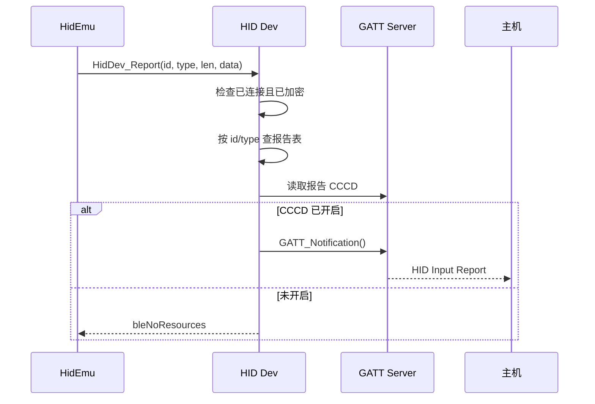

`hidDevSendReport()`：

```c
if((pRpt = hidDevRptById(id, type)) != NULL)
{
    if((pAttr = GATT_FindHandle(pRpt->cccdHandle, &retHandle)) != NULL)
    {
        value = GATTServApp_ReadCharCfg(gapConnHandle,
                                        (gattCharCfg_t *)pAttr->pValue);
        if(value & GATT_CLIENT_CFG_NOTIFY)
        {
            state = HidDev_sendNoti(pRpt->handle, len, pData);
        }
    }
}
```

### 12.5 主机输出报告

主机写 LED 输出报告：

```text
ATT Write Request
  -> HidDev_WriteAttrCB()
  -> pRpt = hidDevRptByHandle()
  -> pHidDevCB->reportCB(... HID_DEV_OPER_WRITE ...)
  -> hidEmuRptCB()
  -> Hid_SetParameter()
```

### 12.6 Protocol Mode

主机可以写 `Protocol Mode`：

```c
if(pValue[0] == HID_PROTOCOL_MODE_BOOT ||
   pValue[0] == HID_PROTOCOL_MODE_REPORT)
{
    pAttr->pValue[0] = pValue[0];
    (*pHidDevCB->evtCB)((pValue[0] == HID_PROTOCOL_MODE_BOOT) ?
                        HID_DEV_SET_BOOT_EVT : HID_DEV_SET_REPORT_EVT);
}
```

报告表通过 `mode` 字段区分 Boot 和 Report：

```c
if(p->handle == handle && p->mode == hidProtocolMode)
    return p;
```

### 12.7 HID 完整流程

```text
初始化
  -> 注册 GAP/GATT/DevInfo/Batt/ScanParam/HID 服务
  -> 启动设备
  -> 广播（initial/high/low）
  -> 主机连接
  -> 配对/加密（hidDevConnSecure = TRUE）
  -> 主机写 CCCD 开启报告通知
  -> 应用周期发送 HID Report
  -> 主机写 LED Output Report
  -> 断开后清理 CCCD，重新广播
```

---

## 13. BLE_UART 工作流程

### 13.1 架构

```text
UART3 RX IRQ
  -> app_uart_rx_fifo (2048B)
  -> uart_rx_flag
  -> main loop app_uart_process()
  -> UART_TO_BLE_SEND_EVT
  -> BLE Notification（按 MTU-3 分段）

BLE Write
  -> on_bleuartServiceEvt(BLE_UART_EVT_BLE_DATA_RECIEVED)
  -> app_uart_tx_fifo (512B)
  -> main loop app_uart_process()
  -> UART3 THR
```

### 13.2 串口接收流程

中断：

```c
case UART_II_RECV_RDY:
case UART_II_RECV_TOUT:
    error = app_drv_fifo_write_from_same_addr(&app_uart_rx_fifo,
                                              (uint8_t *)&R8_UART3_RBR,
                                              R8_UART3_RFC);
    if(error != APP_DRV_FIFO_RESULT_SUCCESS)
    {
        // FIFO 满，丢弃剩余字节
        for(uint8_t i = 0; i < R8_UART3_RFC; i++)
            for_uart_rx_black_hole = R8_UART3_RBR;
    }
    uart_rx_flag = true;
    break;
```

主循环：

```c
void app_uart_process(void)
{
    SYS_DisableAllIrq(&irq_status);
    if(uart_rx_flag)
    {
        tmos_start_task(Peripheral_TaskID, UART_TO_BLE_SEND_EVT, 2);
        uart_rx_flag = false;
    }
    SYS_RecoverIrq(irq_status);

    if(R8_UART3_TFC < UART_FIFO_SIZE)
    {
        app_drv_fifo_read_to_same_addr(&app_uart_tx_fifo,
                                       (uint8_t *)&R8_UART3_THR,
                                       UART_FIFO_SIZE - R8_UART3_TFC);
    }
}
```

### 13.3 BLE 发送流程

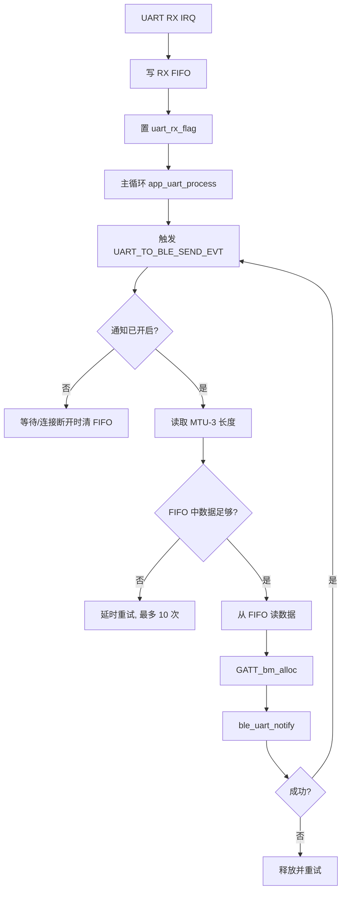

### 13.4 BLE 接收流程

```c
void on_bleuartServiceEvt(uint16_t connection_handle, ble_uart_evt_t *p_evt)
{
    switch(p_evt->type)
    {
        case BLE_UART_EVT_BLE_DATA_RECIEVED:
            // BLE -> UART
            app_uart_tx_data((uint8_t *)p_evt->data.p_data,
                             p_evt->data.length);
            break;
    }
}
```

### 13.5 重试状态机

```c
typedef enum
{
    SEND_TO_BLE_TO_SEND = 1,
    SEND_TO_BLE_ALLOC_FAILED,
    SEND_TO_BLE_SEND_FAILED,
} send_to_ble_state_t;
```

| 状态           | 含义                   | 下一步                         |
| -------------- | ---------------------- | ------------------------------ |
| `TO_SEND`      | 正常发送               | 成功继续，失败转 `SEND_FAILED` |
| `ALLOC_FAILED` | 内存池不足             | 延时 2 tick 重试               |
| `SEND_FAILED`  | `ble_uart_notify` 失败 | 延时 2 tick 重试               |

### 13.6 MTU 与吞吐

```c
read_length = ATT_GetMTU(peripheralConnList.connHandle) - 3;
```

- 默认 MTU 23：每次最多 20 字节。
- `BLE_BUFF_MAX_LEN=251`：MTU 247，每次最多 244 字节。
- 发送频率由 `UART_TO_BLE_SEND_EVT` 和 `GATT_Notification` 的返回状态共同决定。

---

## 14. RemoteController 产品化工作流

### 14.1 初始化

```c
App_Init()
  ├─ 注册 App 任务
  ├─ 按键扫描 GPIO + reload task
  ├─ ADC 初始化 + 电量采样
  ├─ PWM 初始化
  ├─ 查询绑定数量
  └─ 打开 HID 广播
```

### 14.2 按键流程

```text
APP_KEYSCAN_EVT
  -> Key_Scan()
  -> 检测新按下/释放
  -> 短按: Key_Press_CB()
  -> 长按: Key_Press_Timeout_CB()
```

短按发送消费者控制报告：

```c
report_buffer[0] = 0xe2;
report_buffer[1] = 0;
hidEmu_consumer_report(report_buffer, 2);

report_buffer[0] = 0;
hidEmu_consumer_report(report_buffer, 2);
```

长按进入配对：

```c
app_pair_flag = TRUE;

GAPRole_GetParameter(GAPROLE_STATE, &ble_state);
if(ble_state == GAPROLE_CONNECTED)
    GAPRole_TerminateLink(hidEmuConnHandle);
else if(ble_state == GAPROLE_ADVERTISING)
    hidEmu_adv_enable(DISABLE);
else
    hidEmu_adv_enable(ENABLE);
```

### 14.3 电池采集流程

```text
APP_BATT_EVT
  -> App_GetBattInfo()
  -> ADC 多次采样
  -> 去校准偏差
  -> 计算分压后电池电压
  -> 分段线性映射电量
  -> 滑动平均滤波
  -> Batt_SetParameter()
```

### 14.4 低功耗状态

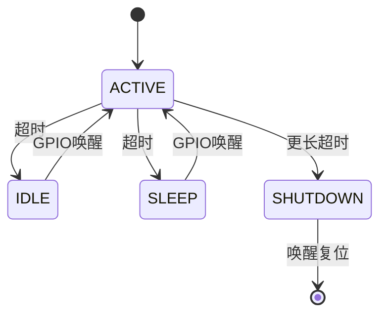

`App_Update_Sleep()` 根据连接状态选择超时：

```c
GAPRole_GetParameter(GAPROLE_STATE, &ble_state);
if(ble_state == GAPROLE_CONNECTED)
    tmos_start_task(appTaskId, APP_ENTER_SLEEP_EVT, APP_CON_SLEEP_TIMEOUT);
else
    tmos_start_task(appTaskId, APP_ENTER_SLEEP_EVT, APP_ADV_SLEEP_TIMEOUT);
```

### 14.5 OTA 集成

`ota.c` 中：

```c
void OTA_Init()
{
    ota_TaskID = TMOS_ProcessEventRegister(OTA_ProcessEvent);
    OTAProfile_AddService(GATT_ALL_SERVICES);
    OTAProfile_RegisterAppCBs(&OTA_IAPProfileCBs);
}
```

`CMD_IAP_INFO` 中降低连接延迟，保证 OTA 吞吐。

---

## 15. Mesh 工作流程

### 15.1 初始化链

```text
main
  ├─ CH59x_BLEInit()
  ├─ HAL_Init()
  ├─ bt_mesh_lib_init()
  │   ├─ RF_RoleInit()
  │   ├─ GAPRole_PeripheralInit()   // PROXY / PB-GATT / OTA
  │   ├─ GAPRole_CentralInit()      // PROXY_CLI
  │   ├─ MeshTimer_Init()
  │   ├─ MeshDeamon_Init()
  │   └─ ble_sm_alg_ecc_init()
  ├─ App_Init()
  │   ├─ vendor_model_srv_init()
  │   ├─ blemesh_on_sync()
  │   ├─ HAL_KeyInit()
  │   ├─ HalKeyConfig(keyPress)
  │   └─ 启动测试事件
  └─ Main_Circulation()
```

`blemesh_on_sync()` 关键步骤：

```c
bt_mesh_cfg_set(&app_mesh_cfg, &app_dev, MACAddr, &info);
hal_rf_init();
bt_mesh_comp_register(&app_comp);
bt_mesh_relay_init();
bt_mesh_proxy_init();
bt_mesh_prov_init(&app_prov);
bt_mesh_mod_init();
bt_mesh_net_init();
bt_mesh_trans_init();
bt_mesh_beacon_init();
bt_mesh_adv_init();
bt_mesh_conn_adv_init();
bt_mesh_settings_init();
settings_load();
```

### 15.2 配网流程

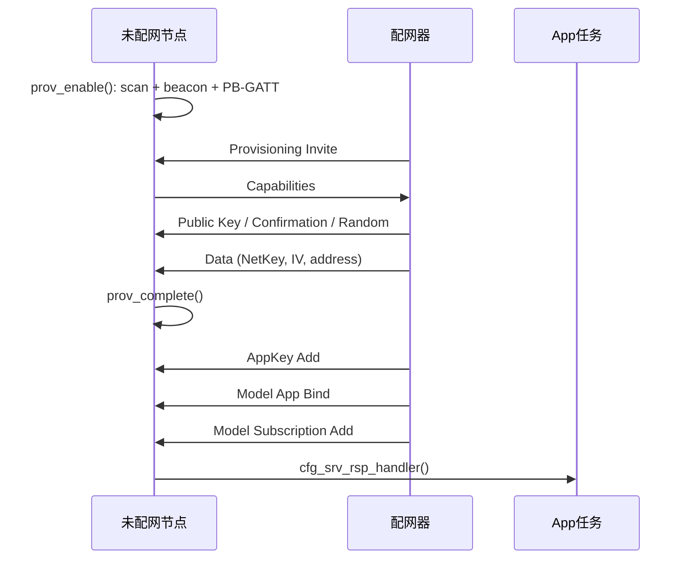

配网完成回调：

```c
static void prov_complete(uint16_t net_idx, uint16_t addr,
                          uint8_t flags, uint32_t iv_index)
{
    if(settings_load_over || (vnd_models[0].keys[0] == BLE_MESH_KEY_UNUSED))
    {
        tmos_start_task(App_TaskID, APP_DELETE_LOCAL_NODE_EVT,
                        APP_WAIT_ADD_APPKEY_DELAY);
    }
}
```

配置服务回调：

```c
if(val->cfgHdr.opcode == OP_APP_KEY_ADD)
{
    tmos_start_task(App_TaskID, APP_DELETE_LOCAL_NODE_EVT,
                    APP_WAIT_ADD_APPKEY_DELAY);
}
else if(val->cfgHdr.opcode == OP_MOD_APP_BIND)
{
    tmos_start_task(App_TaskID, APP_DELETE_LOCAL_NODE_EVT,
                    APP_WAIT_ADD_APPKEY_DELAY);
}
else if(val->cfgHdr.opcode == OP_MOD_SUB_ADD)
{
    tmos_stop_task(App_TaskID, APP_DELETE_LOCAL_NODE_EVT);
}
```

### 15.3 厂商模型收发

发送：

```c
struct send_param param = {
    .app_idx = vnd_models[0].keys[0],
    .addr = addr,
    .trans_cnt = 0x01,
    .period = K_MSEC(400),
    .rand = 0,
    .tid = vendor_srv_tid_get(),
    .send_ttl = BLE_MESH_TTL_DEFAULT,
};

return vendor_message_srv_send_trans(&param, pData, len);
```

接收：

```c
if(val->vendor_model_srv_Hdr.opcode == OP_VENDOR_MESSAGE_TRANSPARENT_MSG)
{
    // 透传数据
}
else if(val->vendor_model_srv_Hdr.opcode == OP_VENDOR_MESSAGE_TRANSPARENT_WRT)
{
    // 无应答写
}
else if(val->vendor_model_srv_Hdr.opcode == OP_VENDOR_MESSAGE_TRANSPARENT_IND)
{
    // 有应答指示的确认
}
```

### 15.4 Mesh 角色

| 角色        | 关键配置                    | 说明              |
| ----------- | --------------------------- | ----------------- |
| Relay       | `CONFIG_BLE_MESH_RELAY`     | 转发消息          |
| Proxy       | `CONFIG_BLE_MESH_PROXY`     | GATT 代理         |
| PB-GATT     | `CONFIG_BLE_MESH_PB_GATT`   | 通过 BLE 连接配网 |
| Friend      | `CONFIG_BLE_MESH_FRIEND`    | 为 LPN 缓存消息   |
| LPN         | `CONFIG_BLE_MESH_LOW_POWER` | 低功耗节点        |
| Provisioner | `provisioner_vendor`        | 配网器            |

---

## 16. RF_PHY 工作流程

### 16.1 初始化

```c
CH59x_BLEInit();
HAL_Init();
RF_RoleInit();
RF_Init();
```

`RF_Init()`：

```c
rf_Config.accessAddress = 0x71764129;
rf_Config.CRCInit = 0x555555;
rf_Config.Channel = 39;
rf_Config.Frequency = 2480000;
rf_Config.LLEMode = LLE_MODE_AUTO;
rf_Config.rfStatusCB = RF_2G4StatusCallBack;
rf_Config.RxMaxlen = 251;

RF_Config(&rf_Config);
```

### 16.2 发送/接收流程

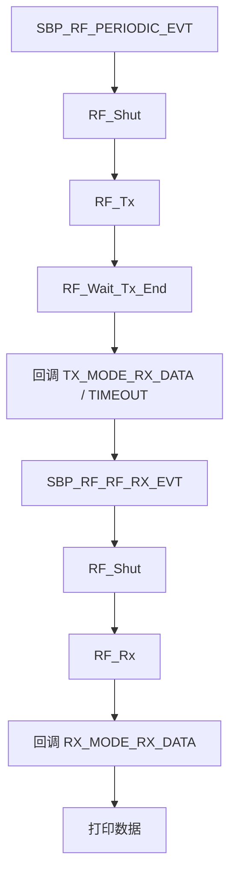

### 16.3 回调约束

```c
void RF_2G4StatusCallBack(uint8_t sta, uint8_t crc, uint8_t *rxBuf)
{
    switch(sta)
    {
        case TX_MODE_TX_FINISH:
        case TX_MODE_TX_FAIL:
        case TX_MODE_RX_DATA:
        case TX_MODE_RX_TIMEOUT:
        case RX_MODE_RX_DATA:
        case RX_MODE_TX_FINISH:
        case RX_MODE_TX_FAIL:
            break;
    }
}
```

注意：

- 回调在中断上下文执行。
- 不要在回调中直接调用 `RF_Tx()` / `RF_Rx()`，应通过 `tmos_set_event`。
- `RF_Wait_Tx_End()` / `RF_Wait_Rx_End()` 标记 `__HIGH_CODE`，必须在 RAM 中等待。
- 自动模式下，TX 完成后自动进入 RX 窗口，超时约 200us。

---

## 17. 周期广播 / 同步扫描流程

### 17.1 广播端

```text
Broadcaster_Init()
  -> 设置扩展广播数据/周期广播数据
  -> 设置周期广播间隔/SID/Secondary PHY
  -> 启动设备
  -> GAPROLE_PERIODIC_ENABLE
  -> 周期修改 periodicAdvertData
```

周期广播数据：

```c
static uint8_t periodicAdvertData[] = {
    44,
    GAP_ADTYPE_MANUFACTURER_SPECIFIC,
    'b', 'l', 'e',
    1, 2, 3, 4, 5, 6, 7, 8, 9, 10,
    ...
};
```

### 17.2 扫描端

```mermaid
sequenceDiagram
    participant Scan as Observer
    participant Stack as BLE协议栈

    Scan->>Stack: 扩展扫描
    Stack-->>Scan: GAP_EXT_ADV_DEVICE_INFO_EVENT
    Scan->>Scan: 检查地址和 periodicAdvInterval
    Scan->>Stack: GAPRole_CreateSync(&sync)
    Stack-->>Scan: GAP_SYNC_ESTABLISHED_EVENT
    Scan->>Stack: GAPRole_ObserverCancelDiscovery()
    Stack-->>Scan: GAP_PERIODIC_ADV_DEVICE_INFO_EVENT
    Stack-->>Scan: GAP_SYNC_LOST_EVENT
    Scan->>Stack: 重新扫描
```

`GAPRole_CreateSync()`：

```c
gapCreateSync_t sync = {0};
tmos_memcpy(sync.addr, pEvent->deviceExtAdvInfo.addr, B_ADDR_LEN);
sync.addrType = pEvent->deviceExtAdvInfo.addrType;
sync.advertising_SID = pEvent->deviceExtAdvInfo.advertisingSID;
sync.options = DUPLICATE_FILTERING_INITIALLY_ENABLED;
sync.syncTimeout = (pEvent->deviceExtAdvInfo.periodicAdvInterval * 6 + 7) / 8;

state = GAPRole_CreateSync(&sync);
```

---

## 18. 调试与问题定位流程

### 18.1 启动类问题

```text
上电无打印
  ├─ 检查供电/复位
  ├─ 检查 UART1 PA9 和波特率
  ├─ 检查 DEBUG 宏
  └─ 检查启动文件/链接脚本

打印 head file error
  └─ libCH59xBLE.a 与 CH59xBLE_LIB.h 版本不一致

打印 SNV config error
  └─ BLE_SNV_ADDR 与 Flash 布局冲突

协议栈初始化死循环
  └─ MEM_BUF 未定义、MEMLen 太小
```

### 18.2 广播类问题

| 现象           | 排查                                        |
| -------------- | ------------------------------------------- |
| 手机搜不到     | 广播是否使能、广播数据长度、设备名、天线    |
| 能搜到但连不上 | 连接参数、白名单、配对要求、广播类型        |
| 广播一会儿就停 | 有限可发现超时，检查 `GAPROLE_WAITING`      |
| 广播名不对     | 检查 `scanRspData` 和 `GGS_DEVICE_NAME_ATT` |

### 18.3 连接类问题

| 现象           | 排查                                                         |
| -------------- | ------------------------------------------------------------ |
| 连接立即断开   | 连接参数越界、从机主动终止、供电                             |
| 连接后无通知   | CCCD 未写、MTU 太小、`GATT_bm_alloc` 失败                    |
| 连接参数不更新 | 主机拒绝、参数不满足规范、事件未启动                         |
| 多连接失败     | `PERIPHERAL_MAX_CONNECTION`/`CENTRAL_MAX_CONNECTION`、内存堆 |

### 18.4 GATT 类问题

| 现象           | 排查                                      |
| -------------- | ----------------------------------------- |
| 找不到服务     | UUID 大小端、服务未注册、广播 UUID 不匹配 |
| 读特征失败     | 权限、offset、长度                        |
| 写特征失败     | 长度、权限、offset                        |
| 通知长度被截断 | `MTU-3` 限制                              |
| 通知内存泄漏   | 失败路径未 `GATT_bm_free`                 |

### 18.5 低功耗问题

| 现象           | 排查                                            |
| -------------- | ----------------------------------------------- |
| 电流偏大       | 未开 `HAL_SLEEP`、GPIO 浮空、调试串口、广播间隔 |
| 睡不下去       | 有挂起 TMOS 任务、`APP_KEEP_WEAK_EVT` 未清      |
| 唤醒异常       | RTC 触发时间、`WAKE_UP_RTC_MAX_TIME`、32K 时钟  |
| 唤醒后外设异常 | 重新初始化 GPIO/UART/ADC/PWM                    |

### 18.6 OTA 问题

| 现象           | 排查                                   |
| -------------- | -------------------------------------- |
| 升级包写入失败 | 未擦除、地址不对齐、地址越界           |
| 升级后不启动   | Image Flag、JumpIAP 地址、App 链接地址 |
| 升级中断变砖   | 方案选择（A/B 更安全）、标志写入顺序   |
| OTA 速度慢     | 连接间隔、MTU、2M PHY、Latency         |

### 18.7 建议的日志点

| 位置                         | 日志内容                               |
| ---------------------------- | -------------------------------------- |
| `main`                       | 库版本、初始化顺序                     |
| `GAP` 状态回调               | 状态和 opcode                          |
| `Peripheral_LinkEstablished` | connHandle、interval、latency、timeout |
| `GATT_MSG_EVENT`             | method、handle、status                 |
| `simpleProfileChangeCB`      | paramID、len                           |
| `CH59x_LowPower`             | 睡眠时长、返回值                       |
| OTA 命令处理                 | cmd、addr、len、status                 |

---

## 19. 二次开发工作流模板

### 19.1 新增一个业务特征

```text
1. 定义 UUID / 长度 / 权限
2. 定义值缓冲区和 CCCD 数组
3. 编写属性表
4. 编写 AddService()
5. 在 Peripheral_Init() 注册服务
6. 编写 Read/Write 回调
7. 注册应用回调
8. 需要通知时：检查 CCCD -> GATT_bm_alloc -> GATT_Notification
9. 断连时清理 CCCD
10. 手机端验证
```

### 19.2 新增一个周期采集任务

```text
1. 定义新事件位（避开已有位）
2. 在连接建立后 tmos_start_task()
3. 事件处理中采集数据
4. 构造协议帧
5. 发送通知/指示
6. 重新启动定时器
7. 断连时停止定时器
```

### 19.3 新增低功耗

```text
1. 工程宏 HAL_SLEEP=TRUE
2. 检查 GPIO 默认电平
3. 检查外设中断唤醒源
4. 调整广播/连接参数
5. 测量电流
6. 处理唤醒后的外设恢复
```

### 19.4 新增 OTA

```text
1. 选择 A/B 或 OnlyUpdateApp
2. 修改链接脚本和 JumpIAP 跳转地址
3. 集成 OTA Profile
4. 实现命令解析
5. 校验 Flash 擦写范围
6. 验证断电恢复
```

---

## 20. 核心不变量与设计原则

1. **所有耗时操作都不能阻塞 TMOS 事件处理**。
2. **通知数据必须来自 `GATT_bm_alloc`，长度不超过 `MTU-3`**。
3. **CCCD 是按连接维护的，断连必须清理**。
4. **属性表顺序决定句柄索引，插属性要同步修改索引**。
5. **连接参数单位是 1.25ms/10ms，广播间隔单位是 0.625ms**。
6. **TMOS 定时器单位是 625us，不是 1ms**。
7. **中断中只做最少工作，复杂处理通过事件回到任务上下文**。
8. **关键时序代码放 RAM（`__HIGH_CODE`）**。
9. **OTA 升级结束前关闭中断，标志写入后再复位**。
10. **低功耗不是单一开关，而是广播/连接/GPIO/外设/任务共同决定的结果**。
11. **主机角色必须使用外部 32K**。
12. **库版本、头文件版本、链接脚本和 Flash 布局必须一致**。

---

> 本文聚焦“流程”和“调用链”。如果你希望继续深入，可以在此基础上有针对性地做：
>
> - 用逻辑分析仪/串口日志验证某条事件时序；
> - 在 `Peripheral` 上增加一个带通知和 CCCD 的自定义服务；
> - 对 `BLE_UART` 做吞吐量与丢包测试；
> - 对 `BackupUpgrade_OTA` 做分阶段断电恢复测试；
> - 对 `HID_Keyboard` 做手机/PC 兼容性测试。
